# BRD — Tài liệu Yêu cầu Nghiệp vụ · Hệ thống thanh toán QR quốc gia Peye-Haiti

| Trường | Nội dung |
|---|---|
| Mã tài liệu | PEYE-HT-2026-BRD-01 |
| Phiên bản | 1.0 — 24/08/2026 |
| Dự án | PEYE-HT-2026 · Hệ thống thanh toán QR quốc gia Peye-Haiti |
| Người lập | BA dự án (VDS) |
| Người duyệt | BRH (chủ đầu tư) · Natcom (đầu mối) · VDS |
| Nguồn tổng hợp | PRD 5.0 · SSD v5.1b · TSD v4.6 · API Spec v3.7 · Phụ lục MOU · Wireframes 42 màn |

> **Cách đọc nhanh:** Phần 2–3 cho lãnh đạo (bài toán, mục tiêu); Phần 4–5 chốt phạm vi và các bên; Phần 6–7 là các luồng và quy trình nghiệp vụ (có sơ đồ đầy đủ); Phần 8–9 là yêu cầu chức năng và luật nghiệp vụ cho đội phát triển/kiểm thử; Phần 10–13 là phi chức năng, nghiệm thu, rủi ro và lộ trình.

---

## 1. GIỚI THIỆU

### 1.1. Mục đích tài liệu

Tài liệu trình bày **yêu cầu nghiệp vụ** (business requirements) của Hệ thống thanh toán QR quốc gia Peye-Haiti trên **toàn bộ các phân hệ**: ứng dụng di động (người mua và người bán trong một ứng dụng), portal giám sát BRH, console vận hành, nền tảng lõi, cổng chuẩn Open Banking — kết nạp định chế, và các tích hợp ngoài.

Đối tượng sử dụng: **BRH** (chủ đầu tư) và **Natcom** (đầu mối) dùng để thống nhất phạm vi và làm căn cứ nghiệm thu; **đội phát triển VDS** dùng làm đầu vào cho phân tích thiết kế chi tiết; **đội kiểm thử** dùng để xây kịch bản kiểm thử. Tài liệu là cơ sở thống nhất phạm vi và nghiệm thu giữa khách hàng và đơn vị phát triển, đầu vào cho giai đoạn phân tích thiết kế.

### 1.2. Phạm vi tài liệu

**Trong phạm vi:** yêu cầu nghiệp vụ và chức năng của 6 phân hệ (PH-01 → PH-06), luật nghiệp vụ, yêu cầu phi chức năng và tiêu chuẩn nghiệm thu cho giai đoạn **footprint/pilot 10/2026** (601 người bán, 3 thành phố).

**Ngoài phạm vi tài liệu này (nêu rõ để tránh tranh chấp khi nghiệm thu):**

- Việc từng định chế tài chính tự nâng cấp hệ thống của mình để tham gia (module Open Banking phía định chế, việc app định chế đọc QR chuẩn) — Peye-Haiti cung cấp **chuẩn, sandbox và bộ kiểm thử hợp chuẩn**, không làm thay phần của định chế.
- Bản thân hệ thống chuyển mạch quốc gia **PRONAP/ATS** và quy chế vận hành của nó (thuộc BRH) — tài liệu chỉ mô tả **điểm tiếp xúc** (báo cáo đối soát cuối ngày).
- Trung tâm dữ liệu dự phòng địa lý; kênh USSD của các định chế; hệ thống AML/CFT đầy đủ (hệ thống chỉ cung cấp **cảnh báo theo ngưỡng** và gọi dịch vụ sàng lọc sẵn có của BRH-System).
- Chương trình khuyến mại, chính sách phí sau pilot, nội dung đào tạo hiện trường (thuộc tài liệu kế hoạch triển khai).

### 1.3. Định nghĩa thuật ngữ và các từ viết tắt

| Thuật ngữ | Giải nghĩa |
|---|---|
| BRH | Banque de la République d'Haïti — Ngân hàng Trung ương Haiti, chủ đầu tư |
| Peye-Haiti / MMS | Nền tảng thanh toán QR quốc gia (Merchant Management System) — đứng **ngoài dòng tiền**, không giữ tiền |
| HTQR 1.0 | Chuẩn QR thanh toán quốc gia Haiti trên nền EMVCo Merchant-Presented Mode, mã hóa TLV, kiểm tra toàn vẹn CRC-16 |
| Định chế | Ngân hàng/ví điện tử tham gia (NatCash, MonCash, UniBank…) — nơi giữ tài khoản và dòng tiền |
| wallet2 | Ví điện tử pilot do NatTransfer vận hành — đóng cả vai định chế NHẬN của người bán lẫn định chế TRẢ của người mua trong pilot |
| Open Banking (OB) | Bộ **12 API chuẩn** để nền tảng làm việc thống nhất với mọi định chế (liên kết tài khoản, số dư, lịch sử, báo Có, lệnh trả, xác nhận OTP) |
| PRONAP / ATS | Hệ thống chuyển mạch quốc gia của BRH: **PRONAP** xử lý giao dịch **thời gian thực**; **ATS** bù trừ và quyết toán **ròng theo phiên** giữa các định chế |
| Báo Có (M4) | Webhook định chế nhận bắn sang nền tảng mỗi khi tài khoản liên kết được ghi Có — nguồn của thông báo «ting ting» |
| Token liên kết | Token định chế cấp sau khi chủ tài khoản ưng thuận bằng OTP — phạm vi hẹp theo scope (số dư · lịch sử · nhận báo Có · trả tiền) |
| Thẻ hệ thống | JWT tự ký định danh hệ thống gọi API, kiêm hash nội dung body request (chuẩn A.1b của đặc tả API) |
| Hai bậc xác thực | Lệnh trả ≤ 5.000 HTG: nhập PIN ứng dụng; > 5.000 HTG: PIN + SMS OTP do định chế gửi (ngưỡng chuẩn hóa `PAY_SCA_THRESHOLD`) |
| Tạo là active | Gian hàng kích hoạt **ngay** khi hoàn tất đăng ký (eKYC đạt + đủ hồ sơ + tài khoản nhận); BRH **hậu kiểm sau**, không duyệt trước |
| eKYC / E1 | Định danh điện tử qua dịch vụ BRH-System (đối chiếu CIN + ảnh chân dung với dữ liệu ONI) |
| E3 / RefID | Báo cáo đối soát cuối ngày từ Switch; RefID là mã tham chiếu giao dịch qua Switch |
| Gạch bill 2 mức | Khớp tiền về với đơn: mức ① tự động theo tài khoản liên kết + số tiền/tham chiếu; mức ② người bán xác nhận tay |
| CH-00 | Màn chọn vai (người mua/người bán) ngay sau đăng ký, **trước** eKYC |
| PWA | Progressive Web App — ứng dụng cài từ web, chạy như app, hoạt động ngoại tuyến |
| Bốn mắt (4-eyes) | Cơ chế một người đề xuất — một người khác phê duyệt cho thao tác nhạy cảm |

### 1.4. Tài liệu tham khảo

| Tài liệu | Phiên bản | Ghi chú |
|---|---|---|
| PeyeHaiti_PRD.md — Yêu cầu sản phẩm | 5.0 (24/08/2026) | 11 Epic · 42 User story · 46 tiêu chí nghiệm thu |
| PeyeHaiti_SSD.md — Thiết kế hệ thống | v5.1b | 9 luồng đầu-cuối S1–S9 |
| PeyeHaiti_TSD.md — Thiết kế kỹ thuật | v4.6 | Kiến trúc, DDL 28 bảng/306 trường, tham số, sizing |
| PeyeHaiti_API_Spec.md — Đặc tả API | v3.7 | 109 mục/110 HTTP endpoint · bộ chuẩn OB 12 API · 41 mã lỗi |
| PeyeHaiti_MOU_PhuLuc_YeuCau — Phụ lục MOU BRH–Natcom | bản 24/08 | Baseline yêu cầu, chuẩn HTQR 1.0, NFR, sizing 3 môi trường |
| PeyeHaiti_Wireframes.html — Wireframe tương tác | bản 20/08 | 42 màn, 4 ngôn ngữ |
| Circulaire BRH-IF-2026-129 | 02/2026 | Căn cứ yêu cầu giám sát AML theo ngưỡng |

### 1.5. Mô tả tài liệu

Tài liệu gồm: Phần 2–3 bối cảnh, bài toán và mục tiêu; Phần 4–5 phạm vi và các bên liên quan; Phần 6 luồng nghiệp vụ đầu-cuối; Phần 7 bảy quy trình nghiệp vụ QT-01 → QT-07 (sơ đồ + bảng bước); Phần 8 yêu cầu chức năng 42 chức năng CN-01 → CN-42 theo 6 phân hệ; Phần 9 luật nghiệp vụ và vòng đời trạng thái; Phần 10 yêu cầu phi chức năng; Phần 11 tiêu chuẩn nghiệm thu; Phần 12 rủi ro — phụ thuộc — giả định; Phần 13 lộ trình.

---

## 2. BỐI CẢNH NGHIỆP VỤ & PHÁT BIỂU BÀI TOÁN

### 2.1. Tổng quan bài toán

Haiti là nền kinh tế tiền mặt: tiểu thương tại các chợ thu tiền mặt, không có công cụ ghi nhận doanh thu, đối chiếu và bán chịu; các ví điện tử hiện hữu (NatCash của Natcom, MonCash của Digicel) và các ngân hàng vận hành **rời rạc, không liên thông** — người mua dùng ví A không trả được cho người bán dùng ví B. BRH chủ trì xây dựng hệ thống thanh toán QR quốc gia với ba trụ:

1. **Một chuẩn QR duy nhất (HTQR 1.0)** — mọi ứng dụng ngân hàng/ví đọc được, một mã QR tại quầy phục vụ mọi người mua;
2. **Một nền tảng quốc gia (Peye-Haiti)** — định danh người bán, sinh QR, nhận báo Có, khớp lệnh, giám sát; **tiền luôn nằm và dịch chuyển giữa các định chế tài chính, nền tảng không giữ tiền**;
3. **Một bộ kết nối chuẩn hóa (Open Banking 12 API)** — mọi định chế tham gia bằng đúng một bộ giao diện, không tích hợp riêng lẻ từng đôi.

Bài toán cần giải: (i) cho tiểu thương một công cụ **nhận tiền tức thời** («ting ting»), tính tiền, sổ nợ hoạt động trên điện thoại phổ thông và vùng sóng 2G; (ii) cho người mua một ứng dụng **quét-và-trả an toàn** với tên người bán đã xác minh; (iii) cho BRH một **bộ máy giám sát thời gian thực**; (iv) **chuẩn hóa kết nối** để định chế mới tự tích hợp.

### 2.2. Hiện trạng quy trình nghiệp vụ

- Thu tiền tại chợ: hoàn toàn tiền mặt; ghi sổ tay hoặc không ghi; bán chịu theo trí nhớ; không có biên lai.
- Chuyển tiền điện tử: trong nội bộ từng ví (NatCash, MonCash) theo số điện thoại; không có QR chuẩn chung, không liên thông giữa các định chế.
- Đăng ký điểm bán: các ví tự phát triển mạng lưới đại lý riêng, không có sổ đăng ký người bán quốc gia, không có định danh thống nhất.
- Giám sát của BRH: qua báo cáo định kỳ của từng định chế, không có bức tranh giao dịch bán lẻ thời gian thực.

### 2.3. Hiện trạng hạ tầng dữ liệu

Chưa có hệ thống nghiệp vụ tiền nhiệm — toàn bộ dữ liệu hình thành mới, **không có bài toán chuyển đổi dữ liệu**. Dữ liệu tham chiếu ngoài: dữ liệu định danh công dân (ONI) truy cập qua dịch vụ eKYC của BRH-System; danh mục mã định chế và mã ngành nghề MCC do BRH cấp khi ban hành chuẩn; báo cáo đối soát cuối ngày từ Switch quốc gia.

### 2.4. Bức tranh hệ sinh thái — đường TIỀN tách khỏi đường THÔNG TIN

Nguyên tắc nền tảng của toàn bộ thiết kế: **Peye-Haiti đứng ngoài đường tiền**. Tiền đi giữa các định chế qua chuyển mạch quốc gia; Peye-Haiti chỉ nhận **thông tin** (báo Có, đối soát) và cung cấp **thông tin** (tra cứu xác minh người bán). Nhờ vậy nền tảng không cần giấy phép giữ tiền, không tạo rủi ro thanh khoản, và sự cố nền tảng **không bao giờ chặn được dòng tiền**.

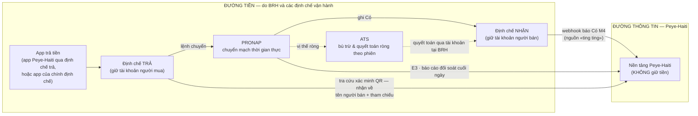

**Giải thích:** khi người mua quét QR, app bên trả có thể **tra cứu** Peye-Haiti để hiện đúng tên người bán đã xác minh (chống dán đè QR); lệnh chuyển tiền sau đó đi thuần đường định chế → PRONAP → định chế nhận. Định chế nhận ghi Có xong thì **báo Có** sang Peye-Haiti để người bán nhận «ting ting» và đơn tự gạch. Cuối ngày, báo cáo từ Switch (E3) dùng để **đối soát ba nguồn**: nền tảng — định chế — Switch.

---

## 3. MỤC TIÊU NGHIỆP VỤ & CHỈ SỐ THÀNH CÔNG

### 3.1. Mục tiêu hệ thống

- **Cho phép** tiểu thương đăng ký, định danh và nhận tiền bằng một mã QR chuẩn quốc gia duy nhất, kích hoạt **ngay khi hoàn tất hồ sơ** (tạo là active, BRH hậu kiểm).
- **Đảm bảo** người bán nhận thông báo tiền về («ting ting») trong **không quá 5 giây (P95)** kể từ khi định chế ghi Có.
- **Cho phép** người mua quét và trả trong cùng ứng dụng với **hai bậc xác thực** (≤ 5.000 HTG chỉ PIN; > 5.000 HTG thêm SMS OTP của định chế), luôn hiển thị **tên người bán đã xác minh** trước khi trả.
- **Cho phép** BRH giám sát giao dịch, hậu kiểm gian hàng, xử lý khiếu nại và nhận cảnh báo giao dịch bất thường theo ngưỡng trên portal thời gian thực.
- **Chuẩn hóa** kết nối định chế bằng bộ Open Banking 12 API + sandbox + quy trình chứng nhận, để định chế mới **tự tích hợp** không cần can thiệp thủ công.
- **Quy mô**: pilot 10/2026 = 601 người bán tại các chợ chỉ định (3 thành phố); quy mô thiết kế = 5.000 người bán hoạt động, ~60.000 giao dịch/ngày, năng lực tiếp nhận báo Có 50 giao dịch/giây (≈ 2,5 lần đỉnh dự phóng).

### 3.2. Chỉ số thành công (KPI pilot)

| Chỉ số | Mục tiêu | Đo tại |
|---|---|---|
| Người bán kích hoạt (Pétion-Ville · Les Cayes · Cap-Haïtien) | 601 | Portal BRH — báo cáo KPI |
| % dùng tích cực theo tuần (≥1 giao dịch/tuần trên số đã kích hoạt) | ≥ 50% | Portal BRH — báo cáo KPI |
| Giao dịch bình quân / người bán / tuần | ≥ 3 | Portal BRH — báo cáo KPI |
| Hoàn tất hồ sơ tự khai (đăng ký → nộp đủ eKYC + tài khoản) | < 10 phút | Đo funnel màn đăng ký |
| Kích hoạt gian hàng | Ngay khi hoàn tất tạo (≤ 5 giây, không cổng duyệt); hậu kiểm hồ sơ có cờ ≤ 24h | Portal BRH — hậu kiểm |
| Độ trễ báo Có (95% giao dịch; từ lúc định chế ghi Có tới lúc app báo/SMS gửi) | ≤ 5 giây | Console vận hành |
| Kết quả lệnh trả cho người mua | ≤ 3 giây (P95) sau xác nhận | Console vận hành |
| Khả dụng dịch vụ | 99,5% | Console vận hành |
| Tỷ lệ gạch đơn tự động | ≥ 95% | Console vận hành |

> Chính sách pilot: **phí giao dịch người bán = 0 HTG đến 31/12/2026** (phê duyệt qua cơ chế tham số bốn mắt). Mục tiêu sau pilot (không cam kết): 5.000 người bán/12 tháng → 100.000 toàn quốc.

---

## 4. PHẠM VI

### 4.1. Trong phạm vi — 6 phân hệ

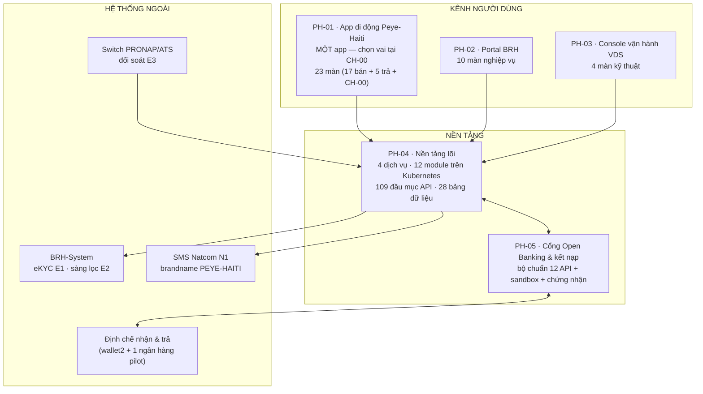

| Phân hệ | Nội dung chính | Quy mô |
|---|---|---|
| PH-01 · Ứng dụng di động | Một app PWA (FR/Kreyòl, ngoại tuyến-trước): đăng ký — chọn vai — eKYC — liên kết tài khoản — QR thu tiền — két tiền — đơn tính tiền — sổ nợ — **thanh toán hai bậc (mọi vai)** — khiếu nại — báo cáo | 23 màn |
| PH-02 · Portal BRH | Đăng nhập 2FA — giám sát thời gian thực — **hậu kiểm** (tạo là active) — quản lý người bán — truy vết giao dịch — case khiếu nại — cảnh báo ngưỡng — báo cáo KPI — nhật ký bất biến — quản trị bốn mắt | 10 màn |
| PH-03 · Console vận hành | Đầu nối OB & kho token — sức khỏe tích hợp & trực ban — đối soát cuối ngày — xử lý chênh lệch | 4 màn |
| PH-04 · Nền tảng lõi | 4 dịch vụ (Merchant & Identity · Commerce · Back-office · Notification) chứa 12 module nghiệp vụ, event bus Kafka | 109 đầu mục API |
| PH-05 · Cổng OB & kết nạp | Bộ chuẩn 12 API, an ninh kênh đối tác, sandbox + bộ vector chứng nhận, tài liệu tích hợp | 12 API chuẩn |
| PH-06 · Tích hợp ngoài | eKYC E1 · sàng lọc E2 · đối soát Switch E3 · SMS N1 | 4 đầu mối |

Ngoài ra còn **5 màn tham chiếu bên trả** (đặc tả để định chế đối chiếu khi nhúng quét QR vào app của họ) — tổng thể bộ wireframe là **42 màn**.

### 4.2. Ngoài phạm vi (sau 10/2026)

QR Pay theo đơn hàng qua Switch · tồn kho · web người bán · thu ngân đa người dùng · loyalty nâng cao · đặt hàng & đánh giá trên app người mua · Open Banking MonCash (đợt 2) · hoàn tiền tự động qua Switch · trả theo số điện thoại/alias không quét QR (chờ chuẩn HTQR v1.1 alias/RNI).

### 4.3. Các quyết định nghiệp vụ đã chốt

| # | Quyết định | Hệ quả nghiệp vụ |
|---|---|---|
| QĐ-1 | Nền tảng dùng chung quốc gia, BRH bảo trợ, VDS xây | Định chế không tự xây hệ thống quản lý điểm bán riêng |
| QĐ-2 | Nền tảng **ngoài đường tiền**; footprint chỉ QR chuyển khoản | Không cần kết nối trực tiếp Switch cho giao dịch; sự cố nền tảng không chặn dòng tiền |
| QĐ-3 | Chuẩn QR quốc gia HTQR 1.0 = kế thừa bộ chuẩn Napas/EMVCo đã kiểm chứng | Ban hành trước 31/7/2026; app định chế đọc ngoại tuyến |
| QĐ-4 | QR/standee chứa **số tài khoản thật đã liên kết** (mô hình VietQR) | Đổi tài khoản → in lại standee; tài khoản cũ ân hạn ≥ 30 ngày vẫn nhận tiền |
| QĐ-5 | **Một app, chọn vai tại CH-00** ngay sau đăng ký, trước eKYC; người bán thanh toán được như người mua | Vai mua chỉ cần OTP (KYC1), dùng ngay; vai bán đi tiếp eKYC (KYC2) |
| QĐ-6 | **Tạo là active** — kích hoạt ngay khi eKYC đạt + đủ hồ sơ + tài khoản nhận | BRH chuyển từ duyệt trước sang **hậu kiểm ≤ 24h** + lấy mẫu 10%, quyền tạm khóa một chạm |
| QĐ-7 | **Hai bậc xác thực thanh toán**: ≤ 5.000 HTG chỉ PIN; > 5.000 HTG PIN + SMS OTP do **định chế** gửi | Ngưỡng 5.000 HTG chuẩn hóa toàn hệ thống — định chế được chặt hơn, không được lỏng hơn |
| QĐ-8 | Token liên kết theo ưng thuận: eKYC → liên kết (OTP chủ tài khoản do định chế gửi) → token | Nền tảng không đối chiếu tên chủ tài khoản — định chế tự phán định quyền sở hữu |
| QĐ-9 | Hoàn tiền = người bán chuyển trả + case portal chốt «Đã hoàn» sau khi **xác minh bút toán** | Một nguồn trạng thái duy nhất; không hoàn tự động qua Switch trong pilot |
| QĐ-10 | OTP thanh toán bậc hai dùng **SMS GW của định chế** (điều kiện kết nạp); SMS của Peye-Haiti (N1) chỉ dùng cho OTP đăng ký, báo có dự phòng, biên lai, nhắc nợ | Trách nhiệm xác thực chủ tài khoản thuộc định chế |

---

## 5. CÁC BÊN LIÊN QUAN & NHÓM NGƯỜI SỬ DỤNG

### 5.1. Các bên liên quan

| Bên | Vai trò trong dự án |
|---|---|
| BRH | Chủ đầu tư; ban hành chuẩn QR + danh mục mã định chế/MCC; vận hành portal giám sát; chủ trì hậu kiểm, khiếu nại, cảnh báo; sở hữu toàn bộ dữ liệu nghiệp vụ |
| Natcom | Đầu mối triển khai; SMS brandname; hotline 8686; đội hiện trường đăng ký hộ tại chợ; vận hành tham số bốn mắt |
| VDS | Xây dựng và vận hành kỹ thuật nền tảng; trực tích hợp 24/7; đối soát |
| Định chế tham gia | Cung cấp Open Banking theo chuẩn (chiều nhận 8 API; chiều trả đủ 12); giữ tài khoản, quyết định cuối về số dư/hạn mức; gửi OTP xác thực |
| ONI (qua BRH-System) | Nguồn dữ liệu định danh công dân cho eKYC |

### 5.2. Nhóm người sử dụng hệ thống

| STT | Nhóm người dùng | Vai trò trên hệ thống |
|---|---|---|
| 1 | Người mua (vai Mua trong app) | Đăng ký nhẹ (OTP — KYC1), chọn vai tại CH-00, liên kết nguồn trả, quét QR và trả tiền hai bậc PIN/OTP, xem biên lai và lịch sử, gửi khiếu nại |
| 2 | Người bán / tiểu thương (vai Bán trong **cùng** app) | Toàn bộ chức năng người mua (người bán thanh toán được) + eKYC, khai gian hàng, liên kết tài khoản nhận, QR thu tiền, két tiền, đơn tính tiền, sổ nợ, báo cáo, biên lai SMS |
| 3 | Cán bộ BRH (portal) | Hậu kiểm gian hàng, quản lý vòng đời người bán, giám sát và truy vết giao dịch, xử lý case khiếu nại — hoàn tiền, cảnh báo theo ngưỡng, báo cáo KPI, nhật ký kiểm toán, quản trị người dùng bốn mắt |
| 4 | Vận hành VDS (console) | Quản trị đầu nối Open Banking, trực sức khỏe tích hợp 24/7, đối soát cuối ngày, xử lý chênh lệch |
| 5 | Vận hành Natcom | Đề xuất/duyệt tham số hệ thống bốn mắt (qua API, không màn riêng); SMS brandname; hotline 8686; đội hiện trường |
| 6 | Định chế NHẬN tiền (wallet2 + 1 ngân hàng pilot) | Cung cấp Open Banking nhóm liên kết/số dư/lịch sử/báo Có theo SLA; giữ tài khoản nhận của người bán |
| 7 | Định chế TRẢ tiền (wallet2 pilot) | Cung cấp thêm nhóm M-PAY (khởi tạo lệnh trả, trạng thái, xác nhận OTP, webhook kết quả); gửi SMS OTP bậc hai bằng SMS GW của chính định chế |
| 8 | Hệ thống BRH-System / Switch | Cung cấp dịch vụ eKYC (E1), sàng lọc (E2), báo cáo đối soát cuối ngày (E3) — tương tác qua API |

---

## 6. LUỒNG NGHIỆP VỤ ĐẦU-CUỐI

### 6.1. Nhận tiền bằng QR — «ting ting» trong 5 giây

Luồng găng nhất của hệ thống. Người bán trình QR (tĩnh trên standee, hoặc động kèm số tiền); người mua trả bằng **bất kỳ** ứng dụng nào đọc chuẩn HTQR; tiền đi thuần đường định chế; nền tảng nhận báo Có và lo phần «biết tiền về — khớp đơn — báo người bán».

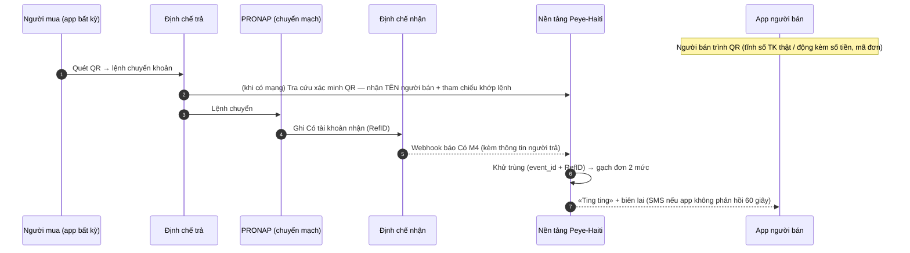

**Giải thích các điểm nghiệp vụ then chốt:**

- **QR đọc ngoại tuyến** — app người bán sinh QR không cần mạng; API không bao giờ là điều kiện để thu được tiền.
- **Tra cứu xác minh** (bước 2) là tùy chọn khi app bên trả có mạng: hiện đúng **tên người bán đã xác minh** (chống QR dán đè) và nhận **tham chiếu khớp lệnh** để tiền về gạch đơn *đích danh* thay vì đoán theo số tiền.
- **Khử trùng 2 tầng**: cùng một sự kiện báo Có gửi lại nhiều lần (retry) không bao giờ sinh hai khoản tiền trên két người bán.
- **Không có mạng phía người bán**: tiền vẫn về (đường tiền độc lập); hệ thống gửi **SMS báo có** khi app không xác nhận trong 60 giây.

### 6.2. Thanh toán trong app — hai bậc xác thực

Áp dụng cho **mọi vai** (người bán cũng trả được — trả nhà cung cấp, mua hàng lẫn nhau). Tiền không chạm nền tảng: lệnh trả đi qua **định chế trả** (nhóm API M-PAY); quyết định cuối cùng (số dư, hạn mức, khóa tài khoản) luôn thuộc định chế.

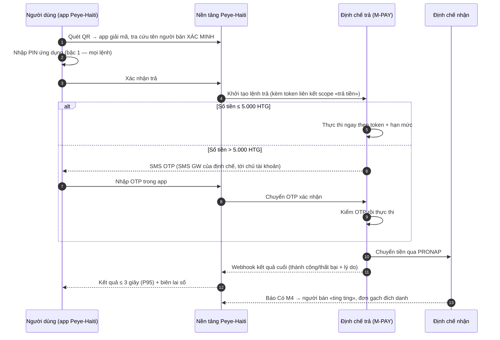

**Giải thích:** bậc 1 (PIN) là xác thực của **ứng dụng Peye-Haiti**; bậc 2 (SMS OTP) là xác thực của **định chế với chính chủ tài khoản** — kích hoạt khi vượt ngưỡng chuẩn hóa 5.000 HTG (≈ 38 USD theo tỷ giá tham khảo 08/2026). Trần ngày bậc-PIN (25.000 HTG và ≤ 20 lệnh/ngày) chỉ đếm các lệnh không OTP — lệnh đã có OTP của định chế không bị trần này. Đứt mạng sau xác nhận: app **chỉ tra lại trạng thái**, tuyệt đối không tạo lệnh mới; hệ thống chặn lệnh trùng tới cùng đích khi lệnh cũ chưa chốt.

---

## 7. QUY TRÌNH NGHIỆP VỤ (QT-01 → QT-07)

> Quy ước sơ đồ: hình **thoi** = bước kiểm tra (V) có rẽ nhánh; hình **chữ nhật** = bước thao tác của người dùng (A thêm mới · B tra cứu · C cập nhật · D hủy/xóa · S tìm kiếm) — riêng bước **chọn lựa của người dùng** (ví dụ chọn vai) là bước C có nhánh ra theo lựa chọn; các quy trình mô tả nghiệp vụ **đã tin học hóa**.

### 7.1. QT-01 — Đăng ký và mở quyền nhận tiền («tạo là active»)

Tác nhân: người dùng (vai bán); hệ thống eKYC và định chế tham gia ở vai hệ thống ngoài. Mục tiêu nghiệp vụ: người mới hoàn tất tự khai **dưới 10 phút**, gian hàng **kích hoạt ngay** khi đủ điều kiện — không chờ duyệt.

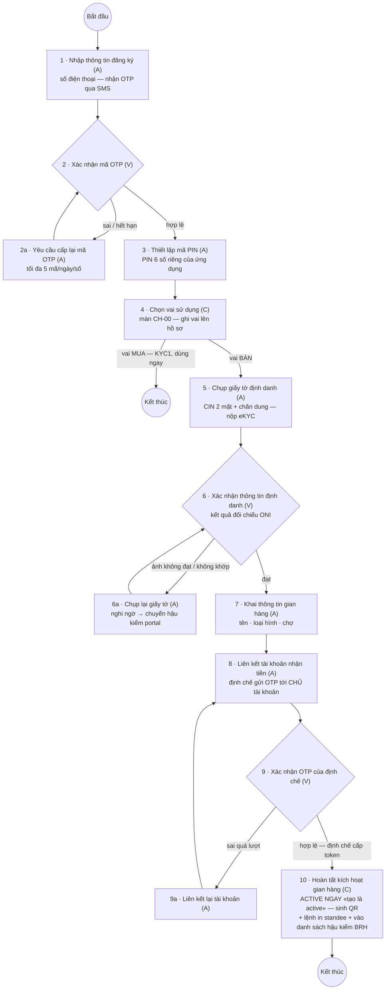

| Bước | Tên bước | Mô tả | Đối tượng |
|---|---|---|---|
| — | **Luồng dữ liệu chính** | | |
| 1 | Nhập thông tin đăng ký (A) | Nhập số điện thoại di động; nhận mã OTP qua SMS | Người dùng |
| 2 | Xác nhận mã OTP (V) | Nhập mã OTP 6 số; hợp lệ thì tiếp bước 3 | Người dùng |
| 3 | Thiết lập mã PIN (A) | Đặt PIN 6 số của ứng dụng (nhập 2 lần) — PIN riêng, độc lập với PIN ví/ngân hàng | Người dùng |
| 4 | Chọn vai sử dụng (C) | Màn CH-00: chọn và ghi vai lên hồ sơ. Vai Mua kết thúc quy trình tại đây (KYC1), dùng được ứng dụng ngay; vai Bán đi tiếp bước 5 | Người dùng |
| 5 | Chụp giấy tờ định danh (A) | Chụp CIN hai mặt + ảnh chân dung; nộp cho dịch vụ eKYC đối chiếu | Người bán |
| 6 | Xác nhận thông tin định danh (V) | Xem kết quả đối chiếu với dữ liệu ONI; đạt → bước 7; ảnh không đạt/không khớp → nhánh 6a | Người bán |
| 7 | Khai thông tin gian hàng (A) | Tên gian hàng, loại hình, chợ/vị trí — nộp cùng hồ sơ định danh | Người bán |
| 8 | Liên kết tài khoản nhận tiền (A) | Chọn định chế, nhập số tài khoản/ví; định chế gửi OTP tới số điện thoại chủ tài khoản | Người bán |
| 9 | Xác nhận OTP của định chế (V) | Hợp lệ → định chế cấp token liên kết, sang bước 10; sai quá lượt → nhánh 9a | Người bán |
| 10 | Hoàn tất kích hoạt gian hàng (C) | Xác nhận hoàn tất hồ sơ; gian hàng **kích hoạt ngay** («tạo là active»), sinh QR + lệnh in standee, vào danh sách hậu kiểm BRH | Người bán |
| — | **Luồng dữ liệu rẽ nhánh** | | |
| 2a | Yêu cầu cấp lại mã OTP (A) | OTP sai quá số lần hoặc hết hạn — yêu cầu mã mới (tối đa 5 mã/ngày/số) | Người dùng |
| 6a | Chụp lại giấy tờ (A) | Ảnh mờ/lóa hoặc đối chiếu không đạt — chụp và nộp lại; trường hợp nghi ngờ chuyển hậu kiểm thủ công trên portal | Người bán |
| 9a | Liên kết lại tài khoản (A) | OTP định chế sai quá số lần — phiên liên kết khóa, tạo lại từ bước 8 | Người bán |

**Luật đi kèm:** điểm tin cậy tự động dưới ngưỡng chỉ **gắn cờ** hậu kiểm (không chặn kích hoạt); lỗi hệ thống ở dịch vụ sàng lọc **không chặn** kích hoạt (sàng lọc bù khi phục hồi); người dùng dừng giữa chừng → hồ sơ dở dang, màn trạng thái chỉ rõ bước còn thiếu; đăng ký hộ bởi nhân viên hiện trường gắn mã nhân viên để truy vết.

### 7.2. QT-02 — Thu tiền bằng QR và đơn tính tiền

Tác nhân: người bán; người mua trả bằng ứng dụng bất kỳ đọc chuẩn HTQR. Mục tiêu: tính tiền không cần máy tính, tiền về **tự gạch đơn** ≥ 95%.

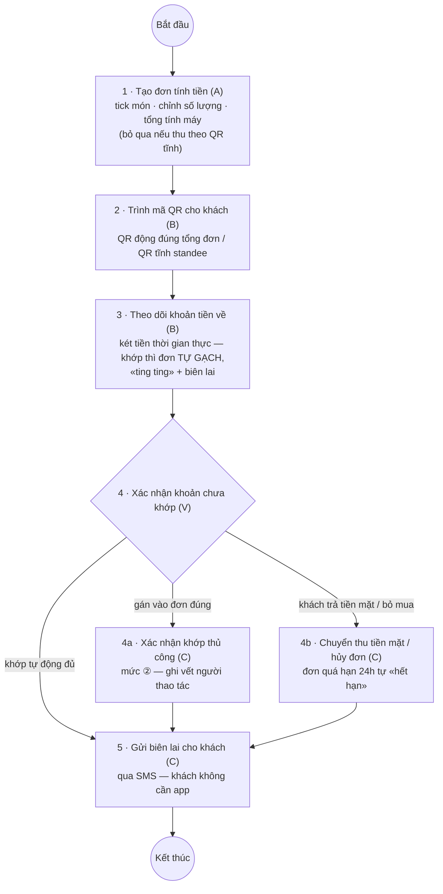

| Bước | Tên bước | Mô tả | Đối tượng |
|---|---|---|---|
| — | **Luồng dữ liệu chính** | | |
| 1 | Tạo đơn tính tiền (A) | Tick chọn món từ danh mục, chỉnh số lượng; tổng tiền tính máy; hoặc bỏ qua nếu thu theo QR tĩnh | Người bán |
| 2 | Trình mã QR cho khách (B) | Hiện QR động đúng tổng đơn (kèm mã đơn, có hạn) hoặc QR tĩnh trên standee | Người bán |
| 3 | Theo dõi khoản tiền về (B) | Xem két tiền thời gian thực; khoản khớp đơn thì đơn tự gạch, có «ting ting» và biên lai | Người bán |
| 4 | Xác nhận khoản chưa khớp (V) | Khoản không tự khớp (mức ①) nằm mục riêng — đối chiếu và quyết định | Người bán |
| 5 | Gửi biên lai cho khách (C) | Gửi biên lai điện tử qua SMS theo số điện thoại người mua | Người bán |
| — | **Luồng dữ liệu rẽ nhánh** | | |
| 4a | Xác nhận khớp thủ công (C) | Gán khoản tiền về vào đơn tương ứng — mức ②, có ghi vết người thao tác | Người bán |
| 4b | Chuyển thu tiền mặt / hủy đơn (C) | Khách trả tiền mặt hoặc bỏ mua — ghi nhận tiền mặt hoặc hủy; đơn quá hạn 24h tự chuyển «hết hạn» | Người bán |

**Luật đi kèm:** hai đơn mở cùng số tiền → hệ thống **không đoán**, yêu cầu người bán chọn (trừ khi chỉ một đơn tạo trong ±15 phút quanh giờ ghi Có); khoản «không phải doanh thu» (người nhà chuyển) đánh dấu loại khỏi doanh số nhưng **vẫn** tính trong giám sát ngưỡng; đơn tiền mặt tách riêng, không lẫn vào đối soát với định chế.

### 7.3. QT-03 — Thanh toán quét QR trong ứng dụng (hai bậc xác thực)

Tác nhân: người dùng đã liên kết nguồn trả (mọi vai — người bán cũng thanh toán được).

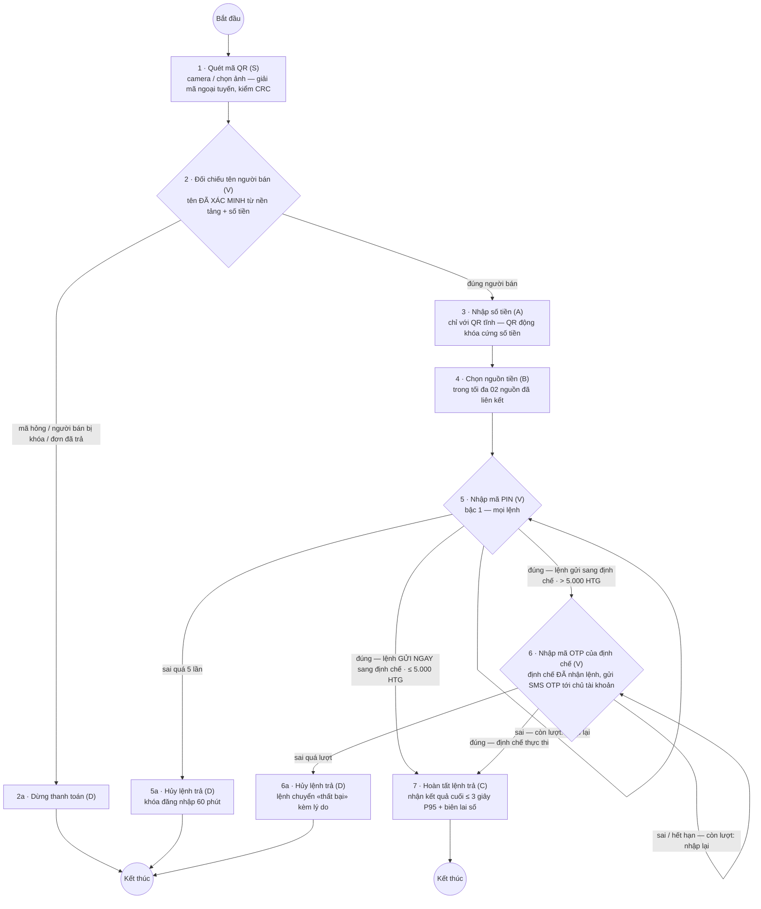

| Bước | Tên bước | Mô tả | Đối tượng |
|---|---|---|---|
| — | **Luồng dữ liệu chính** | | |
| 1 | Quét mã QR (S) | Quét bằng camera hoặc chọn ảnh; ứng dụng giải mã ngoại tuyến, kiểm CRC | Người dùng |
| 2 | Đối chiếu tên người bán (V) | Xem tên người bán **đã xác minh** từ nền tảng và số tiền; đúng → bước 3; mã hỏng/người bán bị khóa/đơn đã trả → nhánh 2a | Người dùng |
| 3 | Nhập số tiền (A) | Chỉ với QR tĩnh; QR động khóa cứng số tiền theo đơn | Người dùng |
| 4 | Chọn nguồn tiền (B) | Chọn tài khoản nguồn trong danh sách đã liên kết (tối đa 02 nguồn) | Người dùng |
| 5 | Nhập mã PIN (V) | PIN ứng dụng — bậc xác thực thứ nhất, mọi lệnh. Đúng: lệnh GỬI NGAY sang định chế nguồn; ≤ 5.000 HTG chờ kết quả (bước 7), > 5.000 HTG định chế gửi SMS OTP (bước 6). Sai còn lượt: nhập lại; sai quá 5 lần → nhánh 5a | Người dùng |
| 6 | Nhập mã OTP của định chế (V) | Chỉ khi số tiền > 5.000 HTG (ngưỡng chuẩn hóa): định chế ĐÃ NHẬN lệnh và gửi SMS OTP tới chủ tài khoản — nhập ngay trong ứng dụng để định chế thực thi; sai quá lượt → nhánh 6a | Người dùng |
| 7 | Hoàn tất lệnh trả (C) | Nhận kết quả cuối hiển thị ≤ 3 giây (P95) và biên lai số có mã tra cứu; trạng thái ghi nhận vào lịch sử | Người dùng |
| — | **Luồng dữ liệu rẽ nhánh** | | |
| 2a | Dừng thanh toán (D) | Mã hỏng/sai chuẩn, người bán bị khóa, đơn đã thanh toán — hệ thống chặn, người dùng thoát | Người dùng |
| 5a | Hủy lệnh trả (D) | Sai PIN quá 5 lần — lệnh hủy, tài khoản khóa đăng nhập 60 phút | Người dùng |
| 6a | Hủy lệnh trả (D) | OTP sai/hết hạn quá số lượt định chế cho phép — lệnh chuyển «thất bại» kèm lý do dễ hiểu | Người dùng |

### 7.4. QT-04 — Hậu kiểm gian hàng (portal BRH)

Mô hình «tạo là active»: portal **không duyệt trước**; danh sách hậu kiểm xử lý trong **24 giờ** với cờ ưu tiên, lấy mẫu **10%** hồ sơ thường.

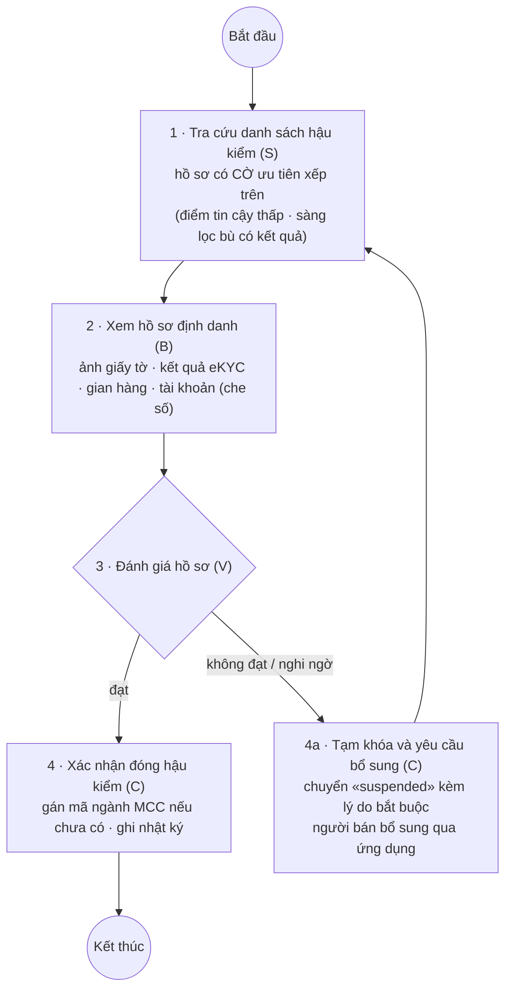

| Bước | Tên bước | Mô tả | Đối tượng |
|---|---|---|---|
| — | **Luồng dữ liệu chính** | | |
| 1 | Tra cứu danh sách hậu kiểm (S) | Danh sách gian hàng mới kích hoạt, cờ ưu tiên (điểm tin cậy thấp, sàng lọc bù có kết quả) xếp trên | Cán bộ BRH |
| 2 | Xem hồ sơ định danh (B) | Ảnh giấy tờ, kết quả đối chiếu eKYC, thông tin gian hàng, tài khoản nhận (che số) | Cán bộ BRH |
| 3 | Đánh giá hồ sơ (V) | Đạt → bước 4; không đạt/nghi ngờ → nhánh 4a | Cán bộ BRH |
| 4 | Xác nhận đóng hậu kiểm (C) | Gán mã ngành nghề MCC nếu chưa có; hồ sơ đóng hậu kiểm, ghi nhật ký kèm người quyết định | Cán bộ BRH |
| — | **Luồng dữ liệu rẽ nhánh** | | |
| 4a | Tạm khóa và yêu cầu bổ sung (C) | Gian hàng chuyển «suspended» kèm lý do bắt buộc; người bán nhận thông báo và bổ sung qua ứng dụng; hồ sơ quay lại danh sách | Cán bộ BRH |

### 7.5. QT-05 — Xử lý khiếu nại và hoàn tiền (portal BRH)

Nguyên tắc bất di bất dịch: kết luận «hoàn tiền» **bắt buộc có xác minh** (dò được bút toán hoàn qua sao kê định chế hoặc đính chứng từ) — hệ thống **chặn** kết luận không căn cứ.

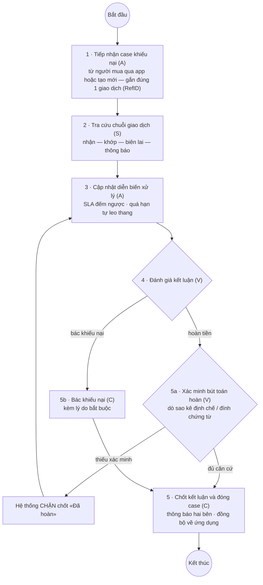

| Bước | Tên bước | Mô tả | Đối tượng |
|---|---|---|---|
| — | **Luồng dữ liệu chính** | | |
| 1 | Tiếp nhận case khiếu nại (A) | Case từ người mua (qua app) hoặc tạo mới; gắn đúng một giao dịch (RefID) | Cán bộ BRH |
| 2 | Tra cứu chuỗi giao dịch (S) | Chuỗi sự kiện đầy đủ: nhận — khớp — biên lai — thông báo | Cán bộ BRH |
| 3 | Cập nhật diễn biến xử lý (A) | Trao đổi, yêu cầu bổ sung chứng cứ; SLA đếm ngược, quá hạn tự leo thang | Cán bộ BRH |
| 4 | Đánh giá kết luận (V) | Hoàn tiền → nhánh 5a; bác khiếu nại → nhánh 5b | Cán bộ BRH |
| 5 | Chốt kết luận và đóng case (C) | Văn bản kết luận, thông báo hai bên, trạng thái đồng bộ về ứng dụng | Cán bộ BRH |
| — | **Luồng dữ liệu rẽ nhánh** | | |
| 5a | Xác minh bút toán hoàn (V) | Dò bút toán chuyển trả qua sao kê định chế hoặc đính chứng từ — thiếu xác minh hệ thống không cho chốt «Đã hoàn» | Cán bộ BRH |
| 5b | Bác khiếu nại (C) | Kết luận bác kèm lý do bắt buộc | Cán bộ BRH |

### 7.6. QT-06 — Đối soát cuối ngày và xử lý chênh lệch (console vận hành)

So khớp **ba nguồn**: nền tảng — bảng kê định chế — báo cáo Switch (E3), theo phiên ngày nghiệp vụ; chênh lệch phân loại và đóng **≤ 2 ngày làm việc**.

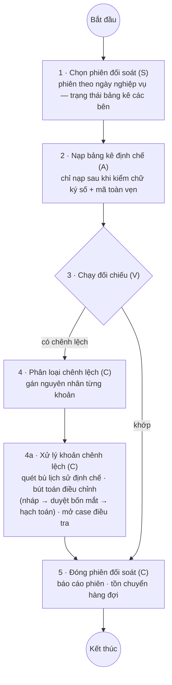

| Bước | Tên bước | Mô tả | Đối tượng |
|---|---|---|---|
| — | **Luồng dữ liệu chính** | | |
| 1 | Chọn phiên đối soát (S) | Phiên theo ngày nghiệp vụ; xem trạng thái bảng kê các bên | Vận hành VDS |
| 2 | Nạp bảng kê định chế (A) | Bảng kê chỉ nạp sau khi kiểm chữ ký số và mã toàn vẹn | Vận hành VDS |
| 3 | Chạy đối chiếu (V) | Khớp → bước 5; có chênh lệch → bước 4 | Vận hành VDS |
| 4 | Phân loại chênh lệch (C) | Gán nguyên nhân từng khoản lệch trong hàng đợi | Vận hành VDS |
| 5 | Đóng phiên đối soát (C) | Báo cáo phiên; chênh lệch tồn chuyển hàng đợi xử lý | Vận hành VDS |
| — | **Luồng dữ liệu rẽ nhánh** | | |
| 4a | Xử lý khoản chênh lệch (C) | Quét bù lịch sử định chế lấp khoảng trống; hoặc lập bút toán điều chỉnh (nháp → duyệt bốn mắt → hạch toán); hoặc mở case điều tra; đóng ≤ 2 ngày làm việc | Vận hành VDS |

### 7.7. QT-07 — Kết nạp định chế mới

Chuẩn hóa để định chế **tự tích hợp**; định mức hỗ trợ 10 ngày-công/định chế, tối đa 03 định chế giai đoạn đầu.

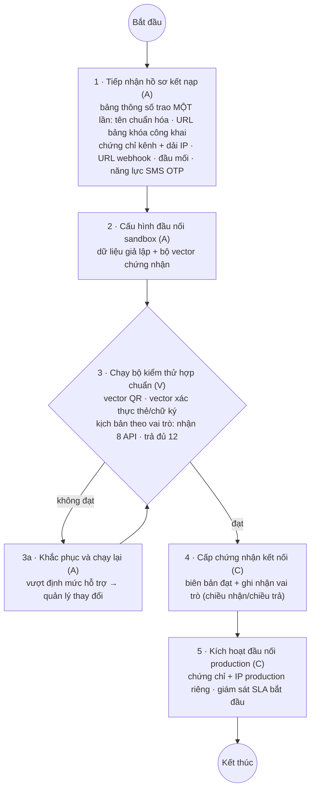

| Bước | Tên bước | Mô tả | Đối tượng |
|---|---|---|---|
| — | **Luồng dữ liệu chính** | | |
| 1 | Tiếp nhận hồ sơ kết nạp (A) | Bảng thông số trao một lần: tên chuẩn hóa định chế, URL bảng khóa công khai, chứng chỉ kênh + dải IP, URL webhook, đầu mối vận hành, năng lực SMS OTP | Vận hành VDS |
| 2 | Cấu hình đầu nối sandbox (A) | Mở kết nối sandbox, dữ liệu giả lập, bộ vector chứng nhận | Vận hành VDS |
| 3 | Chạy bộ kiểm thử hợp chuẩn (V) | Định chế tự chạy: vector QR, vector xác thực thẻ/chữ ký, kịch bản tích hợp theo vai trò (nhận 8 API · trả đủ 12); đạt → bước 4 | Định chế |
| 4 | Cấp chứng nhận kết nối (C) | Biên bản đạt bộ kiểm thử; ghi nhận vai trò tham gia (chiều nhận/chiều trả) | Vận hành VDS |
| 5 | Kích hoạt đầu nối production (C) | Chứng chỉ + IP production riêng; giám sát SLA bắt đầu | Vận hành VDS |
| — | **Luồng dữ liệu rẽ nhánh** | | |
| 3a | Khắc phục và chạy lại (A) | Không đạt vector — định chế sửa theo hướng dẫn, chạy lại; vượt định mức hỗ trợ xử lý theo quản lý thay đổi | Định chế |

---

## 8. YÊU CẦU CHỨC NĂNG THEO PHÂN HỆ

> Toàn bộ 42 chức năng CN-01 → CN-42, mức «Bắt buộc» trừ khi ghi khác. Các chức năng lõi (CN-01, CN-03, CN-06, CN-08, CN-17) đặc tả sâu kèm bảng thông tin chung và dòng sự kiện; các chức năng còn lại ở mức phân rã — chi tiết màn hình và luồng sự kiện từng màn đã đặc tả tại Phụ lục MOU mục A.3 (đặc tả màn hình) và bộ wireframe 42 màn.

### 8.1. PH-01 · Ứng dụng di động Peye-Haiti (người mua & người bán)

| Mã | Chức năng | Mô tả | Mức độ |
|---|---|---|---|
| CN-01 | Đăng ký, chọn vai & định danh | Đăng ký SĐT + OTP + PIN; chọn vai tại CH-00 (trước eKYC); vai bán chạy eKYC + khai gian hàng; «tạo là active» | Bắt buộc |
| CN-02 | Đăng nhập & an toàn tài khoản | Đăng nhập PIN, thiết bị mới bắt OTP; quên PIN đặt lại bằng OTP; khóa khẩn qua hotline 8686 (thu hồi mọi phiên ≤ 60 giây) | Bắt buộc |
| CN-03 | Liên kết tài khoản nhận tiền | Liên kết 2 bước với OTP của định chế; tài khoản chính duy nhất; đổi tài khoản có ân hạn 30 ngày và phát hành lại QR | Bắt buộc |
| CN-04 | Sinh & quản lý QR thu tiền | QR tĩnh (in standee) và QR động (kèm số tiền, mã đơn, hạn hiệu lực, tự làm mới) đúng chuẩn HTQR 1.0 | Bắt buộc |
| CN-05 | Két tiền & biên lai | Danh sách tiền về thời gian thực, «ting ting», biên lai điện tử từng khoản, khoản chưa rõ nguồn tách mục riêng | Bắt buộc |
| CN-06 | Đơn tính tiền & danh mục món | Danh mục hàng hóa; đơn nhiều món tổng tính máy; trạng thái đơn thời gian thực; gạch tay có ghi vết | Bắt buộc |
| CN-07 | Sổ nợ & khách quen | Bán chịu, nhắc nợ qua SMS (tối đa 1 tin/khách/ngày), gạch nợ gắn khoản tiền về hoặc xác nhận tiền mặt; ngoại tuyến 100% | Bắt buộc |
| CN-08 | Thanh toán trong app (mọi vai) | Quét QR → tên xác minh → hai bậc PIN/OTP theo ngưỡng 5.000 HTG → biên lai số; chống trùng lệnh | Bắt buộc |
| CN-09 | Lịch sử trả & khiếu nại | Lịch sử khoản đã trả; tạo khiếu nại gắn 1 giao dịch, trạng thái đồng bộ portal | Bắt buộc |
| CN-10 | Liên kết nguồn trả | Tối đa 02 nguồn, quy trình 2 bước OTP định chế, thu hồi tức thời, nguồn mặc định | Bắt buộc |
| CN-11 | Báo cáo doanh số | Doanh số ngày/tuần/tháng tách QR — tiền mặt — bán chịu, nhất quán với két tiền | Bắt buộc |
| CN-12 | Thông báo | Trung tâm thông báo phân loại; cảnh báo liên kết hết hiệu lực ghim đầu; thông báo tiền không xóa được | Bắt buộc |
| CN-13 | Hồ sơ, cài đặt & ngoại tuyến | Quản lý tài khoản/thiết bị/ngôn ngữ (FR + Kreyòl tối thiểu); chế độ ngoại tuyến đọc QR, xem/tạo đơn, đồng bộ lại | Bắt buộc |
| CN-14 | Chuyển vai & nâng cấp người bán | Nút «Trở thành người bán» kích hoạt onboarding merchant ngay trong app (làm nốt phần còn thiếu, không lặp bước nào); chuyển vai khi gian hàng active | **Sau pilot** — trong pilot đổi vai qua kênh hỗ trợ/đội hiện trường |

#### CN-01 · Đăng ký, chọn vai & định danh

| Trường | Nội dung |
|---|---|
| **Tên chức năng** | CN-01: Đăng ký, chọn vai & định danh |
| **Mô tả** | Khởi tạo tài khoản người dùng và (với vai bán) hồ sơ gian hàng; ghi dữ liệu người dùng, gian hàng, hồ sơ eKYC; phạm vi tới khi gian hàng kích hoạt |
| **Tác nhân** | Người dùng; dịch vụ eKYC BRH-System (E1); dịch vụ sàng lọc (E2) |
| **Điều kiện trước** | Số điện thoại chưa có tài khoản active; ứng dụng cài đặt được (PWA) |
| **Điều kiện sau** | Thành công (vai mua): tài khoản KYC1 dùng được ngay · Thành công (vai bán): gian hàng ACTIVE, nhận tiền được, vào danh sách hậu kiểm BRH · Thất bại: hồ sơ dở dang kèm lý do (ảnh không đạt, đối chiếu không khớp, OTP sai quá lượt) |
| **Ngoại lệ** | Dịch vụ eKYC gián đoạn (hồ sơ chờ, người dùng được thông báo); sàng lọc E2 lỗi hệ thống không chặn kích hoạt (sàng lọc bù về sau) |
| **Yêu cầu đặc biệt** | Đỉnh chiến dịch đăng ký ~500 hồ sơ/ngày; PIN lưu băm Argon2id; ảnh định danh lưu mã hóa, không chia sẻ hệ thống ngoài |

**Dòng sự kiện chính (Basic Flow):**

| Hành động của tác nhân | Phản ứng của hệ thống | Dữ liệu (C/R/U/D) |
|---|---|---|
| 1. Nhập số điện thoại, chấp thuận điều khoản | 2. Kiểm tra SĐT duy nhất, gửi OTP | người dùng (C) |
| 3. Nhập OTP, đặt PIN 2 lần | 4. Xác nhận kênh, lưu PIN băm, mở phiên đầu | phiên đăng nhập (C) |
| 5. Chọn vai tại CH-00 | 6. Vai mua: kết thúc (KYC1). Vai bán: mở luồng eKYC | người dùng (U) |
| 7. Chụp CIN 2 mặt + chân dung; khai gian hàng | 8. Kiểm chất lượng ảnh tại chỗ; gọi eKYC đối chiếu; tạo hồ sơ gian hàng | gian hàng, hồ sơ eKYC (C) |
| 9. Liên kết tài khoản nhận (CN-03) | 10. Khi eKYC đạt + đủ hồ sơ + có tài khoản nhận: **kích hoạt ngay**, đưa vào danh sách hậu kiểm, thông báo cho người bán | gian hàng (U), liên kết (C) |

**Dòng sự kiện phụ (Alternative Flow):** (a) ảnh không đạt/đối chiếu không khớp → yêu cầu chụp lại, không chắc chắn thì chuyển hậu kiểm thủ công trên portal; (b) sàng lọc trả lỗi hệ thống → kích hoạt vẫn tiến hành, tự sàng lọc bù khi dịch vụ phục hồi; (c) người dùng dừng giữa chừng → hồ sơ dở dang, màn trạng thái chỉ rõ bước còn thiếu.

**Ghi chú:** quy tắc «tạo là active» — điểm tin cậy tự động dưới ngưỡng cấu hình chỉ **gắn cờ** hậu kiểm (xử lý trong 24 giờ, lấy mẫu 10%), không chặn kích hoạt; mã người bán sinh dạng PIN-M-xxxxxx; vai mua không chạy eKYC/sàng lọc.

#### CN-03 · Liên kết tài khoản nhận tiền

| Trường | Nội dung |
|---|---|
| **Tên chức năng** | CN-03: Liên kết tài khoản nhận tiền |
| **Mô tả** | Gắn tài khoản tại định chế vào hồ sơ người bán theo quy trình Open Banking 2 bước; ghi liên kết và token (mã hóa trong kho khóa) |
| **Tác nhân** | Người bán; định chế nhận (Open Banking) |
| **Điều kiện trước** | Người bán đã qua eKYC; định chế thuộc danh mục đã kết nạp |
| **Điều kiện sau** | Thành công: liên kết active, token cấp theo scope, tài khoản đầu tiên gắn cờ «tài khoản chính» — đích của QR · Thất bại: không tạo liên kết; lý do hiển thị (tài khoản không tồn tại, bị phong tỏa, OTP sai quá lượt) |
| **Ngoại lệ** | Định chế gián đoạn (thử lại sau); token bị định chế thu hồi giữa chừng (yêu cầu liên kết lại, cảnh báo ghim ở thông báo) |
| **Yêu cầu đặc biệt** | OTP do **chính định chế** gửi tới số điện thoại chủ tài khoản họ đang giữ — nền tảng không đối chiếu tên; số tài khoản đầy đủ không bao giờ hiển thị lại; token tự gia hạn trước hạn 7 ngày |

**Dòng sự kiện chính:**

| Hành động của tác nhân | Phản ứng của hệ thống | Dữ liệu (C/R/U/D) |
|---|---|---|
| 1. Chọn định chế, nhập số tài khoản | 2. Gọi định chế khởi tạo liên kết; định chế gửi OTP tới chủ tài khoản; hiển thị số đã che nhận OTP | liên kết (C) |
| 3. Nhập OTP của định chế | 4. Chuyển OTP sang định chế; nhận token liên kết; mã hóa cất kho khóa; gắn cờ tài khoản chính nếu là tài khoản đầu tiên | token (C), liên kết (U) |
| 5. Xem xác nhận liên kết | 6. Hiển thị tài khoản dạng che số, tên chủ tài khoản định chế trả về; đăng ký nhận báo Có cho liên kết | — |

**Ghi chú:** đổi tài khoản chính là quy trình nhiều bước có hoàn tác an toàn — tài khoản cũ vào **ân hạn 30 ngày** (tham số) vẫn nhận tiền, QR phát hành lại phiên bản mới; thu hồi liên kết hiệu lực tức thời và định chế ngừng gửi báo Có.

#### CN-06 · Đơn tính tiền & danh mục món

| Trường | Nội dung |
|---|---|
| **Tên chức năng** | CN-06: Đơn tính tiền & danh mục món |
| **Mô tả** | Quản lý danh mục hàng hóa và lập đơn nhiều món tại quầy; sinh QR động đúng tổng đơn; theo dõi và tất toán đơn trong ngày |
| **Tác nhân** | Người bán |
| **Điều kiện trước** | Gian hàng active; hoạt động được cả khi mất mạng (đồng bộ lại sau) |
| **Điều kiện sau** | Thành công: đơn tạo với mã đơn, QR động gắn mã đơn; tiền về mang mã đơn thì đơn tự gạch · Thất bại: đơn không tạo (danh mục trống, dữ liệu không hợp lệ) |
| **Ngoại lệ** | Xung đột đồng bộ ngoại tuyến: dữ liệu tiền = máy chủ thắng; ghi chú/danh mục = bản client mới hơn thắng |
| **Yêu cầu đặc biệt** | Tổng tiền = Σ(đơn giá × số lượng) tính máy, không nhập tay; đơn mở hết hạn 24 giờ (tham số); thay đổi giá không ảnh hưởng đơn đã lập |

**Dòng sự kiện chính:**

| Hành động của tác nhân | Phản ứng của hệ thống | Dữ liệu (C/R/U/D) |
|---|---|---|
| 1. Tick chọn món, chỉnh số lượng | 2. Cập nhật tổng tức thời; tạo đơn với mã đơn khi xác nhận | đơn, dòng đơn (C) |
| 3. Chọn «Thu tiền» / «Bán chịu» / «Lưu chờ» | 4. Thu tiền: sinh QR động đúng tổng gắn mã đơn; Bán chịu: ghi vào sổ nợ khách; Lưu chờ: giữ đơn mở | đơn (U), QR (C) |
| 5. Theo dõi trạng thái đơn trong ngày | 6. Cập nhật thời gian thực khi tiền về khớp mã đơn (đơn tự gạch); đơn quá hạn chuyển «hết hạn» | đơn (U) |

#### CN-08 · Thanh toán trong app — hai bậc xác thực

| Trường | Nội dung |
|---|---|
| **Tên chức năng** | CN-08: Thanh toán trong app (mọi vai) |
| **Mô tả** | Cho người dùng (cả vai mua lẫn vai bán) trả tiền bằng quét QR chuẩn quốc gia từ tài khoản nguồn đã liên kết; ghi lệnh trả và biên lai |
| **Tác nhân** | Người dùng; nền tảng (tra cứu xác minh); định chế nguồn trả (M-PAY) |
| **Điều kiện trước** | Đã liên kết ít nhất một nguồn trả với quyền «trả tiền»; lệnh không trùng với lệnh đang treo tới cùng đích |
| **Điều kiện sau** | Thành công: lệnh «thành công», biên lai số có mã tra cứu, người bán nhận báo Có khớp đích danh · Thất bại: lệnh «thất bại» kèm lý do dễ hiểu (thiếu số dư, vượt hạn mức, từ chối, sai OTP quá lượt) |
| **Ngoại lệ** | Đứt mạng sau xác nhận: ứng dụng chỉ tra trạng thái tới kết quả cuối, tuyệt đối không tạo lệnh mới; định chế không phản hồi: lưới đỡ tra trạng thái theo chu kỳ |
| **Yêu cầu đặc biệt** | Hai bậc: ≤ 5.000 HTG chỉ PIN; > 5.000 HTG PIN + SMS OTP do **định chế** gửi (ngưỡng chuẩn hóa toàn hệ thống — định chế được chặt hơn, không được lỏng hơn); kết quả ≤ 3 giây P95; chống trừ tiền hai lần bằng khóa idempotent; quyết định cuối (số dư, hạn mức) thuộc định chế nguồn |

**Dòng sự kiện chính:**

| Hành động của tác nhân | Phản ứng của hệ thống | Dữ liệu (C/R/U/D) |
|---|---|---|
| 1. Quét QR | 2. Giải mã ngoại tuyến, kiểm CRC; tra cứu nền tảng lấy tên người bán **xác minh** + trạng thái + tham chiếu khớp lệnh | — |
| 3. Xem tên xác minh, nhập số tiền (QR tĩnh), chọn nguồn | 4. Khóa số tiền với QR động; kiểm lệnh treo trùng đích | lệnh trả (C) |
| 5. Nhập PIN (mọi lệnh) | 6. ≤ 5.000 HTG: gửi lệnh sang định chế ngay. > 5.000 HTG: định chế gửi SMS OTP tới chủ tài khoản, ứng dụng chuyển trạng thái chờ OTP | lệnh trả (U) |
| 7. Nhập OTP định chế (bậc hai, nếu có) | 8. Chuyển OTP xác nhận sang định chế; định chế thực thi lệnh | lệnh trả (U) |
| 9. Xem kết quả và biên lai | 10. Nhận webhook kết quả cuối; cập nhật trạng thái, phát biên lai số, thông báo đẩy | lệnh trả (U), biên lai (C) |

**Ghi chú:** hạn mức ngày bậc-PIN đếm riêng (chỉ đếm lệnh không OTP); OTP thanh toán dùng SMS GW của định chế (điều kiện kết nạp); lệnh treo quá hạn chuyển «quá hạn» và được tra lại; trạng thái «thành công/thất bại» là cuối cùng, bất biến.

### 8.2. PH-02 · Portal giám sát BRH

| Mã | Chức năng | Mô tả | Mức độ |
|---|---|---|---|
| CN-15 | Đăng nhập portal & phân quyền | 2FA bắt buộc (mật khẩu + TOTP); 5 vai trò RBAC (quản trị · duyệt hồ sơ · giám sát-AML · vận hành chỉ đọc · thanh tra chỉ đọc), không vai trò nào vừa tạo vừa duyệt | Bắt buộc |
| CN-16 | Bảng giám sát thời gian thực | Chỉ số ngày: số/giá trị giao dịch, người bán hoạt động, tỉ lệ khớp tự động, độ trễ báo Có; trạng thái kết nối từng định chế; cảnh báo nóng | Bắt buộc |
| CN-17 | Hậu kiểm & quản lý người bán | Danh sách hậu kiểm 24h + lấy mẫu 10%; đóng hậu kiểm/tạm khóa/mở khóa/đóng vĩnh viễn theo checklist; thao tác nhạy cảm bốn mắt | Bắt buộc |
| CN-18 | Giám sát & truy vết giao dịch | Tra cứu đa tiêu chí, chuỗi sự kiện đầy đủ một giao dịch, xuất kết quả; mọi phiên tra cứu ghi nhật ký | Bắt buộc |
| CN-19 | Case tra soát & khiếu nại | Vòng đời case có SLA và leo thang; hoàn tiền bắt buộc xác minh bút toán | Bắt buộc |
| CN-20 | Cảnh báo giao dịch bất thường | Luật ngưỡng cấu hình được (giá trị/tần suất), danh sách theo dõi, chuyển cảnh báo thành case; không phải hệ thống AML/CFT đầy đủ | Bắt buộc |
| CN-21 | Báo cáo định kỳ & KPI | Báo cáo vận hành theo kỳ, bảng KPI, xuất tệp; số liệu nhất quán với giám sát cùng kỳ | Bắt buộc |
| CN-22 | Nhật ký kiểm toán | Bất biến (chuỗi hash), không sửa/xóa bằng bất kỳ quyền nào; lưu tối thiểu 10 năm (đề xuất C17) | Bắt buộc |
| CN-23 | Quản trị người dùng bốn mắt | Tạo/sửa tài khoản, gán vai trò; người tạo khác người phê duyệt; vô hiệu hóa tức thời | Bắt buộc |
| CN-24 | Tham số hệ thống (API) | 25 tham số cấu hình (danh mục TSD §13.3) theo cơ chế đề xuất — phê duyệt — áp dụng (bốn mắt), có nhật ký | Bắt buộc |

#### CN-17 · Hậu kiểm & quản lý người bán

| Trường | Nội dung |
|---|---|
| **Tên chức năng** | CN-17: Hậu kiểm & quản lý người bán |
| **Mô tả** | Kiểm soát sau kích hoạt theo mô hình «tạo là active»: xử lý danh sách hậu kiểm, quản lý vòng đời gian hàng (active/suspended/closed); tác động dữ liệu gian hàng và nhật ký |
| **Tác nhân** | Cán bộ BRH (vai duyệt hồ sơ; đóng vĩnh viễn cần bốn mắt) |
| **Điều kiện trước** | Đăng nhập 2FA; hồ sơ thuộc danh sách hậu kiểm hoặc tra cứu được |
| **Điều kiện sau** | Thành công: hồ sơ đóng hậu kiểm, hoặc chuyển trạng thái mới kèm lý do; người bán được thông báo tự động · Thất bại: thao tác bị chặn (thiếu lý do, thiếu người duyệt thứ hai, checklist chưa hoàn thành) |
| **Ngoại lệ** | Gian hàng còn case đang mở thì không đóng vĩnh viễn được |
| **Yêu cầu đặc biệt** | Danh sách hậu kiểm xử lý trong 24 giờ; cờ ưu tiên từ điểm tin cậy tự động và kết quả sàng lọc bù; mọi quyết định ghi nhật ký kèm người quyết định |

Basic Flow: theo QT-04 (mục 7.4). Alternative Flow: đóng vĩnh viễn — hoàn thành checklist (thu hồi liên kết, xử lý QR đã phát hành) rồi người duyệt thứ hai xác nhận; mở khóa gian hàng suspended cần lý do.

### 8.3. PH-03 · Console vận hành (VDS)

| Mã | Chức năng | Mô tả | Mức độ |
|---|---|---|---|
| CN-25 | Quản trị đầu nối Open Banking | Đăng ký/kích hoạt kết nối định chế; nạp chứng thư, xoay khóa chồng lấp không gián đoạn, thu hồi khẩn có cảnh báo hai bên | Bắt buộc |
| CN-26 | Giám sát sức khỏe tích hợp | Bảng SLA từng tích hợp (độ trễ báo Có, tỉ lệ lỗi, hàng đợi); cảnh báo trực ban; kênh quét bù khi webhook gián đoạn | Bắt buộc |
| CN-27 | Đối soát cuối ngày | Phiên đối soát với định chế và Switch (E3); kết quả khớp/lệch; báo cáo phiên | Bắt buộc |
| CN-28 | Xử lý chênh lệch | Hàng đợi chênh lệch theo trạng thái; quét bù/điều chỉnh bốn mắt/mở case; chỉ đóng khi hai bên khớp hoặc có quyết định được duyệt | Bắt buộc |

### 8.4. PH-04 · Nền tảng lõi (backend)

Nền tảng lõi không có màn hình riêng — cung cấp năng lực cho các phân hệ trên qua **4 dịch vụ** (Merchant & Identity · Commerce · Back-office · Notification) chứa **12 module** nghiệp vụ (Gian hàng · Định danh · Tài khoản & Token — thuộc Merchant & Identity; Ingest · Khớp tiền · Đơn hàng & Sổ nợ · Biên lai · Payment · Sync — thuộc Commerce; Compliance · Admin & Config — thuộc Back-office; Notification) chạy trên Kubernetes với event bus Kafka; 109 đầu mục API; 28 bảng dữ liệu/306 trường.

| Mã | Chức năng | Mô tả | Mức độ |
|---|---|---|---|
| CN-29 | Sinh & xác thực QR chuẩn HTQR 1.0 | QR tĩnh/động theo đặc tả tag; phiên bản hóa khi đổi tài khoản nhận; bộ vector hợp chuẩn ≥ 30 ca phục vụ chứng nhận app định chế | Bắt buộc |
| CN-30 | Tiếp nhận báo Có & khớp lệnh | Webhook báo Có ≥ 50 giao dịch/giây; khử trùng 2 tầng (event_id + RefID); khớp 2 mức — ưu tiên đích danh theo tham chiếu tra cứu QR; phát sự kiện «ting ting» | Bắt buộc |
| CN-31 | Tra cứu xác minh & trang công khai | API tra cứu QR cho app định chế (tên xác minh + tham chiếu khớp đích danh, hiệu lực 15 phút); trang công khai xác minh người bán không cần đăng nhập | Bắt buộc |
| CN-32 | Thông báo đa kênh | Push ưu tiên, SMS dự phòng (người bán offline vẫn nhận báo có qua SMS); biên lai SMS cho người mua không dùng app | Bắt buộc |
| CN-33 | Nhật ký & khóa tham chiếu | Ghi vết mọi sự kiện tài chính, khóa tham chiếu xuyên hệ thống, nguyên tắc «3 KHÔNG» với dữ liệu đẩy ra ngoài | Bắt buộc |
| CN-34 | Hạn mức & cảnh báo theo ngưỡng | Ngưỡng giá trị/tần suất cấu hình; hậu kiểm AML theo ngưỡng ngày; danh sách theo dõi | Bắt buộc |

### 8.5. PH-05 · Cổng Open Banking & kết nạp định chế

| Mã | Chức năng | Mô tả | Mức độ |
|---|---|---|---|
| CN-35 | Bộ chuẩn Open Banking 12 API | Nhóm liên kết tài khoản ×5 · truy vấn ×2 · báo Có ×1 · lệnh trả ×4 (khởi tạo, trạng thái, xác nhận OTP, webhook kết quả) + 1 API tra cứu nền tảng cung cấp; ma trận vai trò: chiều nhận 8 API, chiều trả đủ 12 | Bắt buộc |
| CN-36 | An ninh kênh đối tác | Thẻ hệ thống tự ký kiêm hash nội dung (chuẩn A.1b); danh tính bằng tên chuẩn hóa; bảng khóa công khai JWKS; response tài chính ký cùng định dạng; mTLS + VPN + IP allowlist ở tầng hạ tầng | Bắt buộc |
| CN-37 | Sandbox & chứng nhận | Điểm cuối riêng, dữ liệu giả lập, trình giả lập định chế mẫu thử hai chiều, bộ vector tự kiểm; định chế tự đăng ký tự kiểm thử | Bắt buộc |
| CN-38 | Tài liệu tích hợp & ví dụ bản tin | Hướng dẫn tích hợp từng bước, ví dụ bản tin đầy đủ toàn luồng, bộ kịch bản kiểm thử | Bắt buộc |

**Giải thích an ninh kênh đối tác (mức nghiệp vụ):** mỗi hệ thống tham gia có **một cặp khóa** và công bố khóa công khai qua bảng JWKS. Khi gọi API, bên gọi tự ký một «thẻ hệ thống» nói rõ *tôi là ai — gọi tới ai — lúc nào*, và nếu request có nội dung thì thẻ khắc thêm **hash của body request** — bên nhận đối chiếu để chắc chắn nội dung không bị sửa trên đường truyền. Response tài chính (số dư, lịch sử, kết quả trả) được ký cùng định dạng ở chiều ngược lại — hai bên đều **không thể chối bỏ** bản tin đã gửi. Tầng hạ tầng (mTLS, VPN, IP) cấu hình **một lần** theo hồ sơ kết nạp.

### 8.6. PH-06 · Tích hợp hệ thống ngoài

| Mã | Chức năng | Hệ thống ngoài | Mô tả | Mức độ |
|---|---|---|---|---|
| CN-39 | Định danh điện tử eKYC | BRH-System (E1) | Gửi ảnh giấy tờ + chân dung, nhận kết quả đối chiếu ONI; đỉnh ~500 hồ sơ/ngày; hạn mức gọi theo quota BRH cấp | Bắt buộc |
| CN-40 | Sàng lọc | BRH-System (E2) | Gọi dịch vụ sàng lọc sẵn có của BRH khi kích hoạt và định kỳ; lỗi hệ thống phía E2 không chặn kích hoạt — sàng lọc bù | Bắt buộc |
| CN-41 | Đối soát Switch | Switch/ACI (E3) | Nhận báo cáo cuối ngày theo phiên (file ký số); đăng ký danh mục tài khoản; SFTP dự phòng | Bắt buộc |
| CN-42 | SMS | Natcom (N1) | SMS OTP đăng ký, «ting ting» dự phòng, biên lai, nhắc nợ — brandname PEYE-HAITI; báo phát DLR; OTP thanh toán bậc hai **không** qua kênh này (SMS GW của định chế) | Bắt buộc |

---

## 9. LUẬT NGHIỆP VỤ & VÒNG ĐỜI TRẠNG THÁI

### 9.1. Bảng luật nghiệp vụ chính

| Mã | Luật nghiệp vụ | Áp tại |
|---|---|---|
| BR-01 | Nền tảng không giữ tiền, không có tài khoản tiền; mọi bút toán thuộc định chế | Toàn hệ thống |
| BR-02 | Tạo là active: kích hoạt ngay khi eKYC đạt + đủ hồ sơ + tài khoản nhận; hậu kiểm ≤ 24h; lấy mẫu 10%; điểm thấp/cảnh báo chỉ gắn cờ | CN-01, CN-17 |
| BR-03 | Hai bậc xác thực: ≤ 5.000 HTG chỉ PIN; > 5.000 HTG PIN + SMS OTP định chế; ngưỡng chuẩn hóa — định chế chặt hơn được, lỏng hơn không | CN-08 |
| BR-04 | Trần ngày bậc-PIN: 25.000 HTG và ≤ 20 lệnh/ngày — chỉ đếm lệnh không OTP | CN-08 |
| BR-05 | Tiền hiển thị «đã thu» chỉ khi có báo Có từ định chế — không bao giờ suy đoán | CN-05, CN-06 |
| BR-06 | Gạch đơn 2 mức: ① tự động (đích danh theo tham chiếu, hoặc tài khoản liên kết + số tiền + cửa sổ thời gian); ② xác nhận tay có ghi vết; hai đơn cùng tiền → không đoán | CN-30, CN-06 |
| BR-07 | Khử trùng 2 tầng theo mã sự kiện + mã tham chiếu: một sự kiện báo Có không bao giờ ghi hai lần | CN-30 |
| BR-08 | Đổi tài khoản nhận: tài khoản cũ ân hạn ≥ 30 ngày vẫn nhận tiền; QR phát hành lại | CN-03, CN-29 |
| BR-09 | Hoàn tiền bắt buộc xác minh bút toán (sao kê hoặc chứng từ) trước khi chốt «Đã hoàn» | CN-19 |
| BR-10 | Thao tác nhạy cảm bốn mắt: tham số hệ thống, bút toán điều chỉnh, đóng gian hàng vĩnh viễn, quản trị người dùng | CN-17, CN-23, CN-24, CN-28 |
| BR-11 | Nguyên tắc «3 KHÔNG» với dữ liệu đẩy ra hệ thống ngoài: không QR thô, không bí mật sống, không số tài khoản đầy đủ | CN-33 |
| BR-12 | Nhật ký kiểm toán bất biến (chuỗi hash, kiểm hằng đêm), lưu tối thiểu 10 năm (đề xuất C17); không quyền nào sửa/xóa được | CN-22 |
| BR-13 | Lệnh trả đứt mạng giữa chừng: chỉ tra lại trạng thái, không tạo lệnh mới; chặn lệnh trùng tới cùng đích khi lệnh cũ chưa chốt | CN-08 |
| BR-14 | Tiền tệ HTG, đơn vị lưu trữ centime (1 HTG = 100 centime), số nguyên 64-bit — không dùng số thực | Toàn hệ thống |

### 9.2. Vòng đời gian hàng

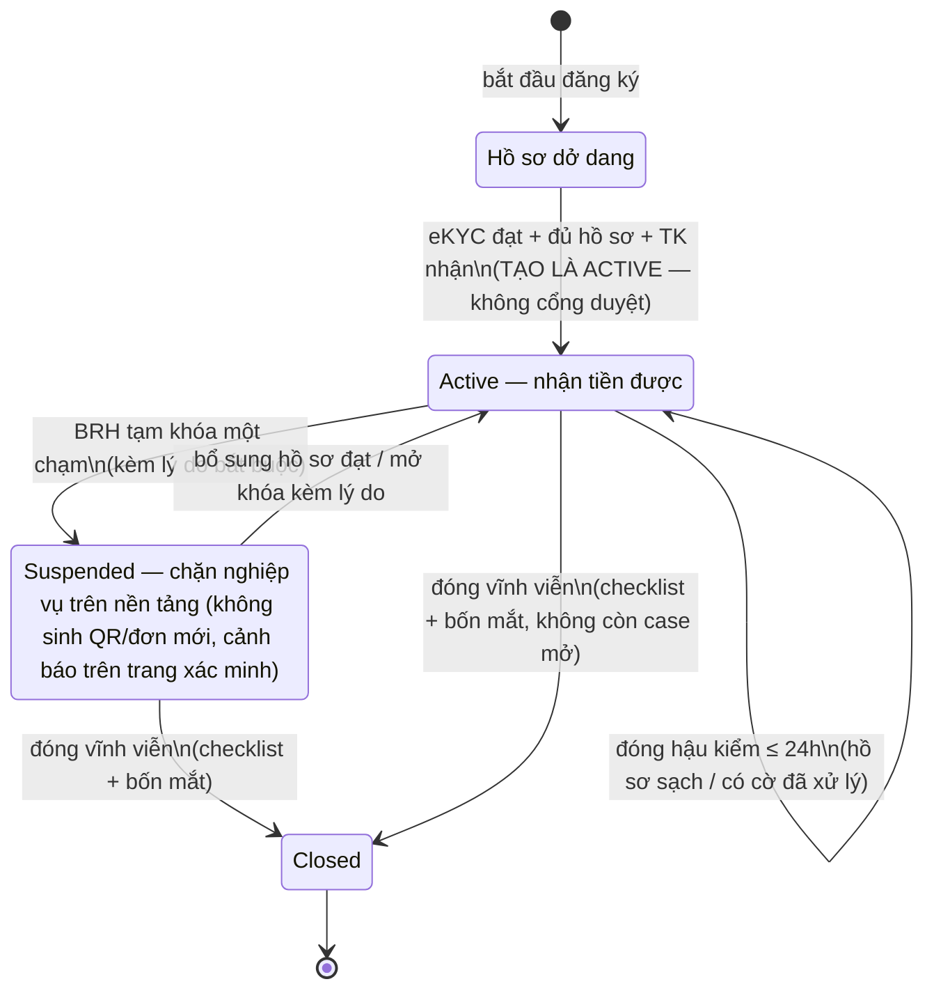

### 9.3. Vòng đời đơn tính tiền

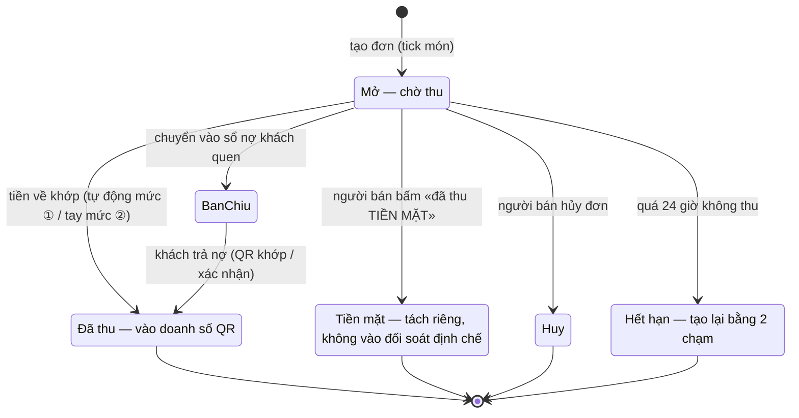

### 9.4. Vòng đời lệnh trả (thanh toán trong app)

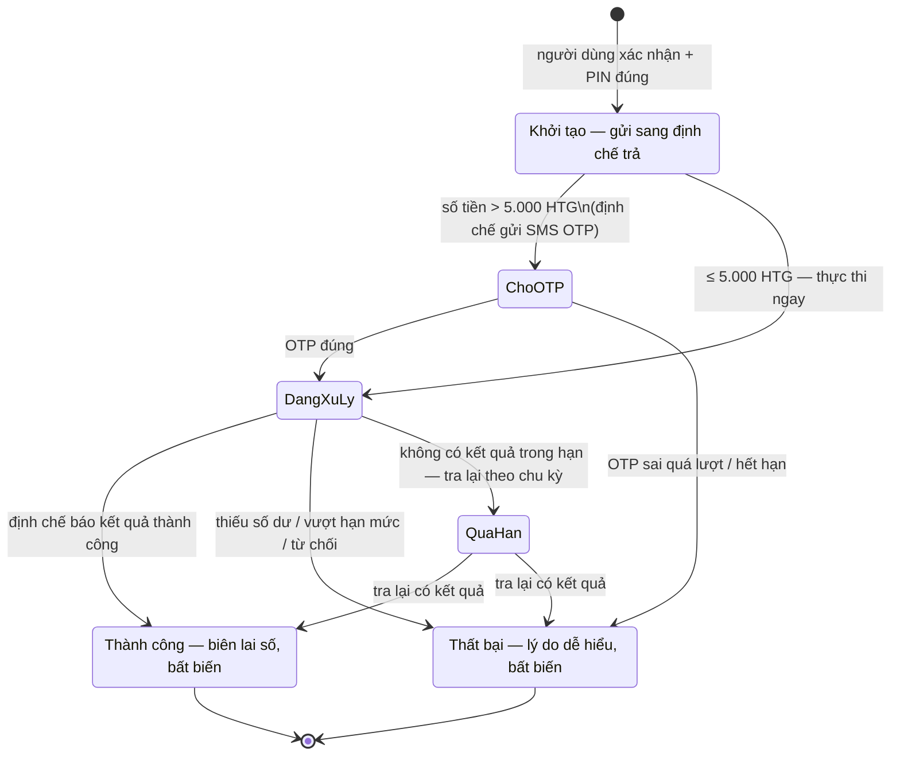

### 9.5. Vòng đời liên kết tài khoản

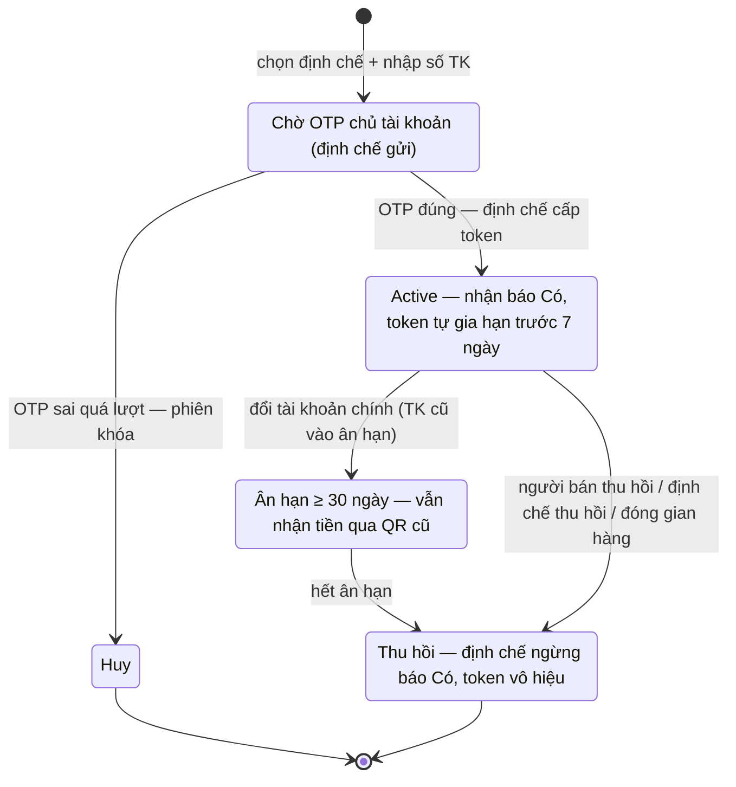

---

## 10. CÁC YÊU CẦU PHI CHỨC NĂNG

### 10.1. Yêu cầu bảo mật hệ thống — ATTT

- **Kênh đối tác:** mTLS chứng chỉ riêng từng đối tác + VPN site-to-site + IP allowlist (tầng hạ tầng, cấu hình một lần theo hồ sơ kết nạp).
- **Tầng ứng dụng:** thẻ hệ thống JWT tự ký (ES256) kiêm hash SHA-256 của body request; response tài chính ký thẻ cùng định dạng; khóa công khai công bố qua JWKS, xoay khóa chồng lấp 7 ngày.
- **Người dùng cuối:** PIN lưu băm Argon2id, khóa 60 phút sau 5 lần sai; OTP có hạn và giới hạn lượt; thiết bị mới bắt xác thực lại; hai bậc xác thực thanh toán theo ngưỡng 5.000 HTG.
- **Quản trị:** 2FA bắt buộc; RBAC 5 vai trò; bốn mắt cho thao tác nhạy cảm; nhật ký kiểm toán bất biến (chuỗi hash).
- **Dữ liệu:** token liên kết mã hóa envelope trong kho khóa (Vault), không bao giờ ghi log; số tài khoản đầy đủ mã hóa, chỉ hiển thị bản che; nguyên tắc «3 KHÔNG» với dữ liệu đẩy ra ngoài.
- **Kiểm thử xâm nhập** độc lập chuẩn OWASP ASVS L2 trước khai trương; lỗi nghiêm trọng phải xử lý xong trước go-live.

**Phân mức nguy cơ ATTT:**

| Mức độ | Nguy cơ cụ thể của hệ thống |
|---|---|
| Nghiêm trọng | Chiếm token liên kết để rút thông tin tài khoản; giả mạo webhook báo Có để gạch đơn khống; sửa nội dung lệnh trả trên đường truyền; lộ kho token/khóa ký |
| Cao | QR dán đè tại quầy (chặn bằng tên xác minh + tham chiếu đích danh); phát lại bản tin báo Có; chiếm phiên portal BRH; SIM-swap chiếm tài khoản người bán |
| Trung bình | Dò quét API công khai (rate-limit theo IP); lạm dụng OTP/SMS (giới hạn 5 OTP/ngày/số); nhân viên nội bộ tra cứu ngoài thẩm quyền (RBAC + nhật ký phiên tra cứu) |
| Thấp | Lộ metadata qua trang công khai (chỉ dữ liệu công khai); từ chối dịch vụ mức ứng dụng (circuit breaker, backpressure) |

### 10.2. Yêu cầu sao lưu

Ảnh chụp toàn phần hằng ngày + nhật ký giao dịch đẩy liên tục 5 phút/lần về lưu trữ đối tượng; giữ bản ngày 30 ngày — tuần 12 tuần — tháng 12 tháng; bật phiên bản hóa chống xóa nhầm; khôi phục được về bất kỳ thời điểm nào trong 30 ngày. Ước lượng dung lượng theo sizing Production ~15 TB.

### 10.3. Yêu cầu về tính ổn định

Mức sẵn sàng mục tiêu ≥ 99,5%/tháng ngoài cửa sổ bảo trì báo trước; RPO ≤ 15 phút; RTO ≤ 8 giờ (dựng lại từ hạ tầng khai báo bằng mã + phục hồi sao lưu); diễn tập khôi phục bắt buộc trước khai trương và tối thiểu 6 tháng/lần; mọi lớp trọng yếu có dự phòng nóng trong site (PostgreSQL đôi đồng bộ, Kafka 3 bản sao, cân bằng tải kép).

### 10.4. Yêu cầu về hiệu năng

| KPI | Chức năng nghiệp vụ | Giá trị cần đạt | Đơn vị đo |
|---|---|---|---|
| Response time | Báo tiền về tới app người bán («ting ting») — CN-05/CN-30 | ≤ 5 (P95), điều kiện webhook định chế đạt chuẩn công bố | giây |
| Response time | Xác nhận kết quả trả cho người mua — CN-08 | ≤ 3 (P95) từ khi bấm xác nhận | giây |
| Response time | API phục vụ ứng dụng (màn hình chính) | ≤ 1,5 (P95) mỗi request | giây |
| Throughput | Tiếp nhận báo Có — CN-30 | 50 bền vững (≈ 2,5 lần đỉnh dự phóng 5.000 người bán) | giao dịch/giây |
| Throughput | API ứng dụng | 300 (thiết kế, ≈ 3 lần đỉnh dự phóng) | request/giây |
| Concurrency | Người dùng ứng dụng giờ cao điểm chợ | 5.000 người bán hoạt động; *[Giả định]* ~800 phiên đồng thời | phiên |
| CPU usage | Mọi dịch vụ tại tải thiết kế | *[Giả định]* ≤ 70% trung bình cụm | % |
| RAM usage | Mọi dịch vụ tại tải thiết kế | *[Giả định]* ≤ 75% trung bình cụm | % |

Kiểm chứng bằng bài kiểm thử tải trên UAT (50 giao dịch/giây báo Có + 300 request/giây API) trước khai trương.

### 10.5. Yêu cầu về giao tiếp

**Giao diện người dùng:** ứng dụng PWA chạy Android và iOS, cài từ web; đa ngôn ngữ tối thiểu tiếng Pháp + Kreyòl Ayisyen (bộ thiết kế hiện có 4 ngôn ngữ); ưu tiên ngoại tuyến (đọc QR, xem/tạo đơn khi mất mạng, đồng bộ lại khi có mạng); tương thích điện thoại phổ thông cấu hình thấp và vùng sóng 2G; bố cục 42 màn theo bộ đặc tả màn hình tại Phụ lục MOU A.3; thiết kế đồ họa chính thức theo bộ nhận diện BRH bàn giao (Figma).

**Giao tiếp phần cứng:** không có thiết bị phần cứng chuyên dụng — camera điện thoại quét QR; standee QR in giấy theo mẫu chốt với BRH; không kết nối POS/EDC trong phạm vi footprint.

**Giao tiếp phần mềm bên ngoài:**

| Hệ thống | Giao diện | Chiều | Ghi chú |
|---|---|---|---|
| Định chế nhận (wallet2 + 1 ngân hàng) | Open Banking: liên kết ×5, số dư, lịch sử, webhook báo Có | Hai chiều | SLA báo Có theo chuẩn công bố; hàng đợi gửi bù |
| Định chế trả (wallet2 pilot) | M-PAY: khởi tạo trả, trạng thái, xác nhận OTP, webhook kết quả | Hai chiều | OTP bậc hai qua SMS GW của định chế |
| BRH-System | E1 eKYC · E2 sàng lọc | Nền tảng gọi ra | Quota theo BRH cấp; E2 lỗi không chặn kích hoạt |
| Switch/ACI | E3 báo cáo cuối ngày · đăng ký danh mục tài khoản | Hai chiều | File ký số; SFTP dự phòng |
| SMS Natcom | N1 gửi SMS + báo phát DLR | Nền tảng gọi ra | Brandname PEYE-HAITI |

### 10.6. Yêu cầu về tính hỗ trợ

Hỗ trợ vận hành sau pilot 6 tháng theo SLA ba mức: Mức 1 (ngừng dịch vụ/sai lệch tiền) tiếp nhận ≤ 30 phút, khắc phục ≤ 4 giờ, trực 24/7; Mức 2 tiếp nhận ≤ 2 giờ, khắc phục ≤ 8 giờ làm việc; Mức 3 tiếp nhận ≤ 1 ngày, khắc phục ≤ 3 ngày làm việc; chuẩn đạt ≥ 95% sự cố mỗi mức trong SLA. Kênh: hotline + email + hệ thống ghi nhận sự cố; hotline người dùng cuối 8686 (Natcom).

### 10.7. Yêu cầu về công nghệ và các ràng buộc

- Kiến trúc dịch vụ trên Kubernetes; PostgreSQL (Production chạy đôi đồng bộ); Kafka; Redis; MinIO; hạ tầng khai báo bằng mã (dựng lại toàn bộ từ mã nguồn hạ tầng).
- Ứng dụng công nghệ PWA (quyết định đã chốt; phát hành native lên cửa hàng ứng dụng xử lý theo quản lý thay đổi).
- Chuẩn QR: HTQR 1.0 trên nền EMVCo, đọc ngoại tuyến; mọi thay đổi chuẩn sau ban hành là yêu cầu thay đổi.
- Ràng buộc: nền tảng không giữ tiền, không có tài khoản tiền; ngưỡng hai bậc xác thực 5.000 HTG chuẩn hóa toàn hệ thống; tiền tệ HTG, đơn vị lưu trữ centime.

### 10.8. Các yêu cầu tài liệu người dùng và hỗ trợ trực tuyến

Bộ tài liệu bàn giao: hướng dẫn sử dụng ứng dụng (đa ngôn ngữ, kèm tài liệu đào tạo đội hiện trường), hướng dẫn portal BRH, hướng dẫn console vận hành, bộ tài liệu tích hợp cho định chế (hướng dẫn từng bước + ví dụ bản tin đầy đủ toàn luồng); trợ giúp trong ứng dụng ở các màn nghiệp vụ chính. *[Giả định]* Không yêu cầu hệ thống help-desk trực tuyến riêng trong phạm vi footprint.

### 10.9. Các thành phần mua ngoài

Chứng thư số/chứng chỉ kênh truyền của bên thứ ba; brandname SMS. Các thành phần nền tảng dùng mã nguồn mở (Kubernetes, PostgreSQL, Kafka, Redis, MinIO, Keycloak, Vault) — không phát sinh chi phí bản quyền. Phí SMS vận hành và kênh truyền nằm ngoài phạm vi tài liệu này (phân bổ tại hợp đồng chính).

### 10.10. Yêu cầu về vận hành khai thác

- Giám sát — quan trắc tập trung (metrics, log, trace) với bảng cảnh báo theo ngưỡng cấu hình; trực ban tích hợp qua console vận hành.
- Các job nền bắt buộc: gia hạn token (trước hạn 7 ngày), quét trạng thái lệnh treo, quét bù lịch sử khi webhook gián đoạn, dọn đơn/lệnh quá hạn, đối soát phiên, kiểm tra nhật ký hash hằng đêm.
- Quy trình phát hành có kiểm soát (CI/CD), môi trường UAT — Sandbox — Production tách biệt; tham số vận hành thay đổi qua cơ chế bốn mắt.
- Runbook sự cố cho các kịch bản: định chế gián đoạn webhook (chuyển quét bù), Switch trễ báo cáo, nghẽn SMS, khóa bị thu hồi khẩn.

### 10.11. Yêu cầu về giải pháp hạ tầng

Ba môi trường, tổng 33 VM · ~134 vCPU · ~492 GB RAM · ~17 TB: **Production** 24 VM (88 vCPU/396 GB/~15 TB, mọi lớp trọng yếu dự phòng nóng trong site); **UAT** 8 VM (38 vCPU/80 GB/~1,9 TB) — môi trường BRH nghiệm thu; **Sandbox** = phân vùng trên cụm UAT + 1 VM bổ sung, cách ly dữ liệu hoàn toàn. Chưa bao gồm trung tâm dữ liệu dự phòng địa lý (bổ sung theo yêu cầu chính thức, không đổi kiến trúc). Trách nhiệm đầu tư và vận hành hạ tầng phân bổ tại hợp đồng chính.

### 10.12. Yêu cầu về tính ghi log

Log nghiệp vụ phải ghi: mọi sự kiện tài chính (báo Có, khớp lệnh, lệnh trả, điều chỉnh) với khóa tham chiếu xuyên hệ thống; mọi thao tác quản trị trên portal/console (kèm giá trị trước/sau); mọi phiên tra cứu dữ liệu giao dịch; mọi quyết định hậu kiểm/case kèm người quyết định; sự kiện an ninh (đăng nhập kể cả thất bại, thu hồi khóa, thay tham số).

| Trọng số | Loại tác động | Ví dụ |
|---|---|---|
| Cao | Thao tác lên dữ liệu tiền và trạng thái tài chính | Điều chỉnh bút toán, xác nhận khớp tay, kết luận hoàn tiền, thu hồi liên kết, đổi tài khoản chính |
| Trung bình | Thao tác lên hồ sơ và quyền | Đóng hậu kiểm, tạm khóa gian hàng, gán vai trò, thay tham số |
| Thấp | Truy vấn, xuất dữ liệu | Tra cứu giao dịch, xuất báo cáo |

Nhật ký kiểm toán quản trị dạng bất biến (chuỗi hash, job kiểm tra hằng đêm), lưu tối thiểu 10 năm (đề xuất C17); log kỹ thuật lưu theo chính sách vận hành, tối thiểu 12 tháng *[Giả định]*; log không có quy định riêng thì mặc định không xóa.

### 10.13. Yêu cầu tuân thủ tiêu chuẩn Quản trị dữ liệu

**Danh mục phần tử dữ liệu trọng yếu (CDE):**

| Tên trường | Mô tả | Bảng dữ liệu | Trường dữ liệu | Loại | Chủ sở hữu |
|---|---|---|---|---|---|
| Mã người bán | Định danh gian hàng toàn hệ thống | merchant | merchant_code | Chuỗi | BRH |
| Số tài khoản nhận | Tài khoản liên kết (mã hóa + bản che + HMAC tra cứu) | account_link | account_no_enc / _masked | Chuỗi mã hóa | BRH |
| Số tiền giao dịch | Giá trị ghi Có/lệnh trả, centime HTG | credit_event · payment | amount_ct | Số nguyên 64-bit | BRH |
| Mã sự kiện báo Có | Khóa khử trùng toàn cục | credit_event | event_id | Chuỗi | BRH |
| Mã tham chiếu Switch | Truy vết giao dịch liên định chế | credit_event | ref_id | Chuỗi | BRH |
| Số điện thoại người dùng | Danh tính kênh liên lạc | person | msisdn | Chuỗi E.164 | BRH |
| Số định danh CIN | Định danh công dân (mã hóa) | hồ sơ eKYC | cin_no | Chuỗi mã hóa | BRH |

**Bảo mật dữ liệu** (TC.CNVTQĐ.QTDL.01): dữ liệu nhạy cảm (token, số tài khoản, CIN, ảnh định danh) mã hóa khi lưu (envelope AES-256-GCM, khóa chủ trong Vault, xoay 12 tháng) và khi truyền (TLS 1.2+/mTLS); toàn bộ dữ liệu nghiệp vụ thuộc sở hữu BRH; quyền kiểm toán an ninh của BRH ghi tại hợp đồng.

**Chất lượng dữ liệu** (TC.CNVTQĐ.QTDL.02): đối soát số liệu ba nguồn (nền tảng — định chế — Switch) theo phiên ngày, chênh lệch phân loại và đóng ≤ 2 ngày làm việc; số liệu hiển thị giữa các màn cùng kỳ phải nhất quán (két tiền — báo cáo — giám sát).

**Siêu dữ liệu** (TC.CNVTQĐ.QTDL.04.6): từ điển dữ liệu 28 bảng/306 trường là siêu dữ liệu chuẩn, cập nhật đồng bộ với thay đổi lược đồ; danh mục 25 tham số hệ thống (TSD §13.3) có mô tả, khoảng giá trị và cơ chế duyệt.

**Lưu trữ và vận hành** (TC.CNVTQĐ.QTDL.03): dữ liệu giao dịch lưu trực tuyến tối thiểu theo vòng đời pilot + 10 năm nhật ký kiểm toán (đề xuất C17; ảnh định danh 5 năm sau khi đóng gian hàng); ảnh định danh lưu ở kho đối tượng mã hóa, không chia sẻ ra hệ thống ngoài.

---

## 11. TIÊU CHUẨN NGHIỆM THU HỆ THỐNG

Nghiệm thu trên môi trường UAT theo bộ tiêu chí nghiệm thu (AC) của tài liệu PRD, theo phạm vi từng giai đoạn; kèm các điều kiện hệ thống: bài kiểm thử tải đạt 50 giao dịch/giây; kiểm thử xâm nhập không còn lỗi nghiêm trọng; diễn tập khôi phục đạt RPO/RTO. Các chức năng là điều kiện nghiệm thu:

| STT | Chức năng nghiệm thu |
|---|---|
| 1 | CN-01 · Đăng ký, chọn vai & định danh (tạo là active — kích hoạt ngay khi đủ điều kiện) |
| 2 | CN-03 · Liên kết tài khoản nhận 2 bước với OTP định chế |
| 3 | CN-04 · Sinh QR tĩnh/động đúng chuẩn HTQR 1.0 (đạt bộ vector hợp chuẩn) |
| 4 | CN-05 + CN-30 · Báo Có, khớp lệnh 2 mức và «ting ting» ≤ 5 giây (P95) |
| 5 | CN-06 · Đơn tính tiền — tổng tính máy, gạch tự động theo mã đơn |
| 6 | CN-07 · Sổ nợ ngoại tuyến và gạch nợ gắn chứng cứ |
| 7 | CN-08 · Thanh toán hai bậc (PIN ≤ 5.000 HTG; PIN + OTP định chế > 5.000 HTG), kết quả ≤ 3 giây (P95) |
| 8 | CN-09 + CN-19 · Khiếu nại từ app tới kết luận trên portal; hoàn tiền có xác minh bút toán |
| 9 | CN-14 · Chuyển vai «Trở thành người bán» trong cùng ứng dụng — **nghiệm thu SAU PILOT** (nút nâng cấp hoãn; trong pilot đổi vai qua kênh hỗ trợ, không chặn gate pilot) |
| 10 | CN-17 · Hậu kiểm gian hàng trong 24 giờ với cờ ưu tiên và lấy mẫu |
| 11 | CN-16 + CN-18 · Giám sát thời gian thực và truy vết chuỗi giao dịch |
| 12 | CN-20 · Cảnh báo giao dịch bất thường theo ngưỡng cấu hình |
| 13 | CN-22 + CN-23 · Nhật ký bất biến; quản trị bốn mắt |
| 14 | CN-25 → CN-28 · Đầu nối OB, giám sát tích hợp, đối soát và xử lý chênh lệch |
| 15 | CN-35 → CN-38 · Bộ chuẩn OB: một định chế ngoài nhóm khởi đầu tự tích hợp trên sandbox và được chứng nhận (hoặc biên bản kiểm thử trên trình giả lập nếu sau 60 ngày chưa có định chế đăng ký) |
| 16 | CN-39 → CN-42 · Tích hợp E1/E2/E3/N1 hoạt động theo kịch bản UAT |

Loại trừ khỏi điều kiện nghiệm thu (tiện ích hỗ trợ): CN-11 báo cáo doanh số dạng biểu đồ nâng cao, CN-12 tùy biến phân loại thông báo — nghiệm thu ở mức có chức năng hoạt động.

---

## 12. RỦI RO, PHỤ THUỘC & GIẢ ĐỊNH

### 12.1. Rủi ro chính

| Rủi ro | Mức | Giảm thiểu |
|---|---|---|
| Định chế nhận chậm webhook báo Có | Cao | SLA ký sớm trong phụ lục hợp đồng; lưới đỡ quét bù lịch sử 5 phút; xác nhận tay khi cần |
| Dịch vụ eKYC (E1) trễ hoặc gián đoạn | Cao | Duyệt tay ảnh giấy tờ; hàng đợi; tự động hóa lại khi phục hồi |
| Chuẩn QR quốc gia ban hành trễ | Trung bình | Payload theo bộ chuẩn Napas sẵn có; pilot nội bộ với wallet2 trước |
| Gian lận đổi SIM chiếm tài khoản | Cao | Đổi tài khoản nhận yêu cầu OTP của chủ tài khoản mới (định chế xác thực); khóa khẩn hotline 8686 thu hồi phiên ≤ 60 giây |
| Người bán bỏ cuộc sau đăng ký | Cao | Đăng ký hộ tại chợ; sổ nợ/tính tiền là giá trị dùng hằng ngày; hotline |
| Số liệu lệch giữa các bên | Trung bình | Chốt theo ngày đối soát; hàng đợi chênh lệch đóng ≤ 2 ngày làm việc |

### 12.2. Phụ thuộc (D1 → D11)

| # | Phụ thuộc | Hạn | Chủ trì |
|---|---|---|---|
| D1 | Chuẩn QR quốc gia (HTQR 1.0) + danh mục mã định chế/MCC ban hành | 31/7/2026 | BRH (VDS tư vấn) |
| D2 | Bộ API Open Banking + SLA (wallet2 + 1 ngân hàng), kèm phụ lục M-PAY (chiều trả) + năng lực SMS OTP của định chế trả | Ký T7/2026; phụ lục M-PAY trước khi bật chiều trả | Natcom/VDS |
| D3 | Đặc tả + sandbox eKYC E1 | T7/2026 | BRH |
| D4 | Mẫu standee & quy trình in theo đợt kích hoạt | Trước T9/2026 | BRH·VDS |
| D5 | Phê phí pilot = 0 + chính sách giám sát hạn mức | Trước 31/7/2026 | BRH |
| D6 | Brandname SMS Peye-Haiti + bộ mẫu tin đăng ký trước | T8/2026 | Natcom |
| D7 | Hotline 8686 + đội hiện trường đào tạo theo chợ | T9/2026 | Natcom |
| D8 | Danh bạ trực ban 3 bên + số leo thang | Trước go-live | 3 bên |
| D9 | wallet2 (bên trả) quét & trả QR chuẩn quốc gia trên môi trường thật | Trước go-live | Natcom |
| D10 | Đặc tả + lịch báo cáo cuối ngày từ Switch (E3) | T8/2026 | BRH/ACI |
| D11 | Chốt danh sách chợ & phân bổ 601 người bán | T8/2026 | BRH·Natcom |

### 12.3. Giả định

- *[Giả định]* ~800 phiên đồng thời giờ cao điểm; CPU ≤ 70% và RAM ≤ 75% trung bình cụm tại tải thiết kế.
- *[Giả định]* Log kỹ thuật lưu tối thiểu 12 tháng; không yêu cầu help-desk trực tuyến riêng trong footprint.
- *[Giả định]* Áp chuẩn ATTT nội bộ đang dùng cho các sản phẩm hiện hữu ở những điểm chưa có quy định riêng của BRH.

### 12.4. Điểm chưa có thông tin (cần chốt)

| # | **[Chưa có thông tin]** | Cần trước |
|---|---|---|
| 1 | Danh mục mã định chế và bảng mã ngành nghề MCC chính thức do BRH cấp khi ban hành chuẩn QR (phụ thuộc D1) | Chốt kịch bản UAT phần sinh QR |
| 2 | SLA chính thức và phụ lục hợp đồng D2 (M-PAY + webhook kết quả) ký với định chế trả pilot | Nghiệm thu CN-08 hai bậc |
| 3 | Danh sách chợ và phân bổ 601 người bán pilot (D11) | Kịch bản nghiệm thu hiện trường |
| 4 | Mẫu biểu báo cáo định kỳ BRH (CN-21) — hiện dùng mẫu đề xuất | Đợt duyệt BRD |
| 5 | Ngưỡng cảnh báo AML chính thức theo Circulaire BRH-IF-2026-129 — hiện cấu hình theo ngưỡng đề xuất | Trước UAT |

---

## 13. LỘ TRÌNH

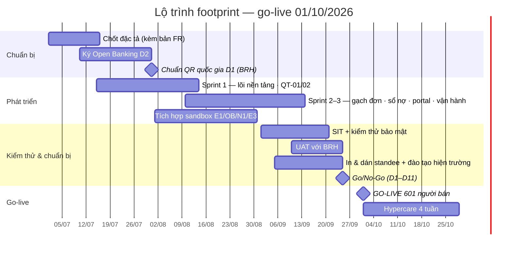

| Mốc | Nội dung |
|---|---|
| T7/2026 | Chốt đặc tả; chuẩn QR 31/7 (D1); ký D2; nhận D3; phát triển sprint 1 |
| T8/2026 | Sprint 2–3; sandbox E1/N1/OB/E3; phê phí pilot (D5) |
| T9/2026 | SIT + bảo mật; UAT với BRH; in & phát standee; đào tạo hiện trường; diễn tập trực ban |
| 01/10/2026 | GO-LIVE 601 người bán · 3 thành phố; hypercare 4 tuần |
| T11–12/2026 | Vận hành ổn định; báo cáo KPI; khuyến nghị mở rộng |

---

## PHỤ LỤC A. Ánh xạ chức năng ↔ tài liệu sản phẩm/kỹ thuật

| Phân hệ | Chức năng BRD | Epic PRD | Quy trình | Đặc tả kỹ thuật |
|---|---|---|---|---|
| PH-01 | CN-01, CN-02, CN-14 | EP-1 (đăng ký), EP-10 (an toàn) | QT-01 | API Spec nhóm E (BFF app) · luồng S1 |
| PH-01 | CN-03, CN-10 | EP-1 | QT-01 | API Spec nhóm C (Open Banking) · luồng S4 |
| PH-01 | CN-04, CN-05, CN-06, CN-07, CN-11 | EP-2, EP-3, EP-4, EP-5 | QT-02 | Luồng S2 (tiền về — gạch đơn) |
| PH-01 | CN-08, CN-09 | EP-11 (thanh toán mọi vai) | QT-03 | Luồng S9 · nhóm M-PAY |
| PH-02 | CN-15 → CN-24 | EP-6, EP-7, EP-8 | QT-04, QT-05 | API Spec nhóm E (portal) |
| PH-03 | CN-25 → CN-28 | EP-9 | QT-06 | Luồng đối soát · E3 |
| PH-04 | CN-29 → CN-34 | (năng lực nền) | — | SSD 4 dịch vụ/12 module · TSD 28 bảng |
| PH-05 | CN-35 → CN-38 | (chuẩn kết nối) | QT-07 | API Spec mục A.1b, C, F.3, F.4 |
| PH-06 | CN-39 → CN-42 | (tích hợp) | — | API Spec nhóm D (E1/E2/E3/N1) |

---

## BẢNG GHI NHẬN THAY ĐỔI

| Ngày | Vị trí | A/M/D | Nguồn gốc | PB cũ | Mô tả | PB mới |
|---|---|---|---|---|---|---|
| 24/08/2026 | Toàn bộ | A | Tổng hợp từ bộ tài liệu thiết kế (PRD 4.4 · SSD v5.1b · TSD v4.5b · API Spec v3.6 · Phụ lục MOU) | — | Khởi tạo tài liệu — toàn bộ các phân hệ, kèm sơ đồ quy trình và vòng đời trạng thái | 1.0 |
| 24/08/2026 | Mục 1.4 · trang đầu | M | Đồng bộ phiên bản tài liệu thiết kế sau chốt 5 câu hỏi tích hợp | 1.0 | Tham chiếu cập nhật: PRD 5.0 · TSD v4.6 · API Spec v3.7 | 1.0 |
