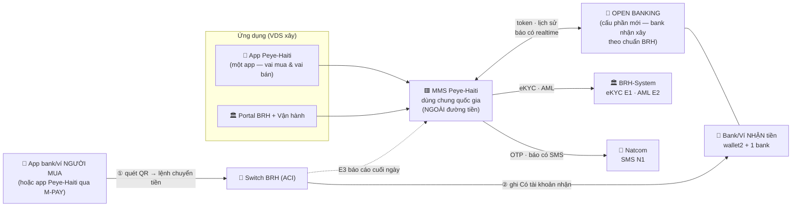
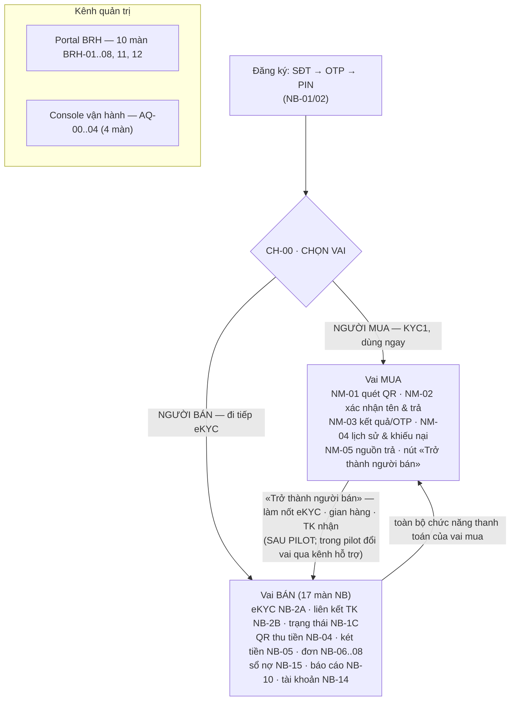
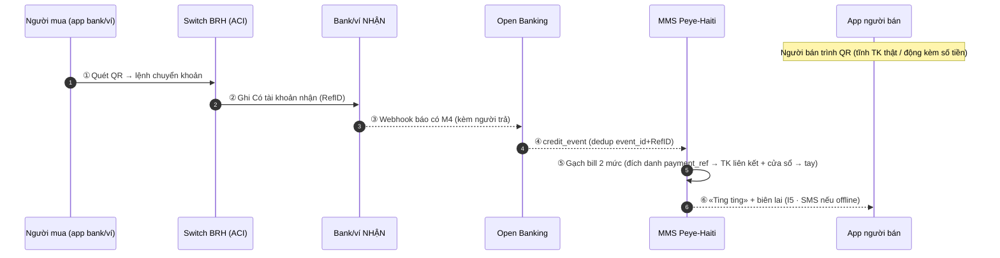
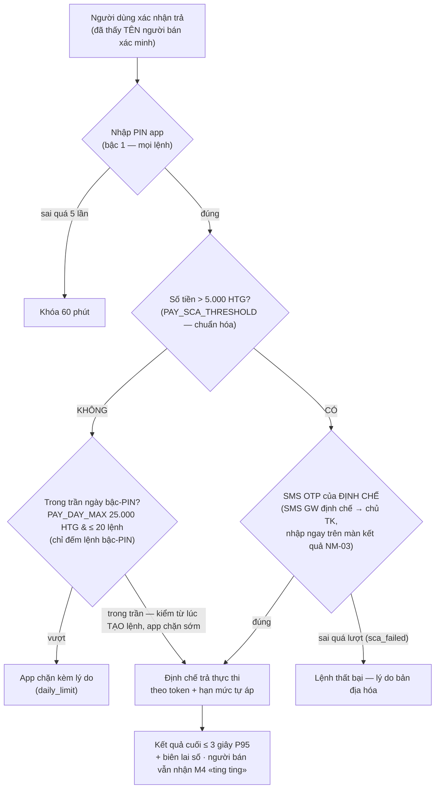
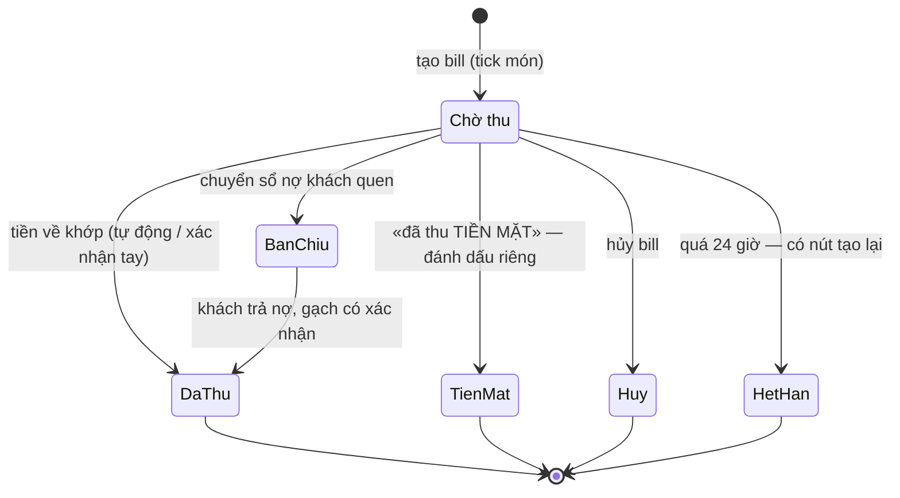
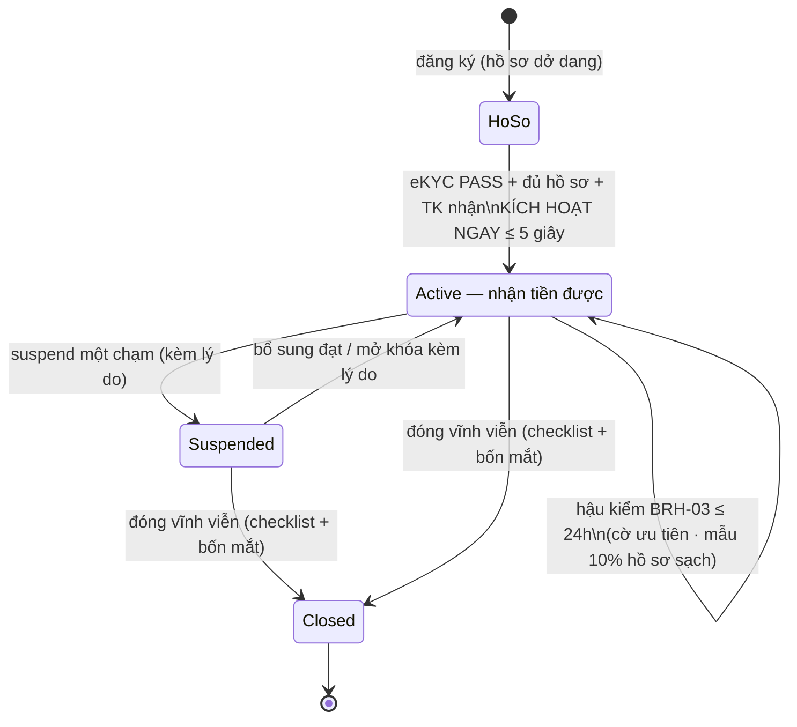
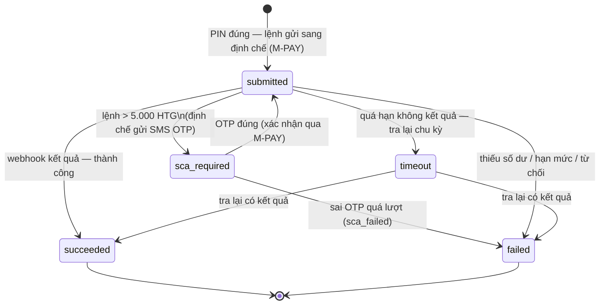
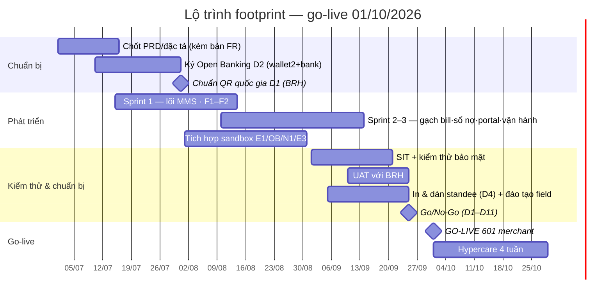

# PRD — Tài liệu Yêu cầu Sản phẩm · Giải pháp Merchant Peye-Haiti (footprint 10/2026)

| Trường | Nội dung |
|---|---|
| Mã tài liệu | Peye-Haiti-PRD-001 |
| Phiên bản | **5.0** — 24/08/2026 (bản trình bày lại đầy đủ trên nền 4.4 — **không thay đổi quyết định**; lịch sử xem Bảng ghi nhận thay đổi cuối tài liệu) |
| Người lập | VDS — Kiến trúc giải pháp |
| Người duyệt | BRH (chủ đầu tư) · Natcom (đầu mối) · VDS |
| Tài liệu liên quan | `PeyeHaiti_Wireframes.html` (42 màn, prototype tương tác VI/FR/EN/HT) · `PeyeHaiti_SSD.md` (thiết kế hệ thống) · `PeyeHaiti_TSD.md` (thiết kế kỹ thuật) · `PeyeHaiti_API_Spec.md` v3.7 (đặc tả API) · SOW 4/2026 · CV 52/CV-NCM_03 · bộ chuẩn Napas TCKT 2.0 (tham chiếu) |

---

## 1. Tóm tắt điều hành

Peye-Haiti là nền tảng thanh toán số quốc gia do **BRH** chủ trì, **Natcom** làm đầu mối triển khai, **VDS** xây dựng. Tài liệu này đặc tả yêu cầu sản phẩm cho **Giải pháp Merchant — footprint go-live 10/2026**: đưa **601 tiểu thương chợ tại 3 thành phố** lên nền tảng, nhận tiền bằng **QR chuyển khoản theo chuẩn quốc gia** (kế thừa bộ chuẩn Napas/EMVCo), kèm công cụ bán hàng: **sổ nợ, đơn tính tiền, danh mục sản phẩm, báo cáo**.

Kiến trúc chọn: **MỘT hệ thống quản lý điểm bán dùng chung quốc gia (MMS)** cho mọi bank/ví, VDS xây, BRH bảo trợ. **MMS nằm NGOÀI đường tiền**: tiền đi thẳng từ bank/ví người mua → Switch BRH (ACI) → tài khoản người bán tại bank/ví nhận; MMS biết tiền về qua **Open Banking của bank/ví nhận** (cấu phần xây mới theo chuẩn BRH ban hành). **BRH-System** cung cấp API eKYC/AML; **Natcom** cung cấp SMS.

Sản phẩm là **MỘT ứng dụng chung** theo mô hình BiMPay (ngân hàng trung ương bảo trợ một app thanh toán cho dân): sau đăng ký, người dùng **chọn vai** tại màn CH-00 (mua/bán); người bán có toàn bộ chức năng thanh toán của người mua, khác nhau chỉ ở nhóm menu quản lý bán hàng. Thanh toán trong app dùng **hai bậc xác thực**: ≤ 5.000 HTG chỉ PIN ứng dụng; > 5.000 HTG thêm SMS OTP do định chế gửi. Gian hàng theo mô hình **«tạo là active»**: kích hoạt ngay khi hoàn tất hồ sơ, BRH hậu kiểm sau.

> **Ngoài phạm vi footprint**: QR Pay theo đơn hàng qua Switch, tồn kho, web người bán — thuộc giai đoạn sau 10/2026.

### 1.1. Cách đọc tài liệu — quy ước mã (đọc mục này trước)

Tài liệu dùng 4 loại mã. Gặp mã ở bất kỳ đâu, tra ngược về bảng này:

| Loại mã | Ví dụ | Nghĩa |
|---|---|---|
| **Mã màn hình** | NB-04, BRH-03 | Một màn hình trong đặc tả tương tác (NB = app vai người bán, NM = màn thanh toán trong app, CH = màn chọn vai, BRH = portal BRH, AQ = màn vận hành, VI = ví bên trả). Bấm mở được trong `PeyeHaiti_Wireframes.html` |
| **Mã luồng** | F1…F9 | Một luồng nghiệp vụ đầu-cuối (mục 6) |
| **Mã tích hợp** | M4, E1, N1 | Một giao diện kết nối với đối tác (bảng đầy đủ ở mục 8). Nhóm **M** = bank/ví cung cấp; nhóm **E** = BRH cung cấp; nhóm **N** = Natcom cung cấp; **I** = năng lực nội bộ MMS |
| **Epic / User story** | EP-2 / US-10 | Nhóm tính năng / một yêu cầu người dùng (mục 7) |

**Nhóm M — bank/ví cung cấp, diễn giải nhanh (chi tiết mục 8):** M1 liên kết tài khoản & cấp quyền truy cập (token) · M1a gia hạn quyền · M1b thu hồi quyền · M3 đọc số dư & lịch sử giao dịch · **M4 = bank NHẬN báo tiền về theo thời gian thực** (nguồn của tiếng «ting ting»; do BANK NHẬN cung cấp, KHÔNG phải Switch/ACI — giao dịch on-us không qua Switch nên chỉ bank nhận biết ghi Có; phục hồi webhook sót = quét lịch sử M3 + đối soát E3) · **M-PAY = bank TRẢ nhận lệnh trả từ app Peye-Haiti** (khởi tạo, trạng thái, xác nhận OTP) · **M-PAY-hook = webhook kết quả trả**.

**Nhóm E — BRH cung cấp:** E1 = đối chiếu danh tính (eKYC ảnh CIN + selfie với dữ liệu ONI) · E2 = sàng lọc phòng chống rửa tiền · E3 = bảng kê cuối ngày từ Switch để đối soát.

**Nhóm N — Natcom cung cấp:** N1 = gửi SMS (mọi mạng, brandname Peye-Haiti). Lưu ý: **OTP thanh toán bậc hai KHÔNG đi qua N1** — do SMS GW của chính định chế trả gửi (điều kiện kết nạp).

**Khung KYC hài hòa quốc gia (văn bản BRH 12/08, Phần III.1):** KYC merchant của Peye-Haiti = **KYC2**; vai người mua = **KYC1** (chỉ OTP số điện thoại, KHÔNG eKYC/CIN) trong khung 3 bậc BRH: danh tính pháp lý + ảnh giấy tờ + selfie do E1 đối chiếu OCR/ONI · OTP gắn số điện thoại · kiểm tra tại định chế khi liên kết tài khoản (M1/OTP bank) · NIF bổ sung song song CIN · PersonID quốc gia là cột chờ `rni_person_id`, điền khi RNI vận hành. Người mua KYC1 **miễn sàng lọc E2 ở pilot** theo đúng khung KYC1 BRH (giao dịch nhỏ); kiểm soát thay thế = ngưỡng OTP `PAY_SCA_THRESHOLD` (bậc 2 của định chế) + trần ngày bậc-PIN `PAY_DAY_MAX` + hạn mức định chế theo KYC + AML hậu kiểm cả phía trả (theo người — `AML_DAY_FLAG`) lẫn phía nhận (theo merchant).

## 2. Bối cảnh & vấn đề

- Haiti là nền kinh tế tiền mặt: ~2/3 người trưởng thành chưa có tài khoản; tiểu thương (đặc biệt **Madan Sara**) thu chi hoàn toàn tiền mặt, không công cụ quản lý, rủi ro an ninh cao.
- BRH đặt số hóa khu vực này là ưu tiên số 1 (PSG 2026); **Switch BRH (ACI) go-live 30/6/2026** — lần đầu có «đường ray» QR chuyển khoản toàn quốc.
- BRH đề nghị Viettel/Natcom/VDS xây phân hệ ứng dụng + quản trị và tư vấn **chuẩn QR quốc gia kế thừa bộ chuẩn Napas** đã kiểm chứng tại Việt Nam.
- Ràng buộc sản phẩm: không máy tính, Android giá rẻ/điện thoại thường, mạng 2G, tiếng Pháp/Creole — sản phẩm phải có **lý do dùng hằng ngày** (sổ nợ, tính tiền), không chỉ là mã QR.

## 3. Mục tiêu & KPI

| Chỉ số | Mục tiêu pilot | Đo tại |
|---|---|---|
| Merchant kích hoạt (Pétion-Ville · Les Cayes · Cap-Haïtien) | 601 | BRH-08 (màn báo cáo KPI) |
| % dùng tích cực **theo tuần** (tử: merchant có ≥1 GD/tuần; mẫu: đã kích hoạt) | ≥ 50% | BRH-08 |
| GD bình quân / merchant / tuần | ≥ 3 | BRH-08 |
| Hoàn tất hồ sơ tự khai (đăng ký → nộp đủ eKYC + tài khoản) | < 10 phút | NB-01→NB-2B (funnel màn đăng ký) |
| Kích hoạt gian hàng | NGAY khi hoàn tất tạo (≤ 5 giây — không cổng duyệt) · hậu kiểm hồ sơ có cờ ≤ 24h | BRH-03 (màn hậu kiểm) |
| Độ trễ báo có (95% GD; T0 = bank ghi Có, T1 = app ack/SMS gửi) | ≤ 5 giây | AQ-00 (console vận hành) |
| Khả dụng dịch vụ | 99,5% | AQ-01 |
| Tỷ lệ gạch bill tự động | ≥ 95% | AQ-00 |

> Chính sách pilot: **phí giao dịch merchant = 0 G đến 31/12/2026** (phê tại D5, cấu hình qua API tham số E.13.x — vận hành Natcom, bốn mắt). Mục tiêu sau pilot (không cam kết): 5.000 merchant/12 tháng → 100.000 toàn quốc.

## 4. Phạm vi

### 4.1. Trong phạm vi

| Cấu phần | Nội dung | Số màn |
|---|---|---|
| App Peye-Haiti — vai người bán (PWA, FR/Creole, offline-first 2G) | đăng nhập & khóa khẩn · đăng ký · OTP/PIN · eKYC · liên kết TK nhận (token) · trạng thái hồ sơ · trang chủ · **QR chuyển khoản tĩnh/động** · báo có «ting ting» & biên lai · danh mục SP · **đơn tính tiền (tick món)** · đơn trong ngày · lịch sử & hoàn · báo cáo · **sổ nợ** · thông báo · tài khoản | 17 |
| App Peye-Haiti — màn chọn vai | CH-00: chọn vai mua/bán ngay sau OTP+PIN, TRƯỚC eKYC (vai mua vào app dùng ngay — KYC1) | 1 |
| App Peye-Haiti — thanh toán trong app (DÙNG CHUNG MỌI VAI — người bán cũng trả được) | quét QR & trả 1 chạm · xác nhận TÊN người bán trước khi trả · hai bậc xác thực (PIN ≤ 5.000 · +SMS OTP định chế > 5.000) · kết quả + biên lai số · lịch sử & khiếu nại · liên kết TK nguồn trả · trang công khai xác minh merchant (web P.1) · nút «Trở thành người bán» | 5 (NM-01..05 — **bật theo lộ trình BRH — §13**) |
| Portal BRH | đăng nhập 2FA · giám sát realtime · hậu kiểm hồ sơ mới & xử lý cờ (kích hoạt tức thời, không duyệt trước) · quản lý merchant (standee, khóa/đóng) · giám sát GD · case tra soát · cảnh báo AML · báo cáo KPI · audit · người dùng | 10 |
| Vận hành VDS | đầu nối Open Banking & kho token · sức khỏe tích hợp & trực ban · đối soát cuối ngày · xử lý chênh lệch | 4 |
| Ví liên thông (tham chiếu bên trả) | «1 mã QR — mọi ví quét được» + luồng quét/trả/biên lai | 5 |

**Tổng: 42 màn** (17 NB + 1 CH-00 + 5 NM + 10 BRH + 4 AQ + 5 VI tham chiếu) — toàn bộ đã có trong `PeyeHaiti_Wireframes.html`. *(Màn «Cấu hình tham số» BRH-09 đã bỏ: tham số do đội vận hành Natcom quản trị qua API E.13.x — bốn mắt, BRH phê duyệt giá trị bằng văn bản.)*

Kèm: **gạch bill 2 mức đã chốt làm** (① TK liên kết + khớp số tiền/cửa sổ — ưu tiên khớp ĐÍCH DANH theo `payment_ref` từ tra cứu B.5 → ② xác nhận tay); **standee in số TK thật đã liên kết (chuẩn VietQR)**; prototype tương tác 4 ngôn ngữ (VN/FR/EN/HT).

### 4.2. Ngoài phạm vi (sau 10/2026)

QR Pay qua Switch · tồn kho · web người bán · thu ngân đa người dùng · loyalty nâng cao · đặt hàng & đánh giá app người mua · Open Banking MonCash · hoàn tiền tự động qua Switch · trả theo số điện thoại/alias không quét QR (chờ HTQR v1.1 alias/RNI).

### 4.3. Quyết định đã chốt (Q1–Q9)

| # | Quyết định | Hệ quả |
|---|---|---|
| Q1 | MMS dùng chung quốc gia, BRH bảo trợ, VDS xây | Bank/ví không tự xây MMS |
| Q2 | MMS ngoài đường tiền; footprint chỉ QR Transfer | Không cần kết nối Switch cho giao dịch |
| Q3 | Chuẩn QR = kế thừa bộ Napas (EMVCo), ban hành trước 31/7/2026 | Napas có QR Transfer thì Haiti có |
| Q4 | **QR/standee chứa SỐ TK THẬT đã liên kết** (như VietQR VN) | In theo đợt kích hoạt; đổi TK → in lại, TK cũ grace 30 ngày |
| Q5 | Token consent: eKYC → liên kết (OTP chủ TK bank gửi) → token | Khung đàm phán Open Banking |
| Q6 | Hoàn tiền = merchant chuyển trả + case BRH-06 chốt «Đã hoàn» theo RefID | Một nguồn trạng thái |
| Q7 | **MỘT app, chọn vai tại CH-00** (trước eKYC); người bán thanh toán được như người mua | EP-11 áp dụng mọi người dùng; nút «Trở thành người bán» |
| Q8 | **TẠO LÀ ACTIVE** — kích hoạt ngay khi hoàn tất tạo (eKYC PASS + đủ hồ sơ + TK nhận), KHÔNG cổng duyệt trước | BRH-03 = danh sách hậu kiểm ≤ 24h + mẫu 10%; suspend một chạm |
| Q9 | **HAI BẬC XÁC THỰC**: ≤ 5.000 HTG (`PAY_SCA_THRESHOLD`) chỉ PIN app · > 5.000 PIN + SMS OTP ĐỊNH CHẾ gửi | Ngưỡng chuẩn hóa — định chế được chặt hơn, không được lỏng hơn; OTP qua SMS GW định chế |

**Giải thích Q4 — standee & số tài khoản trong QR**

- **Standee** = bảng mã QR đặt ở quầy tiểu thương; trong QR có số TK/ví **thật** mà merchant đã liên kết — mô hình VietQR đại trà tại VN (hàng triệu tiểu thương dùng).
- Merchant hiểu ngay «tiền về đúng số TK CỦA TÔI»; người mua quét thấy đúng tên chủ TK — minh bạch, dễ tin.
- **Đổi TK nhận** → sinh QR mới + in lại standee; trong lúc chưa thay, **TK cũ giữ liên kết ≥ 30 ngày (grace)** nên tiền quét QR cũ vẫn về + vẫn «ting ting», không mất giao dịch nào.
- TK có thể dùng chung với chi tiêu cá nhân → app có nút **«không phải doanh thu»** (US-40) loại khoản không bán hàng khỏi doanh số; số TK công khai tại quầy là thông lệ đại trà đã được thị trường VN kiểm chứng.
- Standee in **theo đợt kích hoạt**; app tự in QR giấy A5 dùng tạm trong lúc chờ standee.

## 5. Người dùng

| Persona | Đặc điểm & nhu cầu | Cấu phần |
|---|---|---|
| Tiểu thương / Madan Sara | Android giá rẻ/điện thoại thường, 2G, FR/Creole; cần «ting ting» tức thì, sổ nợ, tính tiền, không phí | App vai người bán (điện thoại thường: SMS báo có + field-agent hỗ trợ) |
| Người mua | Trả bằng **app Peye-Haiti** (chọn vai người mua ở CH-00; quét & trả, hai bậc PIN/OTP, biên lai số, khiếu nại) — KYC1 (OTP); nút «Trở thành người bán» để nâng cấp (sau pilot; trong pilot đổi vai qua kênh hỗ trợ); vẫn quét được bằng app bank/ví khác («1 QR mọi ví») | App Peye-Haiti (vai người mua) — thời điểm bật theo lộ trình BRH |
| Người bán (vai trong CÙNG app) | Toàn bộ chức năng người mua (THANH TOÁN được — trả nhà cung cấp, giao dịch bán-với-bán) + nhóm menu quản lý bán hàng (QR thu tiền, két tiền, đơn, sổ nợ, báo cáo) | App Peye-Haiti (vai người bán) |
| Bank/ví TRẢ (wallet2 pilot) | Cung cấp **M-PAY** khởi tạo trả + xác nhận OTP + webhook kết quả (phụ lục hợp đồng D2); gửi SMS OTP bậc hai bằng SMS GW của chính mình | Đầu nối OB |
| Cán bộ BRH | Hậu kiểm, giám sát, AML, khiếu nại, báo cáo | Portal BRH |
| Đội vận hành Natcom | Tham số hệ thống (maker/checker bốn mắt, BRH phê duyệt giá trị) | API E.13.x — không màn |
| Vận hành VDS | Trực 24/7 tích hợp, đối soát, chênh lệch | Màn AQ |
| Nhân viên field Natcom | Đăng ký hộ tại chợ, standee, đào tạo | Chế độ hỗ trợ + quy trình |
| Bank/ví NHẬN tiền (wallet2 + 1 bank) | Cung cấp Open Banking M1/M1a/M1b/M3/M4 theo SLA D2; giữ tài khoản nhận | Đầu nối OB (AQ-00) |

## 6. Luồng nghiệp vụ chính (F1–F9)

- **F1 · Onboarding («tạo là active»)**: đăng ký (SĐT) → OTP+PIN → **CH-00 chọn vai (TRƯỚC eKYC)** → [vai MUA: vào app ngay — KYC1] · [vai BÁN: eKYC E1 (CIN+selfie ↔ ONI) → khai gian hàng (tên · loại hình · chợ — nộp cùng E.2.2; mã field-agent lấy từ bước đăng ký) → liên kết TK nhận (M1 → OTP chủ TK → token) → **ACTIVE NGAY** + sinh QR & đặt lệnh in standee — KHÔNG cổng duyệt; hậu kiểm BRH sau]. Điện thoại thường: nhân viên field thao tác hộ.
- **F2 · Nhận tiền QR**: như sơ đồ trên; liên thông theo giai đoạn — tối thiểu **wallet2 bên trả** từ go-live (D9).
- **F3 · Đơn tính tiền**: tick món → tổng → Thu tiền (QR đúng tổng)/Bán chịu (sổ nợ)/Lưu chờ; lối thoát tiền mặt & hủy; hết hạn 24h.
- **F4 · Gạch bill 2 mức**: ① tự động — ưu tiên đích danh theo `payment_ref` (tra cứu B.5), không có thì TK liên kết + số tiền/cửa sổ → ② xác nhận tay.
- **F5 · Sổ nợ**: offline 100%; trả nợ qua QR gạch theo 2 mức (mặc định đề xuất, người bán xác nhận).
- **F6 · Biên lai qua SMS**: người bán gửi biên lai cho khách theo SĐT (SMS); người mua nhận SMS, không cần app.
- **F7 · Khiếu nại–hoàn**: case bám RefID; hoàn = chuyển trả + **xác minh bút toán** + case chốt; SLA đề xuất 24h/5 ngày làm việc.
- **F8 · Đối soát**: E3 theo phiên; lệch → quét M3 lấp khoảng / điều chỉnh bốn mắt / chuyển case; đóng ≤ 2 ngày làm việc.
- **F9 · An toàn tài khoản**: quên PIN → đặt lại bằng OTP về SIM đăng ký; mất máy → khóa khẩn qua hotline 8686 (thu hồi mọi phiên, QR vẫn nhận tiền); token nhắc gia hạn trước 7 ngày.

**Luồng quyết định hai bậc xác thực (áp cho mọi lệnh trả trong app — F đi kèm EP-11):**

## 7. Yêu cầu chức năng chi tiết — Epic · User story · Bước chức năng · UI/UX · Tiêu chí nghiệm thu

> Wireframe từng màn (bố cục, dữ liệu vào/ra, quy tắc màn hình) nằm trong **prototype tương tác** `PeyeHaiti_Wireframes.html` — bấm được như app thật, 4 ngôn ngữ (VN/FR/EN/HT). Mục này bổ sung tầng SẢN PHẨM: ai cần gì, làm theo bước nào, trải nghiệm ra sao, nghiệm thu bằng tiêu chí gì. **11 Epic · 42 user story · 46 acceptance criteria** (AC-1.1…AC-11.6 — EP-1: 6 · EP-2: 8 · EP-3: 5 · EP-4: 4 · EP-5: 1 · EP-6: 5 · EP-7: 3 · EP-8: 3 · EP-9: 3 · EP-10: 2 · EP-11: 6). Định dạng tiêu chí: **Cho** (bối cảnh) / **Khi** (hành động) / **Thì** (kết quả đo được).

### 7.0. Nguyên tắc UI/UX chung (áp cho mọi màn app di động)

| # | Nguyên tắc | Chi tiết bắt buộc |
|---|---|---|
| UX-1 | Dùng được bởi người ít chữ | Icon + màu + ÂM THANH đi kèm mọi trạng thái quan trọng; số tiền luôn cỡ chữ lớn (≥32sp ở màn QR/báo có); đọc số tiền bằng giọng nói Creole khi có tiền về (bật/tắt được) |
| UX-2 | Mạng yếu 2G | Mỗi màn tải ≤100KB; ảnh nén ≤200KB; thao tác ghi (bill, sổ nợ) phản hồi TỨC THÌ từ dữ liệu máy, đồng bộ nền sau |
| UX-3 | Trạng thái offline minh bạch | Băng rôn «● Đang offline — N mục chờ đồng bộ» + màn chi tiết hàng đợi (NB-14); không bao giờ hiện «đã thu tiền» khi chưa có báo có từ bank |
| UX-4 | Ngôn ngữ | Chọn FR/Creole ngay màn đầu tiên, đổi được ở NB-14 |
| UX-5 | Thao tác một tay, nút to | Vùng chạm ≥48dp; hành động chính là nút lớn dưới cùng; bàn phím số cho mọi ô tiền |
| UX-6 | Sai thì nói cách sửa | Mọi thông báo lỗi = lời thường + việc cần làm tiếp («Ảnh mờ — chụp lại ở chỗ sáng hơn»), không hiện mã lỗi kỹ thuật cho người bán |
| UX-7 | Điều hướng cố định | Menu đáy 4 tab (Trang chủ · Nhận tiền · Sổ nợ · Tôi); header có nút quay lại; luồng đăng ký không cho nhảy cóc |

### EP-1 · Đăng ký & mở quyền nhận tiền (F1 — màn NB-00→NB-1C, CH-00, BRH-03)

| US | User story | Màn | Ưu tiên |
|---|---|---|---|
| US-01 | Là tiểu thương, tôi muốn tự đăng ký gian hàng bằng số điện thoại trong <10 phút, để không phải ra quầy | NB-01/02 | Bắt buộc |
| US-02 | Là tiểu thương, tôi muốn chụp thẻ CIN + selfie để được xác minh danh tính, để được phép nhận tiền | NB-2A | Bắt buộc |
| US-03 | Là tiểu thương ĐÃ có ví wallet2/tài khoản bank, tôi muốn liên kết nó làm nơi nhận tiền, để dùng ngay | NB-2B | Bắt buộc |
| US-05 | Là tiểu thương, tôi muốn thấy hồ sơ đang ở bước nào (eKYC đang xử lý/cần chụp lại/đã kích hoạt — không còn trạng thái «chờ duyệt») | NB-1C | Bắt buộc |
| US-06 | Là nhân viên field Natcom, tôi muốn đăng ký hộ trên máy của tôi (gắn mã NAT-xxx), để phủ nhanh 601 merchant | NB-01 | Bắt buộc |
| US-46 | Là người dùng, tôi chọn VAI (mua/bán) ở màn CH-00 NGAY SAU bước OTP+PIN và TRƯỚC eKYC (eKYC chỉ hỏi vai bán); nút «Trở thành người bán» (làm nốt phần vai bán còn thiếu: eKYC bậc 2 nếu chưa · gian hàng · TK nhận — không lặp lại bước nào) **HOÃN SAU PILOT** — trong pilot, đổi vai qua kênh hỗ trợ/field agent | CH-00 · hồ sơ | Chọn vai: Bắt buộc · Nâng cấp: SAU PILOT |
| US-07 | Là cán bộ BRH, tôi muốn gian hàng ACTIVE NGAY khi tạo xong (không cổng duyệt) và các hồ sơ CÓ CỜ (điểm eKYC thấp/AML hit/E2 bù sau) được xếp hàng HẬU KIỂM ưu tiên với quyền suspend một chạm, để vừa không nghẽn vừa kiểm soát được | BRH-03 | Bắt buộc |

**Bước chức năng (happy path US-01→05):** 1) Nhập SĐT + mã NV hỗ trợ (tùy chọn) — KHÔNG khai gian hàng ở bước này → 2) Nhận OTP qua SMS (N1), nhập 6 số → 3) Tạo PIN 6 số ×2 → 3b) **CH-00 chọn vai** (mua: vào app dùng ngay — dừng tại đây; bán: đi tiếp) → 4) Chụp CIN mặt trước (khung căn tự động, chấm mờ tại máy) → 5) CIN mặt sau → 6) Selfie (chống giả mạo) → hệ thống gọi E1 đối chiếu ONI → 6b) Khai gian hàng: tên, loại hình, chọn chợ (danh mục vận hành seed & quản trị qua E.13.x) — nộp cùng E.2.2 → 7) Chọn nguồn nhận tiền: liên kết ví/bank có sẵn (bank gửi OTP tới chủ TK để xác nhận quyền sở hữu) → 8) OTP xác nhận từ bank → nhận quyền truy cập (token) → 9) **KÍCH HOẠT NGAY** (TẠO LÀ ACTIVE — không cổng duyệt), sinh QR (số TK thật) + đặt lệnh in standee; hồ sơ có cờ (điểm thấp/AML/E2 down) → VẪN active, vào danh sách hậu kiểm BRH-03 (≤24h); NB-1C theo dõi trạng thái → 10) SMS + thông báo «Gian hàng sẵn sàng nhận tiền» (phát ngay lúc kích hoạt).

**UI/UX riêng:** mỗi bước 1 việc, thanh tiến trình 3 chặng nhánh bán (Danh tính → Gian hàng → Tài khoản — khớp Bước 1/3·2/3·3/3 wireframes); ảnh CIN có ví dụ mẫu đúng/sai; nếu E1 chậm >10 giây hiện «Đang đối chiếu — bạn có thể để máy đó, xong sẽ báo».

**Tiêu chí nghiệm thu:**
- **AC-1.1** Cho người mới với CIN hợp lệ; Khi hoàn tất bước 1→8; Thì tổng thời gian thao tác ≤10 phút (đo funnel) và gian hàng ở trạng thái «kích hoạt» NGAY khi hoàn tất (không còn «chờ duyệt»).
- **AC-1.2** Cho ảnh CIN mờ; Khi E1 trả kết quả chất lượng kém; Thì NB-1C hiện yêu cầu «chụp lại» kèm SMS, và cho chụp lại không phải nhập lại thông tin.
- **AC-1.3** Cho người bán nhập số TK KHÔNG thuộc mình; Khi bấm liên kết; Thì bank gửi OTP tới SĐT chủ TK thật (không phải người bán) → người bán không có OTP → liên kết KHÔNG hoàn tất, KHÔNG cấp token (bank tự phán định quyền sở hữu, MMS không đối chiếu tên).
- **AC-1.4** Cho hồ sơ eKYC PASS + đủ gian hàng + TK nhận; Khi hoàn tất tạo; Thì merchant `active` NGAY (≤5 giây), sinh QR + lệnh in standee, KHÔNG qua hàng đợi duyệt; hồ sơ điểm thấp/AML hit/E2 chưa sàng lọc → VẪN active nhưng vào danh sách hậu kiểm ưu tiên (BRH xem ≤24h, suspend một chạm); hồ sơ sạch hậu kiểm mẫu 10%.
- **AC-1.5** Cho phiên đăng ký hộ bởi nhân viên NAT-014; Khi hồ sơ kích hoạt; Thì hồ sơ gắn mã NAT-014 và phiên trên máy nhân viên được đánh dấu riêng (`is_agent_session`) để truy vết, tách bạch với phiên của chính merchant.
- **AC-1.8** «NGHIỆM THU SAU PILOT (nút nâng cấp hoãn)» Cho người dùng vai người mua; Khi bấm «Trở thành người bán» và hoàn tất phần vai bán còn thiếu (eKYC bậc 2 nếu chưa có + gian hàng + TK nhận — kích hoạt tức thời, C10); Thì app chuyển giao diện vai người bán ≤5 giây sau khi merchant `active`, KHÔNG đăng ký/đăng nhập lại; toàn bộ chức năng thanh toán (EP-11) giữ nguyên.

### EP-2 · Nhận tiền bằng QR & báo có (F2 — NB-03/04/05, VI-01→04)

| US | User story | Màn | Ưu tiên |
|---|---|---|---|
| US-08 | Là tiểu thương, tôi muốn có mã QR TĨNH dán quầy (in số TK thật đã liên kết), để khách tự quét trả bất kỳ số tiền nào | NB-04 | Bắt buộc |
| US-09 | Là tiểu thương, tôi muốn tạo QR ĐỘNG kèm đúng số tiền, để khách khỏi gõ nhầm | NB-04 | Bắt buộc |
| US-10 | Là tiểu thương, tôi muốn nghe «ting ting» + xem biên lai NGAY khi tiền vào, để tin là đã nhận được tiền | NB-05 | Bắt buộc |
| US-11 | Là tiểu thương để máy ở nhà/hết pin, tôi muốn nhận SMS báo tiền về, để không lỡ giao dịch | NB-05/13 | Bắt buộc |
| US-12 | Là người mua dùng wallet2 (hoặc ví/bank khác đã nối Switch), tôi muốn quét mã Peye-Haiti và trả như chuyển khoản thường, để không phải cài thêm app | VI-01→04 | Bắt buộc (wallet2 — D9) |
| US-40 | Là tiểu thương dùng TK cá nhân để nhận, tôi muốn đánh dấu «không phải doanh thu» cho khoản người nhà chuyển, để báo cáo bán hàng không sai | NB-05/09 | Nên có |

**Bước chức năng (US-09→10):** 1) Trang chủ → «Nhận tiền» → 2) Gõ số tiền trên bàn phím số lớn (hoặc chọn món từ danh mục để tự điền) → 3) Màn QR: mã + số tiền cỡ lớn + tên gian hàng → 4) Khách quét bằng app bank/ví của họ, xác nhận → tiền đi thẳng vào tài khoản nhận của merchant qua Switch → 5) Bank nhận bắn «báo tiền về» (M4) kèm thông tin người trả → 6) App reo «ting» + rung + đọc to số tiền (Creole, nếu bật) + hiện biên lai (người trả, số tiền, giờ, mã tham chiếu); nếu app không phản hồi trong 60 giây → gửi SMS.

**UI/UX riêng:** màn QR tự tăng độ sáng tối đa; QR chiếm ≥60% màn; nút «Chia sẻ/In»; biên lai có nút «Gửi cho khách (SMS + app)» và «Báo sai giao dịch»; danh sách tiền về trong ngày cuộn ngay dưới nút tạo QR (mô hình «két tiền»).

**Quy tắc sinh QR (chốt):** «ting ting» đến từ báo có M4 khi tiền vào TK liên kết — MỌI loại QR (kể cả chuyển khoản không quét QR) đều có thông báo; API không bao giờ là điều kiện để thu được tiền.

| Loại QR | Sinh ở đâu | Gọi API? | TTL | Gạch bill |
|---|---|---|---|---|
| ① Tĩnh (standee + màn hình) | App render offline từ payload cố định | Không | Không | Không gắn bill; tự gạch nếu trùng duy nhất 1 bill mở (tiền + cửa sổ) |
| ② Động nhập số tiền | App render offline (tag 54) | Không bắt buộc — online thì gửi «intent» ngầm để khớp chặt | 15 phút (app tự xoay mã) | Theo số tiền + cửa sổ |
| ③ Động từ bill (tick món) | App render offline, bill_id vào tag 62 | Nên gọi khi online (sync bill trước khi khách quét); offline vẫn ra QR | 15 phút | Bill tự «Đã thu»; bill chưa sync → credit treo PENDING, tự gạch khi bill lên (≤72h) |

**Tiêu chí nghiệm thu:**
- **AC-2.1** Cho merchant đã kích hoạt; Khi khách trả qua QR tĩnh hoặc động; Thì 95% giao dịch có «ting ting»/biên lai trong ≤5 giây kể từ lúc bank ghi Có (đo T0→T1 tại AQ-00, soak 72h).
- **AC-2.2** Cho app merchant offline; Khi có tiền về; Thì SMS báo có được gửi khi app không xác nhận (ack) trong 60 giây, và tới máy trong ≤60 giây tiếp theo (khớp bước 6 và TSD §11).
- **AC-2.3** Cho QR động 1.500 G; Khi khách sửa số tiền trên app trả thành số khác; Thì tiền vẫn vào nhưng KHÔNG tự gạch vào bill (rơi về xác nhận tay) — không bao giờ gạch sai bill.
- **AC-2.4** Cho merchant đổi tài khoản nhận (luồng NB-14); Khi liên kết TK mới thành công; Thì hệ thống sinh QR mới + tạo lệnh in standee mới, TK cũ giữ liên kết thêm ≥30 ngày (tiền quét QR cũ vẫn về + «ting ting» + gạch bill), và app nhắc thay standee tới khi xác nhận đã dán.
- **AC-2.5** Cho ví wallet2 bản go-live; Khi quét 3 test vector QR hợp lệ (tĩnh/động/kèm bill); Thì hiển thị đúng tên gian hàng và trả thành công cả 3 (điều kiện D9).
- **AC-2.6** Cho QR động quá 15 phút; Khi khách quét; Thì app bên trả báo mã hết hạn, merchant tạo lại bằng 2 chạm.
- **AC-2.7** Cho khoản tiền về không phải bán hàng; Khi merchant bấm «không phải doanh thu» trên biên lai; Thì khoản này loại khỏi doanh số & báo cáo NB-10/BRH-08 nhưng VẪN tính trong giám sát AML.
- **AC-2.8** Cho máy mất mạng hoàn toàn; Khi merchant tạo QR động (nhập tiền hoặc từ bill); Thì QR vẫn hiển thị được ngay và khách quét trả bình thường — tiền về vẫn có thông báo (app online lại/SMS).

### EP-3 · Đơn tính tiền & danh mục món (F3 — NB-06/07/08)

| US | User story | Màn | Ưu tiên |
|---|---|---|---|
| US-13 | Là tiểu thương, tôi muốn lưu danh mục món + giá (có ảnh), để tính tiền nhanh | NB-06 | Nên có |
| US-14 | Là tiểu thương, tôi muốn tick chọn nhiều món (chỉnh số lượng −/+), tổng tự cộng, để tính tiền không cần máy tính | NB-07 | Nên có |
| US-15 | Là tiểu thương, tôi muốn bấm «Thu tiền» ra thẳng QR đúng tổng bill, để khỏi gõ lại số | NB-07→04 | Nên có |
| US-16 | Là tiểu thương, tôi muốn đóng bill bằng «đã thu TIỀN MẶT» hoặc hủy bill, để sổ sách trong ngày không bị kẹt | NB-08 | Nên có |
| US-17 | Là tiểu thương, tôi muốn xem bill trong ngày theo 3 nhóm (chờ thu/đã thu/bán chịu) + tổng, để cuối ngày chốt sổ | NB-08 | Nên có |

**Bước chức năng (US-14→15):** 1) «Tạo đơn tính tiền» → 2) Tick món, chỉnh số lượng, tổng hiện to ở đáy → 3) Chọn: «Thu tiền» (→ QR động đúng tổng, bill chuyển «chờ thu») / «Bán chịu» (→ chọn khách trong sổ nợ) / «Lưu chờ» → 4) Tiền về khớp bill → bill tự thành «đã thu» + ting ting.

**Vòng đời bill:**

**Tiêu chí nghiệm thu:**
- **AC-3.1** Cho bill 2 món tổng 2.140 G; Khi tiền về đúng 2.140 G trong đời bill; Thì bill tự chuyển «đã thu» và tổng ngày cập nhật đúng ở cả NB-08, NB-09, NB-10 (một nguồn số liệu).
- **AC-3.2** Cho 2 bill cùng mở cùng số tiền; Khi tiền về; Thì hệ thống KHÔNG tự đoán — yêu cầu merchant chọn bill (trừ khi chỉ 1 bill tạo trong ±15 phút quanh giờ ghi Có).
- **AC-3.3** Cho bill «chờ thu» quá 24 giờ; Khi mở NB-08; Thì bill hiển thị «hết hạn» và có nút tạo lại.
- **AC-3.4** Cho khách trả tiền mặt; Khi merchant bấm «đã thu TIỀN MẶT»; Thì bill đóng, được đánh dấu riêng, KHÔNG lẫn vào dòng tiền QR/đối soát bank.
- **AC-3.5** Cho máy offline; Khi tạo bill/danh mục; Thì thao tác hoàn tất ngay trên máy và tự đồng bộ khi có mạng (không mất dữ liệu khi tắt app).

### EP-4 · Sổ nợ & khách quen (F5 — NB-15)

| US | User story | Màn | Ưu tiên |
|---|---|---|---|
| US-18 | Là tiểu thương, tôi muốn ghi nợ cho khách quen trong ≤10 giây (tên/SĐT + số tiền), để thay cuốn sổ giấy | NB-15 | Bắt buộc |
| US-19 | Là tiểu thương, tôi muốn bấm 1 nút nhắc nợ qua SMS, để khỏi ngại đòi miệng | NB-15 | Bắt buộc |
| US-20 | Là tiểu thương, tôi muốn khi khách trả nợ bằng QR thì app ĐỀ XUẤT gạch đúng khoản nợ để tôi xác nhận, để sổ tự khớp | NB-15/05 | Bắt buộc |
| US-21 | Là tiểu thương vùng sóng yếu, tôi muốn sổ nợ chạy 100% không mạng, để lúc nào cũng ghi được | NB-15 | Bắt buộc |

**Tiêu chí nghiệm thu:**
- **AC-4.1** Cho máy đang offline; Khi ghi nợ/ghi trả; Thì thao tác xong ≤10 giây và dữ liệu còn nguyên sau khi tắt-mở app.
- **AC-4.2** Cho khoản nợ 900 G của Jean; Khi tiền về 900 G không khớp bill nào; Thì app đề xuất «gạch nợ Jean?» — chỉ gạch khi merchant xác nhận.
- **AC-4.3** Cho merchant đã gạch tay khoản nợ lúc offline; Khi báo có tự động về sau; Thì hệ thống KHÔNG trừ nợ lần hai (đối chiếu uuid).
- **AC-4.4** Cho nút nhắc nợ; Khi bấm; Thì SMS mẫu (Creole/FR) tới khách trong ≤10 giây, tối đa 1 tin/khách/ngày.

### EP-5 · Biên lai qua SMS (F6 — NB-05/09)

| US | User story | Màn | Ưu tiên |
|---|---|---|---|
| US-24 | Là người mua không có app, tôi muốn nhận biên lai qua SMS khi người bán gửi, để vẫn có bằng chứng | NB-05 | Nên có |

**Tiêu chí nghiệm thu:**
- **AC-5.4** Cho merchant bấm «gửi biên lai cho khách» trên một giao dịch đã có tiền về; Khi nhập số điện thoại người mua; Thì SMS biên lai (mã giao dịch, số tiền, tên gian hàng, giờ) tới trong ≤30 giây, tối đa 5 SMS/giờ/merchant (`SMS_RATE_LIMIT`), và KHÔNG gửi lại trùng cho cùng một `credit_event`.

### EP-6 · Portal BRH — hậu kiểm, giám sát (BRH-01→05, 08, 11, 12) + tham số qua API E.13.x (không màn)

| US | User story | Màn | Ưu tiên |
|---|---|---|---|
| US-26 | Là cán bộ hậu kiểm, tôi muốn hàng đợi hồ sơ có cờ kèm kết quả eKYC/AML từng ca, để kết luận/tạm khóa/yêu cầu bổ sung ≤24h (gian hàng đã hoạt động từ lúc tạo) | BRH-03 | Bắt buộc |
| US-27 | Là cán bộ giám sát, tôi muốn dashboard thời gian thực (GD, merchant hoạt động, cảnh báo) và truy vết từng giao dịch theo mã tham chiếu, để nắm hệ thống | BRH-02/05 | Bắt buộc |
| US-28 | Là cán bộ quản lý, tôi muốn khóa/mở/đóng merchant kèm lý do + tracking standee (in→giao→dán), để quản trọn vòng đời | BRH-04 | Bắt buộc |
| US-29 | Là lãnh đạo BRH, tôi muốn báo cáo KPI pilot theo chợ/thành phố xuất được CSV/PDF theo yêu cầu, để theo dõi cam kết 50%/3GD *(email định kỳ tự động: hoãn sau pilot)* | BRH-08 | Bắt buộc |
| US-30 | Là đội vận hành Natcom, tôi muốn sửa tham số (chợ, hạn mức, phí=0, ngưỡng) qua API theo cơ chế 1 người đề xuất + 1 người phê duyệt, hiệu lực theo ngày — BRH phê duyệt giá trị bằng văn bản (không có màn portal) | — (API E.13.x) | Bắt buộc |
| US-31 | Là thanh tra, tôi muốn tra cứu nhật ký bất biến mọi thao tác (ai, làm gì, lúc nào, trên đối tượng nào), để phục vụ hậu kiểm | BRH-11/12 | Bắt buộc |

**Vòng đời gian hàng (mô hình «tạo là active»):**

**Tiêu chí nghiệm thu:**
- **AC-6.1** Cho ca hồ sơ cờ vàng; Khi cán bộ từ chối; Thì bắt buộc nhập lý do, merchant nhận SMS + trạng thái NB-1C đổi tương ứng, audit ghi vết.
- **AC-6.2** Cho thay đổi «phí pilot»; Khi người đề xuất tự phê duyệt; Thì hệ thống chặn (bắt buộc người thứ hai — bốn mắt).
- **AC-6.3** Cho một giao dịch bất kỳ; Khi tra theo mã tham chiếu tại BRH-05; Thì thấy chuỗi đầy đủ: tiền về → khớp bill → thông báo → (case nếu có), trong 1 màn.
- **AC-6.4** Cho báo cáo tuần; Khi cán bộ bấm xuất; Thì tải được CSV/PDF với số liệu CHỐT theo ngày đối soát (không lệch với BRH-02 quá số giao dịch chưa chốt).
- **AC-6.5** Cho mọi bản ghi audit; Khi kiểm chuỗi hash hằng đêm; Thì không phát hiện đứt gãy (job tự động báo cáo).

### EP-7 · Khiếu nại & hoàn tiền (F7 — BRH-06, NB-09)

| US | User story | Màn | Ưu tiên |
|---|---|---|---|
| US-32 | Là cán bộ xử lý case, tôi muốn hàng đợi khiếu nại theo mã tham chiếu với SLA đếm ngược, chứng cứ 2 phía, và bước «xác minh đã chuyển trả» trước khi chốt «Đã hoàn», để hoàn tiền không thể gian lận | BRH-06 | Bắt buộc |

**Bước chức năng:** 1) Tiếp nhận (từ app hoặc portal) → 2) Case mở, bám mã tham chiếu, SLA 24h phản hồi → 3) Yêu cầu giải trình/chứng cứ → 4) Kết luận «hoàn»: hướng dẫn merchant chuyển trả từ app bank của họ → 5) Hệ thống XÁC MINH bút toán chuyển trả (đọc lịch sử tài khoản qua token, khớp số tiền + người nhận) hoặc cán bộ đính chứng từ → 6) Case chốt «Đã hoàn» — trạng thái hiển thị ngược lại ở lịch sử người bán, doanh số điều chỉnh bằng bút toán có phê duyệt → 7) Đối soát tự loại khoản chuyển trả khỏi doanh thu bán mới.

**Tiêu chí nghiệm thu:**
- **AC-7.1** Cho kết luận «hoàn» chưa có xác minh chuyển trả; Khi cán bộ bấm chốt; Thì hệ thống chặn — không thể đánh «Đã hoàn» tay không.
- **AC-7.2** Cho case quá SLA; Khi tới hạn; Thì case nổi đỏ trên BRH-02 và email nhắc người phụ trách.
- **AC-7.3** Cho case «Đã hoàn»; Khi xem NB-09 của merchant; Thì giao dịch gốc hiện trạng thái hoàn + doanh số ngày đã trừ đúng.

### EP-8 · AML & hạn mức (BRH-07)

| US | User story | Màn | Ưu tiên |
|---|---|---|---|
| US-33 | Là cán bộ AML, tôi muốn hàng đợi cảnh báo (danh sách E2, ngưỡng giao dịch lớn, chia nhỏ, vượt hạn mức ngày) kèm bối cảnh merchant, để quyết định nhanh | BRH-07 | Bắt buộc |
| US-34 | Là cán bộ AML, tôi muốn mọi quyết định (bỏ qua/yêu cầu giải trình/tạm khóa) bắt buộc ghi lý do, để chịu được thanh tra | BRH-07 | Bắt buộc |

**Tiêu chí nghiệm thu:**
- **AC-8.1** Cho merchant nhận vượt ngưỡng ngày AML (500.000 G/ngày — `AML_DAY_FLAG`); Khi chạm ngưỡng; Thì tự sinh cảnh báo + gắn cờ hạn chế gian hàng + mở case AML cho tới khi xử lý.
- **AC-8.2** Cho ≥5 giao dịch nằm trong dải 80–100% ngưỡng `AML_TX_FLAG` trong 24h; Khi luật chống chia nhỏ chạy; Thì sinh cảnh báo «nghi chia nhỏ» đúng ca này.
- **AC-8.3** Cho quyết định «bỏ qua» thiếu lý do; Khi lưu; Thì hệ thống từ chối.

### EP-9 · Vận hành & đối soát (F8 — AQ-00→04)

| US | User story | Màn | Ưu tiên |
|---|---|---|---|
| US-35 | Là vận hành VDS, tôi muốn nhìn 1 màn biết: kết nối bank nào trục trặc, webhook trễ bao nhiêu, bao nhiêu token sắp hết hạn, để xử trước khi merchant kêu | AQ-00/01 | Bắt buộc |
| US-36 | Là vận hành, tôi muốn đối soát cuối ngày theo phiên với bảng kê Switch và xử từng khoản lệch (quét bù/điều chỉnh/chuyển case) trong ≤2 ngày làm việc | AQ-03/04 | Bắt buộc |
| US-37 | Là trực ban, tôi muốn cảnh báo tự leo thang 5–30–60 phút kèm phương án dự phòng từng dịch vụ, để sự cố không trôi | AQ-01 | Bắt buộc |

**Tiêu chí nghiệm thu:**
- **AC-9.1** Cho webhook bank ngừng 30 phút (diễn tập); Khi phục hồi; Thì quét lịch sử M3 lấp đủ khoảng + đối soát E3 bù, không tạo trùng bản ghi.
- **AC-9.2** Cho 1 khoản lệch «Switch có – hệ thống không thấy»; Khi xử lý xong; Thì khoản lệch đóng ≤2 ngày làm việc và có vết đầy đủ (nguyên nhân → hành động).
- **AC-9.3** Cho dịch vụ eKYC (E1) lỗi >5%/15 phút; Khi ngưỡng chạm; Thì trực ban nhận cảnh báo ≤5 phút và luồng đăng ký tự chuyển chế độ «chờ đối chiếu tay».

### EP-10 · An toàn tài khoản (F9 — NB-00)

| US | User story | Màn | Ưu tiên |
|---|---|---|---|
| US-38 | Là tiểu thương quên PIN, tôi muốn lấy lại bằng OTP, để không mất tài khoản | NB-00 | Bắt buộc |
| US-39 | Là tiểu thương mất máy, tôi muốn khóa khẩn qua hotline 8686, để chặn đăng nhập (QR vẫn nhận tiền bình thường) | NB-00 | Bắt buộc |

**Tiêu chí nghiệm thu:**
- **AC-10.1** Cho lệnh khóa khẩn qua hotline 8686 (xác thực OTP gửi về SIM đăng ký); Khi thực hiện; Thì mọi phiên đăng nhập bị thu hồi ≤60 giây, QR vẫn nhận tiền, SMS xác nhận gửi về.
- **AC-10.2** Cho người dùng quên PIN; Khi yêu cầu đặt lại PIN; Thì bắt buộc OTP gửi về SIM đăng ký; đặt lại PIN xong, mọi phiên đăng nhập cũ bị thu hồi.

### EP-11 · Thanh toán trong app — MỌI VAI (mô hình BiMPay · luồng S9 — màn NM-01→05)

Nguồn: yêu cầu «Application client» BRH + họp BRH 20/08 (người bán cũng thanh toán — EP này áp dụng MỌI người dùng; hai bậc xác thực). Tiền KHÔNG chạm Peye-Haiti: lệnh trả đi qua định chế TRẢ (M-PAY); bên nhận vẫn nhận M4 + khớp bill như cũ. Thời điểm bật vai người mua đại trà = quyết định lộ trình BRH.

| US | User story | Màn | Ưu tiên |
|---|---|---|---|
| US-41 | Là người mua, tôi muốn quét QR và trả trong một cử chỉ, để thanh toán xong dưới 3 giây | NM-01/02 | Bắt buộc (khi bật Client) |
| US-42 | Là người mua, tôi muốn THẤY TÊN người bán trước khi xác nhận, để chắc tiền tới đúng người (chống QR dán đè) | NM-02 | Bắt buộc |
| US-43 | Là người mua, tôi muốn nhận thông báo thành công/thất bại và biên lai số, để có bằng chứng thanh toán | NM-03 | Bắt buộc |
| US-44 | Là người mua, tôi muốn xem trang công khai của merchant (tên, ngành, chợ/TP, SĐT nếu có), để xác minh trước khi trả | web P.1 | Nên có |
| US-45 | Là người dùng, tôi muốn khiếu nại một khoản đã trả ngay trong app, để được xử lý có thời hạn | NM-04 | Bắt buộc |

**Vòng đời lệnh trả:**

**Tiêu chí nghiệm thu:**
- **AC-11.1** Cho QR HTQR hợp lệ; Khi quét ở NM-01; Thì app hiện TÊN người bán (resolve) + số tiền; **hai bậc xác thực**: ≤5.000 HTG (`PAY_SCA_THRESHOLD`) chỉ PIN app · >5.000 PIN + SMS OTP do ĐỊNH CHẾ gửi (app hiện `msisdn_masked`, nhập ngay trên màn kết quả); trần ngày `PAY_DAY_MAX` (25.000 HTG & ≤20 lệnh) CHỈ áp lệnh bậc-PIN — vượt → app chặn kèm lý do (`daily_limit`); sau xác nhận (nhánh OTP: sau khi nộp OTP), kết quả cuối ≤3 giây P95 (`PAY_CONFIRM_SLA`); định chế trả chậm hơn → hiện «đang xử lý», không treo app.
- **AC-11.2** Cho định chế trả từ chối (thiếu số dư/từ chối/hạn mức/`sca_failed` — sai OTP quá số lần); Khi có kết quả; Thì app hiện lý do bản địa hóa (từ `failure_reason`), KHÔNG sinh biên lai, khoản hiện «thất bại» trong lịch sử.
- **AC-11.3** Cho thanh toán thành công; Thì người mua nhận thông báo + biên lai số; NGƯỜI BÁN vẫn nhận «ting ting» qua M4 và bill được gạch như luồng S2 (không phụ thuộc app người mua).
- **AC-11.4** Cho mã merchant bất kỳ; Khi mở trang công khai P.1; Thì thấy tên, ngành, chợ/TP, SĐT công khai (nếu merchant đồng ý) + nhãn «Đã xác thực»; KHÔNG BAO GIỜ lộ số TK/doanh số; merchant `suspended` hiện cảnh báo.
- **AC-11.5** Cho khoản đã trả; Khi tạo khiếu nại ở NM-04; Thì sinh case nguồn `buyer_app` với SLA phản hồi đầu `CASE_SLA_FIRST` (24h), người mua theo dõi được trạng thái.
- **AC-11.6** Cho mất mạng giữa lúc xác nhận và lúc có kết quả; Khi máy online lại; Thì app chỉ hỏi lại trạng thái (không bao giờ sinh lệnh mới), hiển thị đúng kết quả cuối; server chặn lệnh trùng đích khi lệnh cũ chưa chốt (`PIN-409-STATE`).

> **Truy vết:** mọi US map về màn hình trong prototype và luồng F; kiểm thử UAT chạy theo đúng danh sách AC ở trên (mục 13). Các màn thuần hiển thị/quản trị phụ (BRH-01 đăng nhập & quản lý người dùng portal, NB-10 báo cáo bán hàng) đặc tả trực tiếp bằng wireframe + nguyên tắc UX-1..7, không lập US riêng.

## 8. Yêu cầu tích hợp (14 mục · 12 giao diện ngoài + 2 nội bộ)

| Mã | Tên | Bên cung cấp | Ghi chú |
|---|---|---|---|
| I2 / I5 | Sinh QR · báo có tới người bán | MMS (nội bộ) | Không cần API ngoài |
| M1 / M1a / M1b | Liên kết TK → token · gia hạn · thu hồi | Bank/ví nhận | Nhắc D-7; thu hồi khi đổi TK/đóng |
| M3 | Lịch sử giao dịch (bằng token) | Bank/ví nhận | Đối soát + phục hồi webhook + xác minh hoàn |
| **M4** | **Webhook báo có realtime (kèm NGƯỜI TRẢ)** | Bank/ví nhận | Đường găng ≤5s; phục hồi sự cố qua M3-poll + E3 |
| M2 | (Ngữ cảnh) ghi Có qua Switch | — | Không phải API tích hợp |
| **M-PAY** | **Khởi tạo lệnh trả + trạng thái + xác nhận OTP** (người mua — C.7/C.8/C.9) | Bank/ví TRẢ (wallet2 pilot) | Consent scope `payment`; OTP bậc hai qua SMS GW định chế; phụ lục hợp đồng D2 |
| **M-PAY-hook** | **Webhook kết quả trả** (B.4) | Bank/ví TRẢ | Idempotent theo ext_payment_id; SLA tổng ≤3s P95 |
| E1 / E2 | eKYC CIN/ONI · AML | BRH-System | E1 specs+sandbox 7/2026; E2 có sẵn |
| **E3** | Báo cáo đối soát cuối ngày từ Switch | BRH/ACI | API (SFTP dự phòng); lọc theo danh mục TK nhận đã đăng ký (E3-reg) |
| N1 | SMS liên mạng (OTP đăng ký · báo có · nhắc nợ · biên lai) | Natcom | Brandname Peye-Haiti; KHÔNG dùng cho OTP thanh toán bậc hai |

> **Kiểm đếm:** 14 mục = **2 nội bộ** (I2 · I5) + **12 giao diện ngoài** (M1 · M1a · M1b · M3 · M4 · M-PAY · M-PAY-hook · E1 · E2 · E3 · E3-reg · N1). **M2 KHÔNG tính** — là ngữ cảnh đường tiền, không phải API tích hợp. Đặc tả từng trường + mã lỗi: `PeyeHaiti_API_Spec.md` v3.7 (109 mục / 110 HTTP endpoint · bộ chuẩn OB 12 API · 41 mã lỗi).

## 9. Yêu cầu phi chức năng

| Nhóm | Yêu cầu |
|---|---|
| Hiệu năng | Hạ tầng sizing cho **5.000 merchant** (60.000 GD/ngày · nhận tiền về 50 TPS · API 300 rps — TSD §9); báo có ≤5s P95; kết quả trả ≤3s P95 |
| Khả dụng | 99,5%; leo thang 5–30–60 phút; dự phòng từng dịch vụ (E1→duyệt tay; N1→OTP thoại; M4→quét M3 5 phút) |
| Offline-first | Sổ nợ/bill/danh mục chạy không mạng; hàng đợi sync hiển thị; ảnh nén 2G |
| Bảo mật | PIN 6 số (khóa 5 lần) · AES-256 · thẻ hệ thống JWT tự ký kiêm hash body + thẻ response tài chính (chuẩn A.1b/F.3) · mTLS · RBAC · audit bất biến; hai bậc xác thực theo ngưỡng 5.000 HTG |
| Riêng tư | Thông tin người trả trong M4 quy định trong chuẩn OB do BRH ban hành; sổ nợ thuộc merchant (consent khi chấm điểm) |
| Ngôn ngữ | App: FR + Creole; tài liệu: VI/FR/EN |

## 10. Phụ thuộc (D1–D11)

| # | Phụ thuộc | Hạn | Chủ trì |
|---|---|---|---|
| D1 | Chuẩn QR quốc gia (kế thừa bộ Napas) ban hành + danh mục mã định chế/MCC | 31/7/2026 | BRH (VDS tư vấn) |
| D2 | Bộ API Open Banking + SLA (wallet2 + 1 bank): M1/M1a/M1b/M3/M4, **M4 kèm người trả** · phụ lục **M-PAY + M-PAY-hook** (khởi tạo trả — cần trước khi bật chiều trả) · năng lực SMS OTP của định chế trả | Ký T7/2026 (phụ lục M-PAY: trước khi bật Client) | Natcom/VDS |
| D3 | Specs + sandbox eKYC E1 | T7/2026 | BRH |
| D4 | Chốt mẫu standee (QR số TK thật + tên gian hàng) & quy trình in theo đợt kích hoạt | Trước T9/2026 | BRH·VDS |
| D5 | Phê phí pilot = 0 + giám sát hạn mức (mọi merchant eKYC đầy đủ → không đặt hạn mức nhận theo bậc; AML giám sát hậu kiểm theo ngưỡng ngày `AML_DAY_FLAG`) | Trước 31/7/2026 | BRH |
| D6 | Brandname SMS Peye-Haiti + bộ template đăng ký trước | T8/2026 | Natcom |
| D7 | Hotline 8686 + đội field đào tạo theo chợ | T9/2026 | Natcom |
| D8 | Danh bạ trực ban 3 bên + số leo thang | Trước go-live | 3 bên |
| D9 | **wallet2 (bên trả) quét & trả QR chuẩn QG trên môi trường thật** | Trước go-live | Natcom |
| D10 | Đặc tả + lịch báo cáo EOD từ Switch (E3) | T8/2026 | BRH/ACI |
| D11 | Chốt danh sách chợ & phân bổ 601 merchant | T8/2026 | BRH·Natcom |

## 11. Rủi ro chính

| Rủi ro | Mức | Giảm thiểu |
|---|---|---|
| Bank nhận chậm M4 | Cao | SLA D2 sớm; fallback M3-poll (5 phút); xác nhận tay khi cần |
| E1 trễ | Cao | Duyệt tay ảnh CIN; hàng đợi; tự động hóa sau |
| Chuẩn QR trễ | TB | Payload theo Napas sẵn; pilot nội bộ wallet2 trước |
| Gian lận đổi SIM | Cao | Đổi TK nhận yêu cầu OTP chủ TK mới (bank xác thực quyền sở hữu); khóa khẩn hotline 8686 thu hồi phiên ≤60 giây |
| Merchant bỏ cuộc | Cao | Assisted onboarding; sổ nợ/tính tiền là giá trị hằng ngày; hotline |
| Số liệu lệch | TB | Chốt theo ngày đối soát; hàng đợi lệch 2 ngày |

## 12. Lộ trình

| Mốc | Nội dung |
|---|---|
| T7/2026 | Chốt PRD (kèm bản FR); **D1 chuẩn QR 31/7**; ký D2; nhận D3; dev sprint 1 (F1–F2) |
| T8/2026 | Sprint 2–3 (gạch bill, sổ nợ, portal, vận hành); sandbox E1/N1/OB/E3; phê D5 |
| T9/2026 | SIT + bảo mật; UAT với BRH; in & phát standee (D4); đào tạo field; diễn tập trực ban |
| **01/10/2026** | **GO-LIVE 601 merchant · 3 thành phố**; hypercare 4 tuần |
| T11–12/2026 | Vận hành ổn định; báo cáo KPI; khuyến nghị mở rộng |

## 13. Nghiệm thu & Go-live gate

- 100% F1–F9 pass UAT (sandbox E1/OB/N1/E3); biên bản BRH ký.
- NẾU BRH chốt bật vai người mua đại trà tại pilot → thêm gate: luồng S9 + AC-11.1..11.6 pass UAT trên sandbox M-PAY (gồm nhánh OTP >5.000); AC-1.8 (nâng cấp vai) NGHIỆM THU SAU PILOT; nếu để GĐ2 → nghiệm thu ở gate GĐ2, KHÔNG chặn pilot.
- Gạch tự động ≥95%; báo có ≤5s P95 đo 72h liên tục.
- Diễn tập: rơi webhook (phục hồi M3-poll + E3), E1 gián đoạn, xử hàng đợi lệch — đạt.
- Pentest không còn lỗi nghiêm trọng; khóa khẩn hotline hoạt động đúng (thu hồi phiên ≤60 giây).
- Trực ban 3 bên + hotline hoạt động; ≥90% standee đã dán.
- **Go/No-Go trước 25/9/2026 — điều kiện: D1–D11 hoàn thành.**

## 14. Sau footprint (định hướng)

QR Pay qua Switch · tồn kho & web người bán · thu ngân · loyalty · mở OB thêm bank/ví (MonCash) · chấm điểm tín dụng từ sổ nợ (consent) · nút «Trở thành người bán» tự phục vụ · 5.000 → 100.000 merchant.

## 15. Thuật ngữ

MMS = hệ thống quản lý điểm bán dùng chung · wallet2 = ví điện tử do NatTransfer vận hành (đóng cả vai ví NHẬN của merchant — cấp Open Banking, lẫn vai ví bên TRẢ của người mua) · Switch BRH = chuyển mạch quốc gia (ACI, vai như Napas; gồm PRONAP xử lý thời gian thực + ATS bù trừ ròng theo phiên) · Open Banking = API bank mở có consent · Token = mã quyền truy cập sau liên kết · Báo có/«ting ting» = thông báo tiền vào · Gạch bill = khớp tiền về với đơn/nợ · Standee = bảng QR tại quầy, in số TK thật đã liên kết · RefID = mã tham chiếu do Switch sinh · eKYC/E1 = đối chiếu CIN+selfie với ONI · CIN/ONI = căn cước/cơ quan định danh Haiti · Napas = chuyển mạch quốc gia VN (nguồn chuẩn) · QR Transfer vs QR Pay = chuyển tới tài khoản (footprint) vs thanh toán đơn hàng qua Switch (sau) · MoSCoW = Bắt buộc/Nên có/Có thể/Sau · Hypercare = trực tăng cường sau go-live.

## 16. Điểm cần chốt — KÈM ĐỀ XUẤT CHỐT THEO THAM CHIẾU THỊ TRƯỜNG VN

> Nguyên tắc: mỗi điểm mở đều có **giá trị đề xuất lấy từ thực tiễn VN/Napas** — BRH chỉ cần PHÊ DUYỆT hoặc điều chỉnh, không phải quyết từ số 0. Cột «Đề xuất chốt» là giá trị mặc định đưa vào thiết kế nếu BRH không có ý kiến khác trước hạn.

| # | Điểm cần chốt | Màn | **Đề xuất chốt (tham chiếu VN)** | Hạn | Người quyết |
|---|---|---|---|---|---|
| C1 | Bộ trường KYC/định danh | NB-01/2A | Như ví điện tử VN mức 1: họ tên, ngày sinh, số CIN, ảnh CIN 2 mặt + selfie; SĐT chính chủ | T7 | BRH |
| C2 | Chính sách OTP | NB-02 | Chuẩn VN: OTP 6 số, hiệu lực 120 giây, tối đa 5 lần gửi lại/ngày, khóa 60 phút sau 5 lần sai | T7 | BRH·Natcom |
| C3 | Quyền truy vấn ONI & bảo vệ dữ liệu | NB-2A | Mô hình VN (xác thực với CSDL dân cư): API chỉ trả **khớp/không khớp + điểm tin cậy**, không trả ảnh gốc; thỏa thuận BRH–ONI cấp Chính phủ | T7 | BRH·ONI |
| C4 | Chuẩn token consent | NB-2B | OAuth2; access token 90 ngày, refresh 12 tháng, thu hồi tức thời; như dự thảo Open API ngân hàng VN | T7 | BRH·bank |
| C5 | Hiển thị song song USD | NB-03 | **Có** (khác VN — Haiti đô-la hóa cao): hiển thị quy đổi theo tỷ giá BRH ngày, bút toán vẫn 100% Gourde | T8 | BRH |
| C6 | TTL QR động & khóa nội dung CK | NB-04 | Như VietQR: QR động hiệu lực **15 phút**; nội dung chuyển khoản sinh từ QR **không cho sửa** (đưa vào chuẩn QR D1) | T7 | BRH |
| C7 | Consent dữ liệu sổ nợ | NB-15 | Mô hình CIC (VN): opt-in rõ ràng khi bật tính năng, rút lại được; chỉ dùng chấm điểm khi có đồng ý | T9 | BRH |
| C8 | Bộ ngôn ngữ | NB-14 | FR + Creole; như VN chỉ 1 ngôn ngữ chính + phụ | T8 | BRH·Natcom |
| C9 | Kiểm duyệt danh mục SP | NB-06 | Như sàn TMĐT VN: **hậu kiểm** + nút báo cáo vi phạm, không tiền kiểm (tránh nghẽn onboarding) | T8 | BRH |
| C10 | Hậu kiểm & SLA | BRH-03 | Đã chốt 20/08: **TẠO LÀ ACTIVE — mọi gian hàng kích hoạt ngay khi hoàn tất**, KHÔNG cổng duyệt; hồ sơ có cờ hậu kiểm ≤24h, mẫu 10% hồ sơ sạch, tạm khóa một chạm | Đã chốt | BRH |
| C11 | Ma trận RBAC | BRH-01/12 | 5 vai trò chuẩn kiểu NHNN: Quản trị hệ thống · Duyệt hồ sơ · Giám sát+AML · Vận hành (chỉ đọc) · Thanh tra (chỉ đọc) | T8 | BRH |
| C12 | Ngưỡng cảnh báo giám sát | BRH-02 | Khởi điểm: webhook trễ >10s; lỗi >1%/15 phút; backlog lệch >50; E1 fail >5% | T8 | BRH |
| C13 | Thẩm quyền kết luận case | BRH-06 | Mô hình Napas: bên tham gia tự xử, chuyển mạch làm trọng tài → Haiti: **tổ 3 bên BRH (chủ trì)–Natcom–VDS**, họp 2 lần/tuần trong pilot | T8 | BRH |
| C14 | Luật ngưỡng AML khởi điểm | BRH-07 | Tham chiếu ngưỡng báo cáo VN (giao dịch lớn ~400 triệu VND): Haiti đề xuất cờ vàng **≥100.000 G/GD hoặc ≥500.000 G/ngày/merchant**; luật chống chia nhỏ (nhiều GD sát ngưỡng trong 24h) | T8 | BRH |
| C15 | Báo cáo định kỳ | BRH-08 | Xuất on-demand theo ngày/tuần/tháng (KPI pilot · trình Thống đốc) — như chế độ báo cáo NHNN; tự động email định kỳ hoãn sau pilot | T8 | BRH |
| C16 | Ngưỡng giám sát AML ngày | Vận hành (E.13.x) | = D5: mọi merchant eKYC đầy đủ → không đặt hạn mức nhận theo bậc; ngưỡng giám sát AML theo ngày (`AML_DAY_FLAG`) do BRH chốt (Haiti nới hơn vì chỉ NHẬN, không chi) | Trước 31/7 | BRH |
| C17 | Thời hạn lưu audit | BRH-11 | Như chứng từ điện tử ngân hàng VN: **10 năm**; ảnh eKYC 5 năm sau khi đóng gian hàng | T8 | BRH |
| C18 | Chu kỳ quyết toán & file | AQ-03 | Như Napas: **nhiều phiên/ngày — khởi điểm 3 phiên**, quyết toán T+1; file ký số, đối soát theo RefID | T8 | BRH·ACI |
| C19 | Mẫu bút toán điều chỉnh | AQ-04 | Mẫu kế toán NH VN: bút toán đảo có tham chiếu gốc, bốn mắt, khóa sổ ngày | T8 | BRH |
| C20 | Phí liên ví (interchange) | VI-03 | Pilot **0**; sau footprint tham chiếu VN (QR chuyển khoản gần 0, QR thanh toán ~0,3–0,9%): đề xuất trần 0,5% khi thu phí | T9 | BRH |
| C21 | Lộ trình mở liên thông | VI-00 | Như Napas mở TCTV theo đợt: **Đợt 1 wallet2 (go-live) → Đợt 2 MonCash (T12/2026) → Đợt 3 app ngân hàng (2027)** | T9 | BRH |
| C22 | Tích hợp quét QR bên trả | VI-01 | Như VN: **SDK quét QR nhúng vào app wallet2 hiện hành** (không làm app mới) | T8 | Natcom |
| C23 | Danh mục chợ pilot | Vận hành (E.13.x) | Đề xuất: **9 chợ / 3 thành phố** (Port-au-Prince·Pétion-Ville, Les Cayes, Cap-Haïtien) theo seed kỹ thuật (`0002_seed_market.sql`) — BRH xác nhận | T8 | BRH |

---

## BẢNG GHI NHẬN THAY ĐỔI

| Ngày | Phiên bản | Nội dung chính |
|---|---|---|
| 24/08/2026 | **5.0** | Trình bày lại đầy đủ trên nền 4.4 — **không thay đổi quyết định**: gỡ nhãn phiên bản trong thân bài (thân tài liệu đọc là phiên bản cuối), bổ sung sơ đồ (bản đồ chọn vai CH-00, luồng quyết định hai bậc, vòng đời bill/gian hàng/lệnh trả), chuẩn hóa Q1–Q9. Đồng bộ chéo theo API Spec v3.6/TSD: gạch bill mức ① ghi rõ ưu tiên khớp đích danh theo `payment_ref` (tra cứu B.5); US-36 chữ «quét bù» thay «bắn lại báo có» (khớp rút gọn CANON2); §9 bảo mật mô tả thẻ hệ thống A.1b/F.3; D1 thêm danh mục mã định chế/MCC; D2 thêm năng lực SMS OTP định chế trả; §15 thêm PRONAP/ATS |
| 20/08/2026 | 4.4 | Họp BRH 20/08 + chốt bổ sung: ① MỘT app chọn vai CH-00 (trước eKYC, 42 màn, người bán thanh toán được, +US-46/AC-1.8 — nút nâng cấp hoãn sau pilot); ② TẠO LÀ ACTIVE (bỏ duyệt trước — BRH-03 thành hậu kiểm ≤24h + mẫu 10%); ③ HAI BẬC XÁC THỰC (PIN ≤5.000 HTG · +SMS OTP định chế >5.000, ngưỡng chuẩn hóa `PAY_SCA_THRESHOLD`); OTP thanh toán = SMS GW định chế. Tổng 42 US · 46 AC |
| 19/08/2026 | 4.2 | Đánh số khớp baseline MOU A.8.2; AC-11.1 tường minh hạn mức pilot (`PAY_MAX_PILOT`/`PAY_DAY_MAX`); người mua KYC1 miễn sàng lọc E2 ở pilot; §13 gate Client = AC-11.1..11.6 |
| 15/08/2026 | 4.x | BRH chốt mô hình BiMPay — đổi tên PINASSI→Peye-Haiti; app 2 vai hợp nhất; +EP-11 (US-41..45); +tích hợp M-PAY (12→14 mục); +5 màn NM; CR BRH 12/08 (KYC2/MCC/NIF/PersonID) |
| 04/08/2026 | 3.x | Bỏ màn BRH-09 «Cấu hình» — tham số qua API E.13.x (bốn mắt) |
| 02/08/2026 | 3.x | CANON2 — 8 rút gọn pilot: màn 43→37 · tích hợp 15→12 · US 40→36 · AC 44→39 · mã lỗi 44→41; matching 2 mức |
| 25/07/2026 | 2.3 | Bỏ API đối chiếu tên (bank tự xác thực OTP); 1 bậc KYC; NFR 5.000 merchant; kiến trúc 4 dịch vụ + Kafka; tên ví wallet2 (NatTransfer) |

---
*Nguồn chuẩn màn hình: `PeyeHaiti_Wireframes.html`. Thiết kế hệ thống: `PeyeHaiti_SSD.md`. Đặc tả kỹ thuật code-ready: `PeyeHaiti_TSD.md`. Đặc tả API từng trường: `PeyeHaiti_API_Spec.md` v3.7.*
