# SSD — Thiết kế giải pháp hệ thống · Giải pháp Merchant Peye-Haiti

| Trường | Nội dung |
|---|---|
| Mã | Peye-Haiti-SSD-001 · **v5.1c (24/08 — vá nhỏ theo rà soát chéo: chú thích B.5 trong kiểm đếm §7 · bổ sung M-PAY vào sơ đồ triển khai §11.1 — không đổi thiết kế) · v5.1b (tối 20/08 — đồng bộ v3.6: CH-00 trước eKYC · TẠO LÀ ACTIVE — S1 kích hoạt ngay, BRH-03 hậu kiểm) · v5.1 (20/08 — đồng bộ v3.5: một app chọn vai CH-00, người bán thanh toán được; S9 +nhánh OTP định chế >5.000 HTG qua C.9; M-PAY ×4) · nền v5.0 (Markdown)** — 15/08/2026 · **15/08 (Peye-Haiti — app chung, mô hình BiMPay):** đổi tên PINASSI→HaitiPay; MỘT app 2 profile (Marchand · Client); Commerce +**module Payment** (người mua khởi tạo trả — tiền vẫn ngoài hệ thống); +luồng **S9** quét & trả; tích hợp 12→**14** (+M-PAY · M-PAY-hook); ERD +thực thể `payment` (19→20) · **15/08 (CR BRH)**: §8 +nguyên tắc «3 KHÔNG» dữ liệu ra hệ thống quốc gia (CR-8) + tuyên bố KYC2 (CR-12) — theo `BRH/PeyeHaiti_CR_BRH_LuuTru_NhatKy.md` (đối chiếu văn bản BRH 12/08) · **04/08**: bỏ màn BRH-09 «Cấu hình» — màn 37→36 (BRH 10), tham số chuyển vận hành Natcom qua E.13.x (4 mắt) · **02/08**: áp CANON2 — 8 rút gọn pilot (bỏ M7/M4b/qr_intent/report_schedule, hoãn app người mua NM + danh bạ V1, gộp device→auth_session, matching 2 mức); màn 43→37 · tích hợp 15→12 · thực thể ERD 21→19 · **25/07**: bỏ API M5 (đối chiếu tên — bank tự xác thực qua OTP) + gộp còn 1 bậc KYC · sắp xếp mục C theo luồng onboarding · tích hợp 17→15, mã lỗi 48→44 · đồng bộ tên ví Natcash→wallet2 (NatTransfer), mã ví dụ NATC→NTRF · 4 dịch vụ · mỗi dịch vụ một schema · event bus Kafka · quy mô 5.000 merchant |
| Nguồn | `PeyeHaiti_PRD.md` · `PeyeHaiti_Wireframes.html` (42 màn — đã gồm CH-00 chọn vai) |
| Phạm vi | Thiết kế mức giải pháp. Chi tiết code-ready (API contract, DDL, sizing) tại `PeyeHaiti_TSD.md` |

## Quy ước đọc

Tài liệu dùng mã tham chiếu đặt trong ngoặc để truy vết sang tài liệu khác. **Bỏ qua phần trong ngoặc, câu vẫn đọc trọn nghĩa** — mã chỉ là mỏ neo, không phải một từ trong câu.

| Mã | Nghĩa | Tra ở |
|---|---|---|
| S1…S8 | Luồng xử lý nghiệp vụ | mục 5 |
| A1…A11 | Quyết định kiến trúc | mục 3 |
| M1, M3, M4… | API do **bank/ví nhận tiền** cung cấp (Open Banking): liên kết tài khoản, đọc số dư & lịch sử giao dịch, báo tiền về | mục 7 · API Spec mục C |
| E1, E2, E3 | API do **BRH và Switch** cung cấp: định danh điện tử, phòng chống rửa tiền, bảng kê cuối ngày | mục 7 · API Spec mục D |
| N1 | Dịch vụ **SMS của Natcom** | mục 7 |
| I2, I5 | Năng lực nội bộ: sinh mã QR, thông báo đa kênh | mục 7 |
| C1…C23 · D1…D11 | Điểm cần chốt · Phụ thuộc bên ngoài | PRD |
| NB · BRH · AQ · VI | Màn hình: app người bán · portal BRH · màn vận hành · ví bên trả | Wireframes |
| MMS | Hệ thống quản lý điểm bán dùng chung quốc gia (phần VDS xây) | — |
| wallet2 | Ví điện tử do NatTransfer vận hành — vừa là ví NHẬN của merchant (cấp Open Banking) vừa là ví bên TRẢ của người mua | — |
| 4 dịch vụ | Merchant & Identity · Commerce (gồm module Ingest) · Back-office (module Compliance + module Admin & Config) · Notification | mục 4 |

## 1. Phạm vi thiết kế

**Trong phạm vi**: phần lõi hệ thống quản lý điểm bán dùng chung, **MỘT ứng dụng di động 2 profile (Marchand · Client — mô hình BiMPay, «Peye-Haiti 15/08»; thời điểm bật Client theo lộ trình BRH)**, portal quản trị cho BRH và màn hình vận hành; các đầu nối sang Open Banking của bank/ví nhận tiền và **định chế TRẢ (M-PAY)**; tích hợp định danh điện tử và phòng chống rửa tiền của BRH (E1, E2), SMS của Natcom (N1), bảng kê cuối ngày của Switch (E3); kèm đặc tả tham chiếu cho ví bên trả (mục 7.1 — phụ thuộc D9).

**Ngoài phạm vi**: thanh toán theo đơn hàng qua Switch (sau 10/2026); hệ thống nội bộ của bank/ví.

## 2. Kiến trúc tổng thể

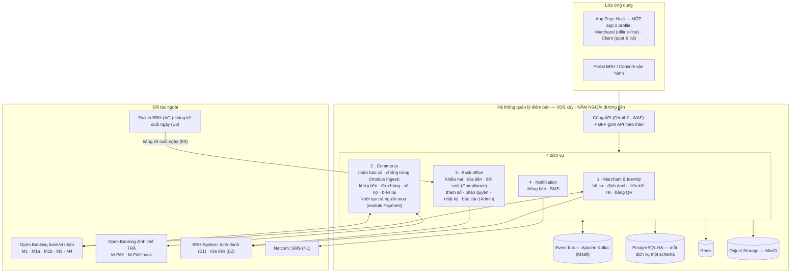

Công nghệ: phía máy người dùng dùng ứng dụng web cài được (PWA) với kho dữ liệu cục bộ mã hóa; phía máy chủ dùng Kubernetes + PostgreSQL + Redis + **Apache Kafka** + MinIO; portal là ứng dụng một trang.

## 3. Quyết định kiến trúc (ADR)

| # | Quyết định | Lý do | Đánh đổi |
|---|---|---|---|
| A1 | MMS dùng chung; dữ liệu merchant TRUNG LẬP; đa tenant chỉ ở lớp adapter & kho token per-bank | Bank nhỏ không tự xây; merchant liên kết 1–2 bank | Phân quyền theo vai trò thay vì tách tenant dữ liệu |
| A2 | Hệ thống nằm ngoài đường đi của tiền; chỉ làm QR chuyển khoản | Go-live không phụ thuộc tiến độ Switch | Phụ thuộc webhook báo tiền về của bank (M4); phải có cơ chế phục hồi (quét lịch sử M3-poll) và bảng kê cuối ngày để đối soát (E3) |
| A3 | QR payload chứa SỐ TK THẬT đã liên kết (VietQR-style) | Merchant thấy tiền về đúng TK của mình; bộ API bank gọn | Đổi TK nhận → in lại standee; TK cũ grace 30 ngày |
| A4 | Cấp quyền truy cập tài khoản bằng token theo chuẩn OAuth2 | Chuẩn hóa Open Banking; bảo vệ chủ tài khoản | Phải quản vòng đời token và đổi tài khoản đúng trình tự |
| A5 | Khớp tiền về với đơn hàng theo 2 mức (tài khoản liên kết + khớp số tiền/cửa sổ → xác nhận tay) | Nội dung chuyển khoản do người trả nhập không đáng tin | Cần cửa sổ thời gian và dung sai chặt; mục tiêu tự khớp ≥95% |
| A6 | Mọi kết nối đều bằng API theo đặc tả của BRH/ACI | Haiti không dùng kết nối socket như Napas Việt Nam | Bảng kê cuối ngày (E3) có kênh truyền file dự phòng |
| A7 | App người bán ưu tiên chạy offline | Mạng 2G, điện chập chờn | Phải có giao thức đồng bộ và xử lý xung đột (mục 9) |
| A8 | Hoàn tiền = người bán tự chuyển trả, cán bộ xác minh rồi mới chốt «Đã hoàn» | Switch không có API hoàn tiền | Chỉ một nơi giữ trạng thái hoàn; phải đào tạo người bán |
| A9 | Mã QR sinh hoàn toàn trên máy người bán (chạy được khi mất mạng); lời gọi API chỉ để khớp chính xác hơn | Mất mạng vẫn thu được tiền — tiếng «ting ting» đến từ webhook báo có của bank, không phụ thuộc loại QR | Khoản không khớp được sẽ treo chờ xác nhận tay |
| A10 | **Bốn dịch vụ**, không phải mười hai. Đường tiền nằm trọn trong **một dịch vụ (Commerce)**: nhận báo có (module Ingest), khớp tiền, đơn hàng, sổ nợ, biên lai; phần hậu kiểm portal gom vào **Back-office** (Compliance + Admin & Config) | Thao tác găng nhất — «khớp khoản tiền rồi đánh dấu đơn đã thu» — là **một transaction trong cùng database**; số kho mã khớp với đội 4 dev (mỗi người làm chủ trọn một dịch vụ). Mỗi dịch vụ đúng **một schema** — vận hành và phân quyền đơn giản | Commerce là dịch vụ lớn nhất; Back-office trộn hai miền ít liên quan; sau này tách lại dịch vụ sẽ phải di trú bảng sang schema mới (chấp nhận — ranh giới module trong code vẫn giữ) |
| A11 | Event bus = **Apache Kafka** (chế độ KRaft, không cần Zookeeper) | Đội vận hành đã quen Kafka; hệ sinh thái công cụ sẵn có | Nặng hơn nhu cầu thật (~60.000 sự kiện/ngày) — chấp nhận đánh đổi để đội làm chủ được công nghệ |

## 4. Bốn dịch vụ trong hệ thống

Mỗi dịch vụ là một khối triển khai độc lập: kho mã riêng, container riêng, **một schema PostgreSQL riêng** (không dịch vụ nào đọc thẳng bảng của schema dịch vụ khác). Trao đổi giữa các dịch vụ: gọi REST nội bộ khi cần trả lời ngay, phát/nhận sự kiện qua Kafka khi có thể chờ.

| # | Dịch vụ | Trách nhiệm | Dữ liệu sở hữu |
|---|---|---|---|
| 1 | **Merchant & Identity** | Toàn bộ vòng đời đưa một người bán vào hệ thống và giữ cho họ nhận được tiền: hồ sơ và trạng thái gian hàng; mã OTP, mã PIN, khóa khẩn khi mất máy; định danh điện tử — gọi dịch vụ của BRH (E1) và **chỉ lấy kết quả**, không tự quyết về rửa tiền; liên kết tài khoản có sẵn (M1), giữ kho token, gia hạn và thu hồi quyền (M1a, M1b), trình tự đổi tài khoản nhận giữ tài khoản cũ 30 ngày (luồng S4); quản lý bảng QR đặt quầy (luồng S8); phiên hỗ trợ của nhân viên hiện trường (danh mục agent quản trong tham số) | merchant, standee, person, ekyc_result, auth_session (kèm fingerprint, is_agent_session), application, account_link, token |
| 2 | **Commerce** | Toàn bộ đường tiền, từ cửa nhận đến đích khớp. **Module Ingest**: tiếp nhận webhook báo có của bank (M4) tại điểm công khai, xác thực chữ ký và chống phát lại, **chống trùng hai tầng** (theo mã sự kiện và mã giao dịch, hợp nhất mọi nguồn), quét lịch sử tài khoản làm lưới đỡ khi webhook chết (M3-poll), xong việc phát sự kiện «có tiền về» lên Kafka. **Các module nghiệp vụ**: danh mục món (hậu kiểm — C9), đơn tính tiền 6 trạng thái, sổ nợ khách quen, biên lai (gửi SMS); nhận sự kiện «có tiền về» → khớp theo 2 mức → **đánh dấu đơn «đã thu» hoặc gạch nợ, ghi dữ liệu biên lai và cờ khớp-muộn trong CÙNG MỘT transaction** (xem A10). Giữ nguyên tắc bất biến «một khoản tiền về chỉ khớp tối đa một đích». **Module Payment («Peye-Haiti 15/08» — profile người mua)**: nhận lệnh trả từ app (idempotent theo client_uuid), resolve đích để app hiện TÊN người bán trước khi xác nhận, gọi M-PAY của định chế TRẢ (consent scope payment), nhận webhook kết quả, thông báo ≤3s — **tiền không chạm Peye-Haiti ở cả hai phía** | schema `commerce`: credit_event (module Ingest) · match_result (kiêm biên lai), product, bill, bill_item, debtor, ledger_entry, **payment** |
| 3 | **Back-office** | Toàn bộ phần hậu kiểm và quản trị dành cho portal BRH. **Module Compliance**: hồ sơ khiếu nại (có thời hạn xử lý, chứng cứ hai phía lưu ngay trên hồ sơ), kết luận hoàn tiền **sau khi đã xác minh bút toán chuyển trả**; phòng chống rửa tiền (kết quả sàng lọc từ BRH — E2, ngưỡng nội bộ, hậu kiểm hạn mức) — **nơi duy nhất ra quyết định về rửa tiền**; đối soát bảng kê cuối ngày của Switch (E3) và xử khoản lệch; bút toán điều chỉnh — dù sinh từ khiếu nại hay từ đối soát — đều là nháp, duyệt bốn mắt rồi mới ghi sổ, **một luồng phê duyệt duy nhất**. **Module Admin & Config**: tham số vận hành (đổi phải qua bốn mắt, hiệu lực theo ngày), danh mục chợ và danh mục nhân viên hiện trường, phân quyền 5 vai trò, nhật ký bất biến có chuỗi băm, tổng hợp chỉ số và xuất báo cáo | schema `backoffice`: case (kèm chứng cứ JSONB), aml_alert, adjustment, recon_run, discrepancy · param, market, app_user, audit_log, report |
| 4 | **Notification** | Đưa tin tới người dùng qua nhiều kênh: đẩy trong app trước, không nhận được trong 60 giây thì gửi SMS qua Natcom (N1); mẫu tin đa ngữ, giới hạn tần suất, theo dõi trạng thái gửi; ghim cảnh báo token sắp hết hạn. Tách riêng để **nhà mạng trục trặc không kéo sập việc khớp tiền** | notification |

> **Vì sao gom Matching vào Commerce**: khớp tiền rồi đổi trạng thái đơn hàng là thao tác **không được phép sai**. Để chúng ở hai dịch vụ tách rời thì phải gọi mạng qua lại kèm khóa lạc quan — tự tạo ra giao dịch phân tán ở đúng chỗ nguy hiểm nhất. Ở chung một dịch vụ, đây chỉ là một transaction cơ sở dữ liệu bình thường, khóa hàng bằng `SELECT … FOR UPDATE`, và nguyên tắc bất biến được bảo đảm bằng ràng buộc duy nhất trên bảng kết quả khớp.

### 4.1. Thiết kế C4 — Level 3: các cấu phần bên trong từng dịch vụ

Ánh xạ theo mô hình C4: **L1 Bối cảnh** = PRD mục 6 · **L2 Khối triển khai** = sơ đồ mục 2 (4 dịch vụ + BFF + hạ tầng) · **L3 Cấu phần** = mục này · **L4 Mã nguồn** = TSD (hợp đồng API, lược đồ dữ liệu, thuật toán).

Chuẩn chung mọi dịch vụ: một container, một schema PostgreSQL riêng, expose REST nội bộ (`/internal/*`, xác thực giữa các dịch vụ bằng token), phát và nhận sự kiện qua **Kafka** theo mẫu **outbox + giao ít nhất một lần** (bên nhận tự chống trùng theo mã sự kiện). Ký hiệu trong sơ đồ: hình trụ = bảng dữ liệu dịch vụ sở hữu · `[[…]]` = chủ đề (topic) Kafka · nét đứt = gọi ra ngoài dịch vụ.

#### BFF & Cổng API

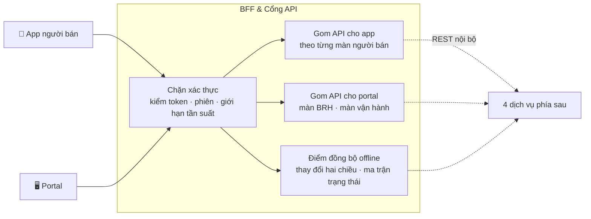

#### Dịch vụ 1 · Merchant & Identity

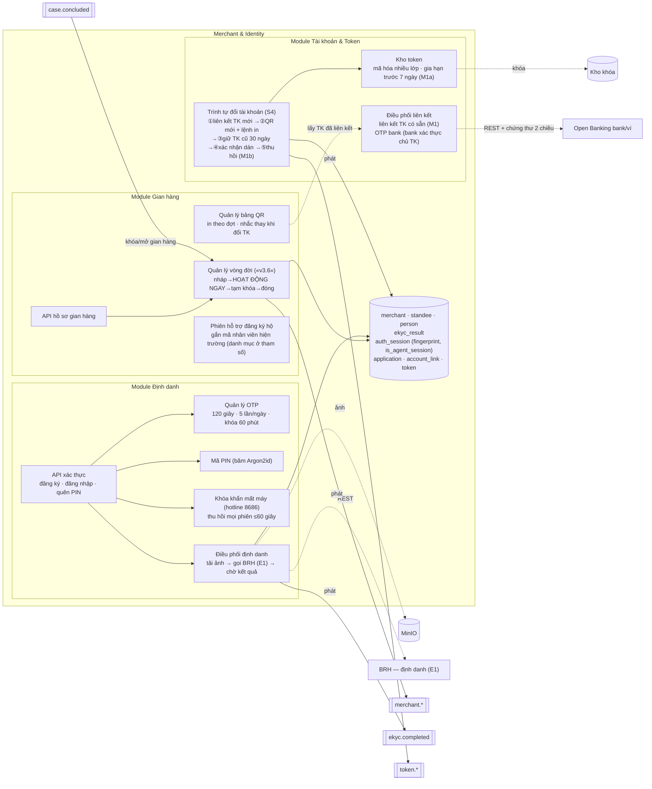

#### Dịch vụ 2 · Commerce — module Ingest *(cửa nhận tiền về)*

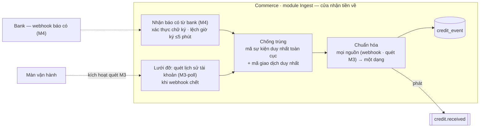

#### Dịch vụ 2 · Commerce — các module nghiệp vụ *(nơi khớp tiền — lõi)*

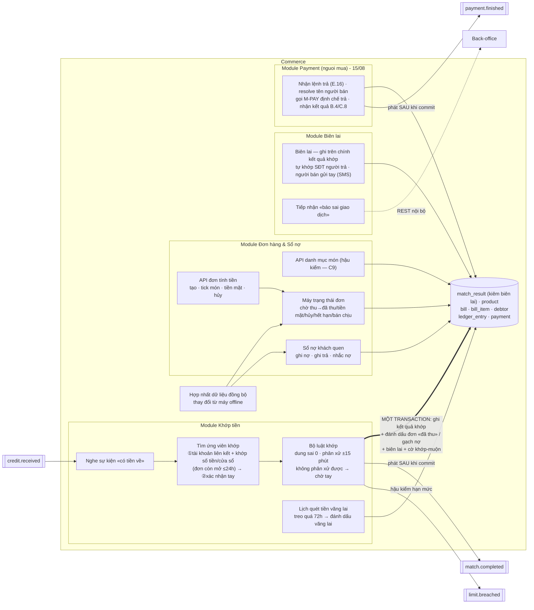

> Mũi tên đậm là điểm mấu chốt của thiết kế: toàn bộ «ghi kết quả khớp + đổi trạng thái đơn + sinh biên lai» xảy ra trong **một transaction duy nhất**, khóa hàng bằng `SELECT … FOR UPDATE`. Nguyên tắc bất biến «một khoản tiền về ↔ tối đa một đích» do ràng buộc **duy nhất trên `match_result.credit_event_id`** bảo đảm, không cần saga hay khóa phân tán.

#### Dịch vụ 3 · Back-office — module Compliance

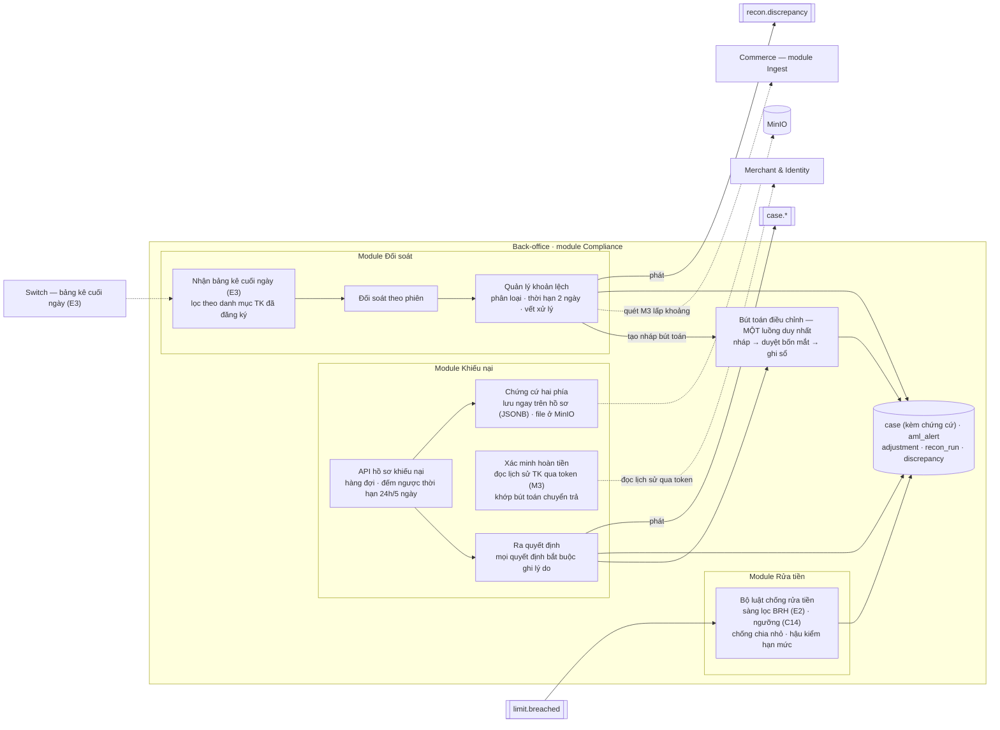

#### Dịch vụ 4 · Notification

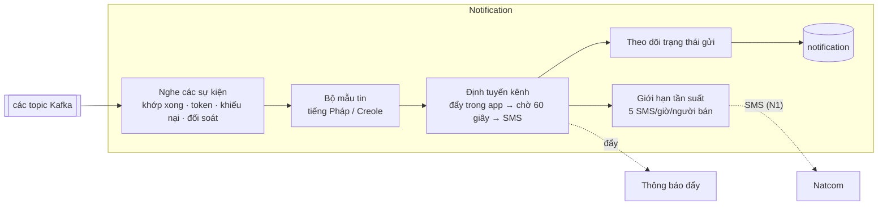

#### Dịch vụ 3 · Back-office — module Admin & Config

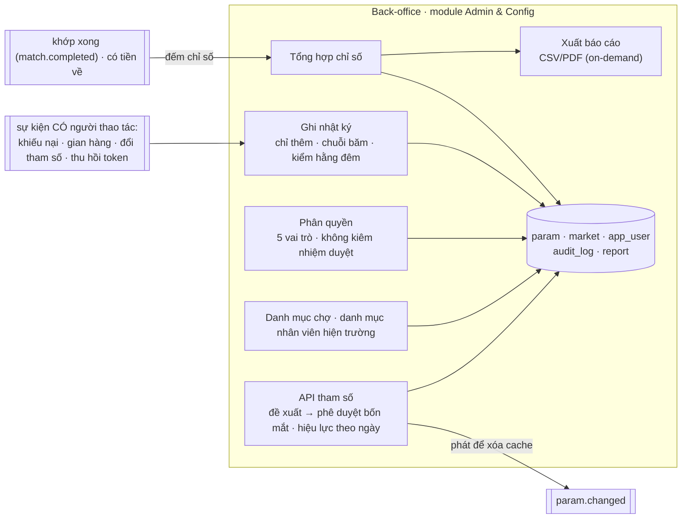

> Nhật ký chỉ ghi những sự kiện **có người thao tác đằng sau** (quyết định của cán bộ, thay đổi tham số). Sự kiện kỹ thuật thuần (tiền về, đổi trạng thái đơn) đi vào hệ giám sát và bộ tổng hợp chỉ số, **không** vào nhật ký — đúng yêu cầu truy vết US-31 và chính sách lưu 10 năm.

## 5. Chín luồng xử lý nghiệp vụ («Peye-Haiti 15/08»: +S9 người mua)

### S2 · Tiền về, chống trùng & gạch bill  *(luồng găng nhất)*

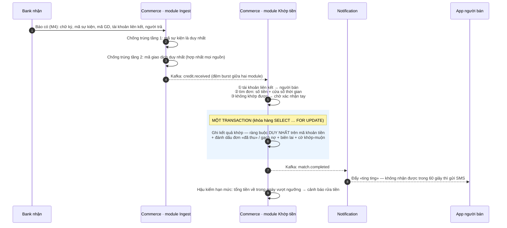

> **Nguyên tắc bất biến — một khoản tiền về chỉ khớp tối đa một đích.** Vì việc ghi kết quả khớp và đổi trạng thái đơn nằm trong cùng một transaction của cùng một cơ sở dữ liệu, nguyên tắc này được bảo đảm bằng **ràng buộc duy nhất trên mã khoản tiền** trong bảng kết quả khớp — không cần khóa phân tán, không cần saga. Nếu cùng một khoản tiền về được xử lý hai lần (do bank bắn lại), lần thứ hai vi phạm ràng buộc và bị bỏ qua một cách an toàn.
>
> **Giám sát hạn mức (hậu kiểm AML):** sau mỗi khoản tiền về, nếu tổng nhận trong ngày của merchant chạm ngưỡng AML (`AML_DAY_FLAG` — 500.000 Gourde/ngày) → phát cảnh báo rửa tiền + gắn cờ hạn chế gian hàng + mở case AML tới khi xử lý. Đây là **giám sát HẬU KIỂM**: mọi merchant đều eKYC đầy đủ (E1), không còn chặn cứng hạn mức theo bậc ở bank.

**Bổ sung «16/08» — khớp ĐÍCH DANH:** khi app định chế TRẢ có mạng, nó gọi `B.5 /qr-inquiry` vào nền tảng TRƯỚC khi chuyển và mang `payment_ref` (TTL 15′) vào lệnh; báo Có M4 kèm `addenda.payment_ref` → khớp mức ① thành đích danh, hết lệ thuộc thuần số tiền (offline-first A9 giữ nguyên — không gọi được B.5 vẫn trả và khớp như cũ).

### S4 · Token & cutover đổi tài khoản

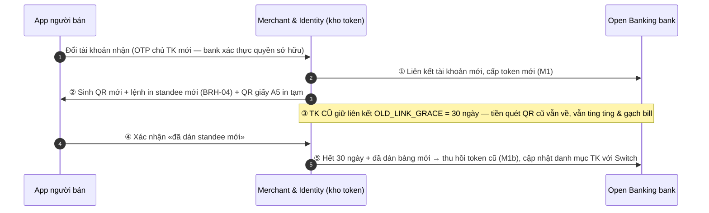

### S9 · Người mua quét & trả (module Payment — màn NM-01→05) «Peye-Haiti 15/08»

① App parse QR HTQR **offline** (A9) → ② `POST /payments`: server resolve đích, trả TÊN người bán để khách xác nhận (chống dán đè) → ③ xác nhận PIN 1 chạm (≤5.000 HTG: bước duy nhất; «v3.5»: lệnh >5.000 → thêm ③b định chế trả `sca_required` + tự gửi SMS OTP tới chủ TK → ③c người dùng nhập OTP trong app, chuyển tiếp qua M-PAY.3/C.9) → gọi **M-PAY.1** của định chế TRẢ bằng token liên kết nguồn trả → ④ định chế trả chuyển tiền theo đường tiền hiện hữu (Switch hoặc on-us) — **Peye-Haiti không chạm tiền** → ⑤ webhook **M-PAY-hook** báo kết quả → cập nhật `payment` + thông báo người mua (tổng ≤3s P95; quá `PAY_TIMEOUT` → job hỏi M-PAY.2) → ⑥ phía NHẬN không đổi: bank nhận bắn M4 → S2 khớp bill, «ting ting», biên lai — hai phía độc lập, đối chiếu qua `ref_id`. Sóng yếu: app cho xếp lệnh chờ (client_uuid idempotent), KHÔNG bao giờ tự bắn lại khi chưa rõ kết quả.

### Trạng thái bill

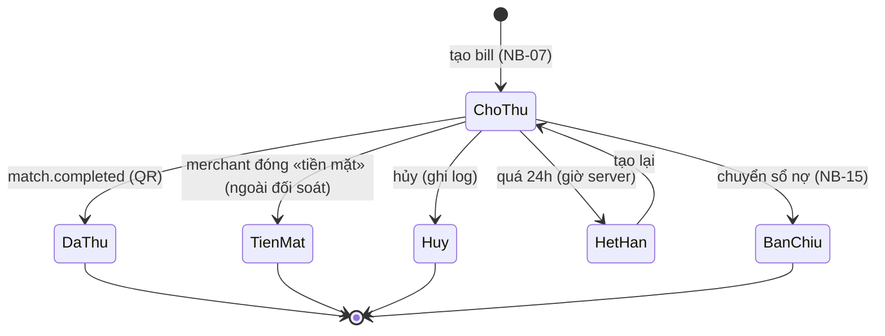

- **S1 · Đăng ký & kích hoạt gian hàng** («v3.6» — thứ tự theo F1/PRD): đăng ký SĐT → nhận mã OTP qua SMS (N1) → đặt mã PIN → CHỌN VAI (màn CH-00, TRƯỚC eKYC; vai mua dừng ở đây, vào app dùng ngay) → nhánh bán: chụp căn cước và ảnh chân dung, hệ thống gửi sang dịch vụ định danh của BRH đối chiếu (E1) → khai gian hàng (chọn chợ từ danh mục cấu hình) → chọn tài khoản nhận tiền: liên kết để lấy token (M1) — bank gửi OTP tới chủ TK xác nhận quyền sở hữu → **KÍCH HOẠT NGAY («v3.6» — không cổng duyệt; sàng lọc rửa tiền chạy nền, có cờ thì vào danh sách HẬU KIỂM BRH ≤24h với quyền tạm khóa một chạm)** → sinh mã QR theo tài khoản đã liên kết và tạo lệnh in bảng QR (luồng S8).
  Trường hợp nhân viên Natcom đăng ký hộ: chạy trong **phiên hỗ trợ** được đánh dấu riêng và gắn mã nhân viên — phục vụ truy vết, tách bạch với phiên của chính người bán.
- **S3 · Đơn tính tiền & mã QR động**: mọi loại QR đều được app vẽ ngay trên máy, **không cần mạng** (QR tĩnh dùng dữ liệu cố định; QR động chèn thêm số tiền, hết hạn sau 15 phút và app tự làm mới). Khi có mạng, app đồng bộ đơn hàng lên máy chủ trước khi khách quét — không chặn thao tác. Nếu đơn chưa kịp đồng bộ, khoản tiền về sẽ treo chờ và tự gạch khi đơn lên (trong 72 giờ).
  Mặc định khớp bằng **số tiền + cửa sổ thời gian** trên các đơn đang mở; chỉ gắn mã đơn vào mã QR nếu chuẩn QR quốc gia và hợp đồng bank đảm bảo trường này không bị cắt (phụ thuộc D1, D2). Người bán vẫn có lối thoát: đóng đơn bằng «đã thu tiền mặt» (nằm ngoài dòng tiền QR và ngoài đối soát), hủy đơn, hoặc để đơn hết hạn sau 24 giờ.
- **Tham số Matching (giá trị mặc định, đặt qua API tham số E.13.x, vận hành Natcom 4 mắt (màn BRH-09 đã bỏ 04/08) — TSD §6 chi tiết)**: `QR_DYNAMIC_TTL = 15 phút` (C6 — hết hạn với NGƯỜI QUÉT; tiền đã chuyển trong hạn vẫn về sau được); `MATCH_WINDOW_BILL = suốt đời bill (≤24h)`; `AMOUNT_TOLERANCE = 0` (chuyển khoản phải đúng tuyệt đối số tiền bill); **tie-break** khi ≥2 bill mở cùng số tiền: nếu chỉ có 1 bill tạo trong ±15 phút quanh thời điểm ghi Có → chọn bill đó, ngược lại **rơi mức ② chờ xác nhận tay** (không đoán). Tiền về sau khi đơn đã hết hạn được xử như tiền vãng lai.
- **S5 · Khiếu nại & hoàn tiền**: hồ sơ khiếu nại bám theo mã tham chiếu giao dịch (thời hạn đề xuất: phản hồi trong 24 giờ, đóng trong 5 ngày làm việc) → thu thập chứng cứ hai phía → người bán tự chuyển tiền trả lại từ app bank của họ → hệ thống **xác minh bút toán chuyển trả** (đọc lịch sử tài khoản qua token — M3, hoặc dựa chứng từ cán bộ đính kèm) → chỉ khi đó mới chốt «Đã hoàn» → sinh bút toán điều chỉnh có phê duyệt. Đối soát gắn cờ khoản hoàn để bảng kê cuối ngày không đếm nhầm thành doanh thu bán mới.
- **S6 · Đối soát cuối ngày**: hệ thống **đăng ký danh mục tài khoản nhận** với Switch (E3-reg) để Switch chỉ gửi về phần liên quan; nếu Switch chưa lọc được thì giai đoạn quá độ nhận trọn bảng kê đã mã hóa, tự lọc và hủy phần thừa. Đối chiếu theo mã giao dịch, số tài khoản và số tiền; khoản lệch được xử: quét lịch sử M3 lấp khoảng, lập bút toán điều chỉnh duyệt bốn mắt, hoặc chuyển thành hồ sơ khiếu nại — đóng trong tối đa 2 ngày làm việc. Doanh số thay đổi sẽ báo cho người bán.
- **S7 · Gạch nợ khách quen**: khi khoản tiền về không khớp đơn hàng nào nhưng trùng số tiền với một khoản nợ đang mở, hệ thống **chỉ đề xuất, người bán xác nhận** — không bao giờ tự gạch. Thứ tự ưu tiên khi khớp: đơn hàng → khoản nợ → tiền vãng lai. Nếu người bán đã gạch tay từ trước (lúc offline), khoản tiền về sẽ tham chiếu vào chính bút ghi đó, không trừ nợ hai lần.
- **S8 · Bảng QR tại quầy**: khi gian hàng được kích hoạt, hệ thống sinh mã QR từ tài khoản đã liên kết; người bán in ngay một bản giấy A5 để dùng tạm, đồng thời hệ thống tạo lệnh in bảng QR mica theo đợt (mẫu chuẩn BRH: mã QR + tên gian hàng + mã người bán) và theo dõi tiến độ in → giao → dán trên portal. **Đổi tài khoản nhận** → sinh QR mới và in lại bảng, tài khoản cũ vẫn giữ liên kết 30 ngày nên không mất giao dịch nào (luồng S4). **Đóng gian hàng** → thu hồi bảng QR theo danh mục kiểm và thu hồi token (M1b), bank ngừng gửi báo có; tiền nếu còn ai quét mã cũ sẽ về thẳng tài khoản thật của chính chủ — nằm ngoài phạm vi hệ thống.

## 6. Mô hình dữ liệu khái niệm

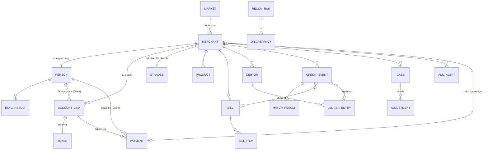

20 nhóm thực thể chính («Peye-Haiti 15/08»: +`payment`) (ERD mức khái niệm — các bảng quản trị/phiên/thông báo xem TSD §5); cột/khóa/index chi tiết tại TSD §5.

## 7. Thiết kế tích hợp — 14 mục: 12 giao diện với bên ngoài + 2 năng lực nội bộ («Peye-Haiti 15/08»: +M-PAY)

| Nhóm | Mã | Giao thức & bảo mật | Chiều | SLA/Ghi chú |
|---|---|---|---|---|
| Nội bộ | I2 · I5 | trong dịch vụ | — | Sinh QR theo chuẩn (Commerce) · thông báo báo có (Notification) |
| OB bank nhận | M1·M1a·M1b·M3 | REST+JWT, mTLS, consent OAuth2 | MMS→Bank | SLA D2; sandbox T7 |
| OB bank nhận | **M4** webhook | mTLS + thẻ hệ thống tự ký kèm hash body (API Spec A.1b «v3.4»), `event_id` idempotent, retry backoff | Bank→MMS | P95 ≤5s; **kèm người trả** |
| BRH-System | E1·E2 | REST+JWT, mTLS | MMS→BRH | E1 sandbox T7; E2 sẵn |
| Switch | E3 EOD | API (SFTP dự phòng), file ký số, **lọc theo danh mục TK nhận đã đăng ký (E3-reg)** | Switch→MMS | theo phiên |
| Natcom | N1 SMS | SMPP/REST | MMS→Natcom | Liên mạng · brandname Peye-Haiti |
| OB bank trả «Peye-Haiti 15/08» | **M-PAY** (khởi tạo · trạng thái · xác nhận OTP C.9 «v3.5» — OTP >5.000 HTG do ĐỊNH CHẾ gửi bằng SMS GW của họ) | REST+JWT, mTLS, consent OAuth2 scope `payment` | MMS→Bank trả | wallet2 pilot; phụ lục hợp đồng D2 |
| OB bank trả «Peye-Haiti 15/08» | **M-PAY-hook** webhook kết quả | mTLS + thẻ hệ thống kèm hash body (A.1b «v3.4»), idempotent `event_id`/`ext_payment_id` | Bank trả→MMS | SLA tổng ≤3s P95 |
| App định chế TRẢ «16/08» | **B.5 /qr-inquiry** tra cứu xác minh QR | mTLS + thẻ hệ thống kèm hash body; response không chứa số TK | App định chế→MMS | Trả `payment_ref` (TTL 15′) → khớp đích danh; không gọi được vẫn trả như cũ |
| (Chỉ để tham chiếu) | M2 | — | — | Đường đi của tiền qua Switch — không phải API phải tích hợp |

> **Kiểm đếm:** 14 mục = **2 nội bộ** (I2 · I5) + **12 giao diện ngoài** (M1 · M1a · M1b · M3 · M4 · **M-PAY · M-PAY-hook** · E1 · E2 · E3 · E3-reg · N1). **M2 KHÔNG tính** — ngữ cảnh đường tiền (M-PAY dùng mã riêng, không tái dùng M2/M6). *(B.5 /qr-inquiry nằm trong bảng nhưng KHÔNG tính vào 12 giao diện phải xây: là API nền tảng expose, định chế chỉ GỌI — cùng quy ước PRD §8.)*

Nguyên tắc chung: mọi lệnh ghi đều mang khóa chống trùng; mỗi đối tác có timeout và bộ ngắt mạch riêng; đánh phiên bản API; **lỗi hạ tầng không bao giờ được tự động sinh giao dịch hoàn tiền**.

### 7.1. Đặc tả tham chiếu BÊN TRẢ (VI-00→04 · D9)
- wallet2 tối thiểu: quét payload EMVCo theo **HTQR 1.0** (TSD §13.4), hiển thị đúng tên gian hàng, chuyển tới SỐ TK THẬT trong QR (tag 38-02).
- **Bộ test vectors QR** (TSD §12.1 · payload §13.4): tĩnh TK thật · động có tiền · addenda bill_id · sai chuẩn — nghiệm thu D9.
- Chỗ đáp: C20 phí liên ví (BRH quyết), C21 lộ trình liên thông (wallet2→MonCash→bank), C22 SDK quét nhúng app wallet2.

## 8. Bảo mật & tuân thủ
- **Xác thực người bán**: mã PIN 6 số băm bằng Argon2id, khóa tài khoản sau 5 lần sai; mã OTP gửi qua SMS; mỗi phiên đăng nhập gắn với dấu vân tay thiết bị.
- **Mất máy**: khóa khẩn qua hotline 8686 (xác thực OTP về SIM đăng ký) — thu hồi mọi phiên trong 60 giây, mã QR vẫn nhận tiền bình thường; phiên hỗ trợ của nhân viên hiện trường là ngoại lệ có kiểm soát.
- **Đường truyền**: TLS 1.2 trở lên; kết nối đối tác dùng chứng thư hai chiều; webhook của bank phải ký số và có chống phát lại (mã sự kiện duy nhất, lệch giờ ký không quá 5 phút).
- **Dữ liệu**: mã hóa AES-256 khi lưu; ảnh định danh để trong kho đối tượng đã mã hóa, cấp quyền truy cập có hạn; thông tin người trả nhận từ bank theo đúng chuẩn Open Banking của BRH; sổ nợ thuộc quyền người bán, chia sẻ phải có đồng ý (điểm chốt C7).
- **Phân quyền**: 5 vai trò (C11); các thao tác nhạy cảm (phí, hạn mức, bút toán điều chỉnh) bắt buộc bốn mắt — người đề xuất khác người phê duyệt.
- **Nhật ký**: chỉ ghi thêm, không sửa xóa, có chuỗi băm chống can thiệp; đề xuất lưu 10 năm (C17).
- **Khóa mã**: quản lý tập trung; token được mã hóa nhiều lớp và xoay khóa định kỳ.
- **Dữ liệu ra hệ thống quốc gia (3 KHÔNG — CR-8, 15/08)**: mọi khai báo cho nhật ký giao dịch quốc gia/RNI/BRH không bao giờ chứa chuỗi QR thô, bí mật sống (token/HMAC — chỉ mã khóa hoặc băm) hay số tài khoản đầy đủ (chỉ bản che). Bản đồ khai báo nhóm A–G: DataDict §6.
- **Khung KYC hài hòa (CR-12, cập nhật 15/08)**: KYC merchant = **KYC2** quốc gia · profile Client (người mua) = **KYC1** (OTP — `person.kyc_level`); NIF bổ sung song song CIN; PersonID quốc gia là cột chờ, điền khi RNI vận hành.

## 9. Chạy offline & đồng bộ
- **Ghi tại máy trước** (kho dữ liệu trên máy có mã hóa): sổ nợ, đơn tính tiền, danh mục món — thao tác phản hồi tức thì. Riêng **tiền thì máy chủ là nguồn sự thật duy nhất**.
- **Đồng bộ theo lô** khi có mạng. Quy tắc xử lý xung đột: liên quan đến tiền thì máy chủ thắng, còn ghi chú của người bán thì máy thắng; mỗi bản ghi có mã định danh riêng và mốc thời gian cập nhật.
- Giao diện tiếng Pháp và Creole; có thể hiển thị kèm quy đổi USD theo tham số (C5) — nhưng mọi bút toán đều 100% bằng Gourde.
- Khi offline, app **không bao giờ** được tự đánh dấu «đã thu tiền» nếu chưa nhận được báo có từ bank; ảnh chụp nén xuống dưới 200KB để đi được trên mạng 2G.

## 10. Ánh xạ NFR → cơ chế (đo được)

| NFR | Cơ chế & điểm đo |
|---|---|
| Báo có ≤5 giây (P95) | Mốc đầu = thời điểm bank ghi Có trong webhook; mốc cuối = app xác nhận đã nhận (hoặc Natcom nhận lệnh gửi SMS); đo P95 trượt 24 giờ trên màn vận hành |
| Khả dụng 99,5% | Kịch bản giám sát tự chạy mỗi phút trên 5 hành trình quan trọng nhất; tính là gián đoạn nếu phút đó có ít nhất 1 lần hỏng |
| 50 TPS nhận tiền về · 300 rps API — quy mô 5.000 merchant | Module Ingest (Commerce) không giữ trạng thái, co giãn theo HPA của Commerce; Kafka chia phần theo mã người bán; sizing TSD §9, kiểm thử tải TSD §12 |
| Vượt 5.000 merchant | Mở rộng ngang: thêm bản sao dịch vụ, thêm bản sao đọc cho cơ sở dữ liệu, thêm broker Kafka — kiến trúc không đổi (lộ trình TSD §9.5) |
| Đăng ký dưới 10 phút · kích hoạt tức thời khi hoàn tất («v3.6») · hậu kiểm hồ sơ có cờ ≤24h | Ghi nhận sự kiện ở từng bước để đo phễu; báo cáo trên portal |

## 11. Mô hình triển khai

Hai môi trường: **UAT** (dùng sandbox của BRH, bank, Natcom, Switch; chạy tự động 9 luồng nghiệp vụ (S1–S9; S9 khi có sandbox M-PAY — gate điều kiện PRD §13); BRH nghiệm thu tại đây) và **PROD** (trung tâm dữ liệu Natcom). **Sizing chi tiết từng máy ảo tại TSD §9.**

### 11.1. Sơ đồ triển khai (PROD)

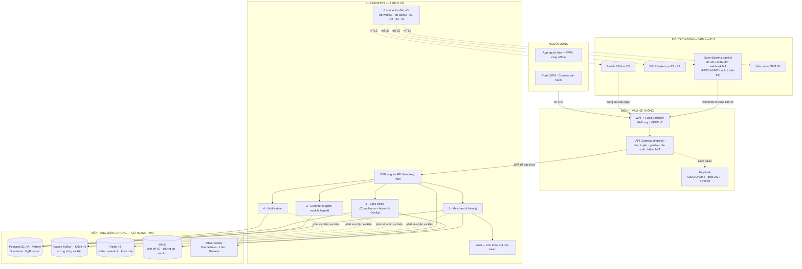

### 11.2. Vai trò các thành phần dùng chung

Không phải thứ nào cũng là một máy ảo riêng. **API Gateway, Keycloak và Vault chạy dạng pod bên trong Kubernetes** (nhiều bản sao, không tốn thêm máy ảo ở quy mô 5.000 merchant). Kafka, PostgreSQL, Redis, MinIO nằm trên máy ảo riêng vì có trạng thái.

| Thành phần | Vai trò | Vì sao cần |
|---|---|---|
| **API Gateway** | Cửa duy nhất vào hệ thống: định tuyến, giới hạn tần suất, kiểm chữ ký JWT trước khi cho request đi tiếp | Chặn xác thực và rate-limit ở một chỗ, các dịch vụ phía sau không phải làm lại |
| **Keycloak** | Máy chủ danh tính: đăng nhập người bán (số điện thoại + PIN) và cán bộ portal, phát/làm mới JWT, giữ 5 vai trò phân quyền, cấp token cho gọi giữa các dịch vụ | Không tự viết phần đăng nhập/OAuth2 — dùng sản phẩm chuẩn đã qua kiểm định |
| **Apache Kafka** | Xương sống sự kiện: các dịch vụ phát và nhận qua đây thay vì gọi thẳng nhau; giao ít nhất một lần, chia phần theo mã người bán | Tách các dịch vụ khỏi nhau về thời gian — Notification hay Admin chậm cũng không giữ chân việc nhận tiền và khớp tiền |
| **Redis** | Đệm nhanh: phiên đăng nhập, bộ đếm giới hạn tần suất, khóa nhẹ chống thao tác trùng | Giảm tải đọc cho cơ sở dữ liệu, phản hồi nhanh hơn |
| **Vault** | Kho khóa mã hóa: giữ khóa gốc bọc token Open Banking, xoay khóa định kỳ | Token truy cập tài khoản là bí mật nhạy nhất — không để lộ trong mã hay cấu hình |
| **PostgreSQL HA** | Cơ sở dữ liệu chính, 5 schema — mỗi dịch vụ một schema (+ `shared`); có bản sao đồng bộ và tự chuyển đổi khi lỗi | Nguồn sự thật cho mọi dữ liệu, kể cả tiền |
| **MinIO** | Kho tệp: ảnh định danh, chứng cứ khiếu nại, bảng kê cuối ngày, bản sao lưu | Tệp lớn không nên nhét vào cơ sở dữ liệu |

### 11.3. Vận hành

Sao lưu: ảnh chụp cơ sở dữ liệu hằng ngày + nhật ký giao dịch đẩy liên tục sang kho đối tượng (mục tiêu khôi phục: mất tối đa 15 phút dữ liệu, dựng lại trong 8 giờ). Chưa có trung tâm dữ liệu dự phòng — nếu BRH yêu cầu, bổ sung site thứ hai sau. Quy trình phát hành tự động (dựng → kiểm thử → quét bảo mật → triển khai), hạ tầng khai báo bằng mã, app tự cập nhật lặng lẽ.

## 12. Giám sát & vận hành
Bảy chỉ số vàng phải nhìn được mọi lúc: độ trễ báo có (P95) · tỷ lệ gạch bill tự động · số webhook lỗi và phải thử lại · tồn đọng khoản lệch chưa xử · độ sẵn sàng của dịch vụ định danh và SMS · số token sắp hết hạn · các khoảng thời gian còn thiếu dữ liệu cần quét M3 lấp. Ngưỡng cảnh báo đặt tại portal (đề xuất C12); mọi truy vết đi theo mã giao dịch hoặc mã sự kiện; quy trình xử lý sự cố nằm ở màn vận hành.

## 13. Rủi ro kỹ thuật
| Rủi ro | Cách hóa giải |
|---|---|
| Bank gửi báo có chập chờn hoặc trễ | Ràng SLA trong hợp đồng Open Banking (D2); phục hồi bằng quét lịch sử tài khoản (M3-poll) + đối soát E3 làm lưới đỡ |
| Dịch vụ định danh của BRH chậm ra mắt | Làm việc trên hợp đồng giả lập trước (contract-first); tạm thời duyệt hồ sơ bằng tay |
| Trường phụ trong mã QR bị cắt trên đường đi | Thiết kế mặc định KHÔNG phụ thuộc trường này — khớp bằng số tiền và cửa sổ thời gian |
| Báo có thiếu thông tin để khớp | Dung sai số tiền bằng 0, không đoán bừa; rơi về xác nhận tay — thà chậm còn hơn gạch sai |
| Kafka nặng hơn nhu cầu thật | Chạy chế độ KRaft (không cần Zookeeper), 3 broker; đội đã quen công nghệ nên đổi lại chi phí vận hành thấp |

## 14. Ánh xạ màn hình → dịch vụ → tích hợp

| Nhóm màn | Màn | Dịch vụ xử lý | Gọi ra ngoài |
|---|---|---|---|
| **Thanh toán trong app — MỌI VAI «v3.5» (+CH-00 chọn vai; người bán cũng trả được)** | CH-00 · NM-01→05 · Quét & trả (hai bậc PIN / +OTP định chế), xác nhận tên, kết quả/biên lai, lịch sử & khiếu nại, liên kết TK trả | Commerce (module Payment) · Merchant & Identity (liên kết) · **Notification (topic `payment.finished`)** · Back-office (case) | M-PAY · M-PAY-hook (định chế trả) |
| **App người bán** | NB-00/01/02 · Đăng nhập, đăng ký, xác thực OTP | Merchant & Identity | SMS (N1) |
| | NB-2A · Chụp căn cước & ảnh chân dung | Merchant & Identity | Định danh (E1); sàng lọc rửa tiền qua Back-office (E2) |
| | NB-2B · Khai gian hàng & liên kết TK nhận («v3.6») · NB-14 · Đổi tài khoản | Merchant & Identity | Bank/ví nhận (M1, M1a, M1b) |
| | NB-1C · Trạng thái hồ sơ · NB-03 · Trang chủ | Merchant & Identity · Commerce | SMS (N1) |
| | NB-04 · Tạo mã QR nhận tiền | Commerce | — *(QR sinh trên máy)* |
| | NB-05 · Báo có & biên lai · NB-13 · Thông báo | Commerce (Ingest → khớp) → Notification | Báo có từ bank (M4) → SMS (N1) |
| | NB-06/07/08 · Danh mục món, đơn tính tiền, đơn trong ngày | Commerce | — |
| | NB-09/10 · Lịch sử, báo cáo bán hàng | Commerce · Back-office | Lịch sử tài khoản (M3) |
| | NB-15 · Sổ nợ khách quen | Commerce | SMS nhắc nợ (N1) |
| **Portal BRH** | BRH-01 · Đăng nhập & người dùng · BRH-02/05 · Dashboard, tra cứu | Back-office | — |
| | BRH-03/04 · Hậu kiểm hồ sơ, quản lý gian hàng | Merchant & Identity | Định danh (E1); thu hồi token khi đóng (M1b) |
| | BRH-06/07 · Khiếu nại, cảnh báo rửa tiền | Back-office | Sàng lọc rửa tiền (E2) |
| | BRH-08/11/12 · Báo cáo, nhật ký, người dùng (+ tham số qua API E.13.x — không màn) | Back-office | — |
| **Vận hành** | AQ-00/01 · Sức khỏe kết nối, cảnh báo | Commerce (module Ingest) · Merchant & Identity · Notification | Toàn bộ bank, BRH, Natcom |
| | AQ-03/04 · Đối soát, khoản lệch | Back-office | Bảng kê cuối ngày (E3); quét M3 lấp khoảng |
| **Ví bên trả** | VI-00→04 · Quét & trả tiền | *(ngoài hệ thống)* | Đặc tả tham chiếu tại mục 7.1 — phụ thuộc D9 |
