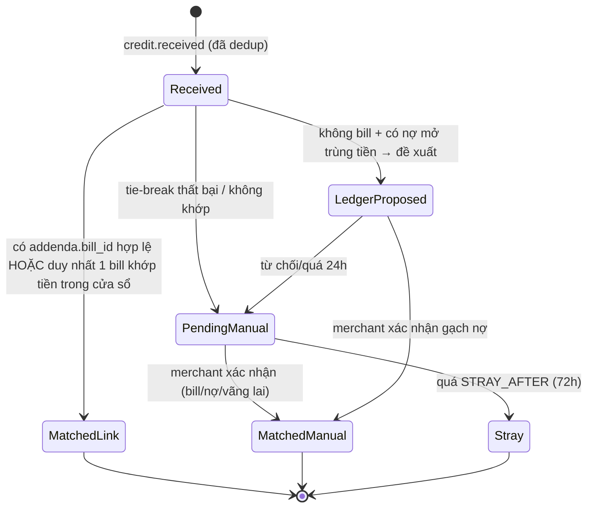
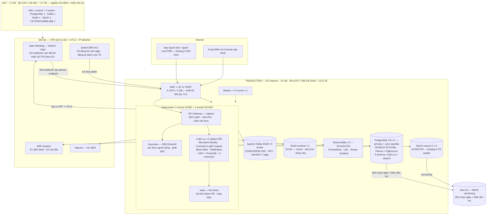

# TSD — Đặc tả kỹ thuật · Giải pháp Merchant Peye-Haiti (code-ready)

<!-- TOC -->
<a id="muc-luc"></a>

**Mục lục**

- [1. Chuẩn chung API](#muc-1-chuan-chung-api)
- [2. API Open Banking (bank/ví nhận cung cấp — hợp đồng D2)](#muc-2-api-open-banking-bank-vi-nhan-cung-cap-hop-dong-d2)
- [2b. Contract các đối tác còn lại (đủ cho 6 connector §13.5)](#muc-2b-contract-cac-doi-tac-con-lai-du-cho-6-connector-13-5)
- [2c. API surface BFF (app + portal) — danh mục endpoint theo màn](#muc-2c-api-surface-bff-app-portal-danh-muc-endpoint-theo-man)
- [3. Webhook M4 — contract chi tiết (đường găng)](#muc-3-webhook-m4-contract-chi-tiet-duong-gang)
- [4. Event bus (Apache Kafka — chế độ KRaft)](#muc-4-event-bus-apache-kafka-che-do-kraft)
- [5. Mô hình dữ liệu vật lý (PostgreSQL 15)](#muc-5-mo-hinh-du-lieu-vat-ly-postgresql-15)
- [6. Khớp tiền (module Matching — trong service **Commerce**) — thuật toán & state machine](#muc-6-khop-tien-module-matching-trong-service-commerce-thuat-toa)
  - [6b. State machine `payment` (module Payment — «Peye-Haiti 15/08», đối xứng §6)](#muc-6b-state-machine-payment-module-payment-peye-haiti-15-08-doi)
- [7. Giao thức đồng bộ offline (app người bán)](#muc-7-giao-thuc-dong-bo-offline-app-nguoi-ban)
- [8. Bảo mật chi tiết](#muc-8-bao-mat-chi-tiet)
- [8b. Chuẩn triển khai xác thực phía dịch vụ («v3.7» — chốt theo Q&A dev 24/08)](#muc-8b-chuan-trien-khai-xac-thuc-phia-dich-vu-v3-7-chot-theo-q-a)
- [9. Hạ tầng & SIZING (quy mô mục tiêu **5.000 merchant** · DC Natcom · **chỉ UAT + PROD**)](#muc-9-ha-tang-sizing-quy-mo-muc-tieu-5-000-merchant-dc-natcom-ch)
  - [9.0. Sơ đồ topology hạ tầng](#muc-9-0-so-do-topology-ha-tang)
  - [9.0.1. Thành phần nền tảng dùng chung — vai trò & vị trí](#muc-9-0-1-thanh-phan-nen-tang-dung-chung-vai-tro-vi-tri)
  - [9.1. Mô hình tải — 5.000 merchant](#muc-9-1-mo-hinh-tai-5-000-merchant)
  - [9.2. PRODUCTION](#muc-9-2-production)
  - [9.3. UAT](#muc-9-3-uat)
  - [9.4. Sao lưu & khôi phục (thay cho trung tâm dữ liệu dự phòng)](#muc-9-4-sao-luu-khoi-phuc-thay-cho-trung-tam-du-lieu-du-phong)
  - [9.5. Lộ trình vượt 5.000 merchant (kiến trúc KHÔNG đổi)](#muc-9-5-lo-trinh-vuot-5-000-merchant-kien-truc-khong-doi)
- [10. Observability & vận hành](#muc-10-observability-van-hanh)
- [11. Notification](#muc-11-notification)
- [12. Kiểm thử & nghiệm thu kỹ thuật](#muc-12-kiem-thu-nghiem-thu-ky-thuat)
- [13. Phụ lục](#muc-13-phu-luc)
  - [13.1. Mã lỗi nghiệp vụ (`biz_code` chính)](#muc-13-1-ma-loi-nghiep-vu-bizcode-chinh)
  - [13.2. Sự kiện instrument KPI (BRH-08)](#muc-13-2-su-kien-instrument-kpi-brh-08)
  - [13.3. Tham số cấu hình (bảng `param` · quản trị qua E.13.2–E.13.4 bởi vận hành Natcom, 4 mắt — màn portal BRH-09 đã bỏ 04/08)](#muc-13-3-tham-so-cau-hinh-bang-param-quan-tri-qua-e-13-2e-13-4-b)
  - [13.4. Payload QR theo chuẩn HTQR 1.0 (D1 — quy chuẩn quốc gia, dự thảo v0.9.1 trình G3 15/08) «CR-3 15/08»](#muc-13-4-payload-qr-theo-chuan-htqr-1-0-d1-quy-chuan-quoc-gia-du)
  - [13.5. Cấu trúc repo đề xuất](#muc-13-5-cau-truc-repo-de-xuat)

<!-- /TOC -->

| Trường | Nội dung |
|---|---|
| Mã | Peye-Haiti-TSD-001 · **v4.6 (Markdown)** — 24/08/2026 · **v4.6 (đồng bộ API Spec v3.7 — chốt 5 câu hỏi tích hợp của dev):** thẻ hệ thống chuyển sang header riêng `x-system-token` (JWT trần; `Authorization` chỉ còn của phiên người dùng BFF; route đối tác từ chối `Authorization`) · F.3 bỏ `req_sha256` với GET (đối chiếu định danh trong body thay thế; C.6 +echo `link_id`) · idempotency ca đang-xử-lý = 409 `details.state="processing"` (retryable, giữ key) · thống nhất thuật ngữ receiving/funding + nhãn quyền `user` · +§8b chuẩn triển khai xác thực (3 SecurityWebFilterChain + phân vùng gateway) · **v4.5b (tối 20/08 — đồng bộ API Spec v3.6):** CH-00 TRƯỚC eKYC (vai mua không chạy E1/E2) · TẠO LÀ ACTIVE (§2c C10: kích hoạt ngay khi hoàn tất — không cổng duyệt; `AUTO_ACTIVATE_SCORE` = ngưỡng GẮN CỜ hậu kiểm; cờ ≤24h, mẫu 10%) — không đổi DDL/số đếm · **v4.5 (họp BRH 20/08 — đồng bộ API Spec v3.5):** ① MỘT app CHỌN VAI (CH-00; người bán thanh toán được — E.16 mọi vai; nút «Trở thành người bán» = onboarding merchant hiện có, không endpoint mới; 42 màn); ② HAI BẬC XÁC THỰC: `PAY_SCA_THRESHOLD` 5.000 HTG thay trần cứng — ≤ ngưỡng PIN app, > ngưỡng +SMS OTP ĐỊNH CHẾ (khôi phục C.9/E.16.6/sca_*: DDL payment +4 cột sca, enum +`sca_required`, §6b +3 transition + sweeper); `PAY_DAY_MAX` chỉ đếm lệnh bậc-PIN; ③ OTP thanh toán đi SMS GW CỦA ĐỊNH CHẾ (F.4 điều 6) — N1 giữ nguyên vai (OTP đăng ký/khóa khẩn/biên lai); tổng 109 mục/110 HTTP (C 9 · E 89) · **v4.4 (bản chốt AuthOB — đồng bộ API Spec v3.4):** ① thẻ hệ thống KIÊM con dấu nội dung — claim `body_sha256` = **hash body** cho mọi request có body (GET: thẻ ≤5′ dùng lại); BỎ `kid`/`jti`; request KHÔNG còn `x-jws-signature` (header này chỉ còn cho THẺ RESPONSE tài chính); ② `iss`/`sub`/`aud` = **TÊN tổ chức** («Peye-Haiti» · «NatCash» · «UniBank»… — ánh xạ 1–1 mã 9332xx); ③ **PIN-only ≤5.000 HTG/GD** (`PAY_MAX_PILOT` + hạn mức ngày `PAY_DAY_MAX` — §13.3, 25 param): BỎ C.9/E.16.6/sca_* (DDL payment gỡ 4 cột sca_*, enum gỡ `sca_required`, §6b gỡ 3 transition SCA + sweeper); tổng 107 mục/108 HTTP (C 8 · E 88) · bộ chuẩn OB 11 API · **v4.3 cùng ngày (đồng bộ API Spec v3.3):** thẻ hệ thống đặt `Authorization: Bearer` MỌI chiều B/C/D (gateway hai phía xác thực tập trung) — token liên kết sang header `x-account-token` (C.5/C.6/C.7/C.9); +SCA SMS OTP cho lệnh trả: C.9 + E.16.6, trạng thái payment +`sca_required`, `failure_reason` +`sca_failed` (§6b + bảng payment); tổng 109 mục/110 HTTP (C 9 · E 89) · **19/08 (an ninh đối tác — đồng bộ API Spec v3.2):** JWT hệ thống đối tác chốt mô hình TỰ KÝ private_key_jwt (không token endpoint — API Spec A.1b: iss=sub=client_id theo mã định chế BRH, aud bên nhận, exp≤5′, jti chống replay, JWT mới từng request, verify 5 bước qua JWKS dùng CHUNG khóa với JWS); C.7 (khởi tạo lệnh trả) bắt buộc ký JWS detached trên request; §1/§8 cập nhật tương ứng · **16/08:** §6 +nhánh khớp ĐÍCH DANH theo `payment_ref` từ **B.5 /qr-inquiry** (API Spec v3.1 — app định chế tra cứu VÀO Peye-Haiti trước khi trả; Redis `qrinq:{ref}` TTL 15′, không bảng mới, không tham số mới, offline-first giữ nguyên) · **15/08 (Peye-Haiti — app chung, mô hình BiMPay):** đổi tên PINASSI→HaitiPay (prefix kỹ thuật `PIN-` giữ); +module NGƯỜI MUA: DDL bảng `commerce.payment` + account_link mở cho person + kyc_level + public_phone (§5) · tích hợp mới **M-PAY** khởi tạo trả + webhook kết quả (không dùng lại mã M2/M6 theo ràng buộc cũ) · §13.3 +`PAY_CONFIRM_SLA`/`PAY_TIMEOUT` · app hợp nhất 2 profile (§13.5) · §12 +test idempotent payment · **15/08 (CR BRH)**: §13.4 payload QR đồng bộ **HTQR 1.0** (GUID `ht.brh.htqr` · định chế 9332xx · tag 52 MCC — hết «mock chờ D1», CR-3) · §13.3 +`MCC_DEFAULT` (CR-1) · §12.1 test vectors sinh lại theo 4 VD chuẩn HTQR · ghi chú D2/M4 +2 trường optional (CR-7) — theo `BRH/PeyeHaiti_CR_BRH_LuuTru_NhatKy.md` (đối chiếu văn bản BRH 12/08) · **04/08**: bỏ màn BRH-09 «Cấu hình» — màn 37→36 (BRH 10), tham số chuyển vận hành Natcom qua E.13.x (4 mắt) · **02/08**: áp CANON2 — 8 rút gọn pilot (bỏ M7/M4b/qr_intent/report_schedule/buyer_profile, gộp device→auth_session, matching 2 mức [bỏ HIST], hoãn app người mua NM); bảng 31→27 · tích hợp 15→12 · nhóm E 91→83 · màn 43→37 · **25/07**: bỏ API M5 (đối chiếu tên — bank tự xác thực qua OTP) + gộp còn 1 bậc KYC · sắp xếp mục C theo luồng onboarding · tích hợp 17→15, mã lỗi 48→44 · đồng bộ tên ví Natcash→wallet2 (NatTransfer), mã ví dụ NATC→NTRF · **4 dịch vụ · 4+1 schema · event bus Apache Kafka (KRaft) · quy mô 5.000 merchant · chỉ UAT + PROD** (nền v1.2: 91 mục / 93 HTTP endpoint nhóm E) |
| Nguồn | `PeyeHaiti_PRD.md` (F1–F9, D1–D11, C1–C23 kèm đề xuất VN) · `PeyeHaiti_SSD.md` **v5.1b** (A1–A11, S1–S9, tham số matching) · Wireframes 42 màn (đã gồm CH-00) |
| Mục tiêu | **Đủ chi tiết để bắt đầu code**: contract API, DDL, state machine, tham số, sizing, test |
| Quy ước | Mọi giá trị `IN_CAPS` là tham số cấu hình (bảng §13.3); tiền tệ minor unit = **centime (1 G = 100 ct)**, lưu `BIGINT amount_ct` |

<a id="muc-1-chuan-chung-api"></a>
## 1. Chuẩn chung API

- **Base URL**: `https://api.peye-haiti.ht/v1` (BFF cho app/portal) · `https://partner.peye-haiti.ht/v1` (đối tác gọi vào: webhook M4 `/credit-events`, kết quả trả `/payment-results` (B.4), tra cứu QR `/qr-inquiry` (B.5), E3 push, SMS DLR `/sms-dlr`) · đối tác expose cho MMS gọi ra theo chuẩn OB BRH.
- **AuthN**: app/portal → OAuth2 password+PIN → JWT access 15 phút / refresh 30 ngày, gắn `device_id`; đối tác → mTLS + **thẻ hệ thống TỰ KÝ (API Spec A.1b, verify qua JWKS, không token endpoint), đặt ở header riêng `x-system-token` (JWT trần) MỌI chiều — `Authorization` chỉ còn của phiên người dùng BFF — request có body thì thẻ kèm `body_sha256` (hash body, «v3.4»); token liên kết ở header `x-account-token`**; RESPONSE tài chính ký **thẻ response** cùng định dạng A.1b (claim `body_sha256`; POST kèm `req_sha256` — GET không có, đối chiếu định danh trong body; F.3 «v3.7»), header `x-jws-signature` (detached, payload SHA-256).
- **Idempotency**: mọi POST ghi có header `Idempotency-Key` (UUIDv4, TTL 48h, lưu bảng `idem_key` — bản ghi tạo NGAY khi bắt đầu xử lý); trùng key + cùng body đã có response chốt → replay kèm `Idempotency-Replayed: true`; đang xử lý (chưa có response chốt) → `409` `details.state="processing"` + `Retry-After: 1`, client giữ key retry («v3.7»); body khác → `PIN-409-IDEM`.
- **Error model** (mọi API):
```json
{ "error": { "code": "PIN-4xx-xxx", "message": "human readable (FR)", "trace_id": "...", "retryable": false } }
```
- `error.trace_id` = mã truy vết kỹ thuật (OpenTelemetry, trùng header `X-Trace-Id`) — **không phải RefID giao dịch của Switch** (`PIN-2026-xxxxxx`); tên cũ `ref_id` (v1.0) bỏ từ v1.1 để tránh nhầm.
- **Mã lỗi chung**: `PIN-400-VAL` (validate) · `PIN-401-AUTH` · `PIN-403-SCOPE` · `PIN-404-NF` · `PIN-409-IDEM` (idempotency conflict) · `PIN-409-STATE` (sai trạng thái) · `PIN-422-BIZ` (nghiệp vụ, kèm `biz_code`) · `PIN-429-RATE` · `PIN-5xx-SYS` (retryable=true; **không bao giờ tự hoàn tiền theo lỗi 5xx**).
- **Phân trang**: `?page_size≤100&cursor=`; **thời gian**: RFC3339 UTC; **retry client**: exponential backoff 1s→2s→4s (max 3) chỉ với `retryable=true`.

<a id="muc-2-api-open-banking-bank-vi-nhan-cung-cap-hop-dong-d2"></a>
## 2. API Open Banking (bank/ví nhận cung cấp — hợp đồng D2)

> Đây là contract MMS yêu cầu bank nhận expose (sandbox bắt buộc T7/2026; mTLS + thẻ kèm hash body «v3.4»; response tài chính ký thẻ response). **Đặc tả chi tiết từng trường request/response và bảng mã lỗi chuẩn hóa nằm tại `PeyeHaiti_API_Spec.md` mục C (C.0–C.9)** — TSD không lặp lại, bảng dưới chỉ tóm tắt vai trò từng API trong luồng nghiệp vụ.

| Mã | Đặc tả | Endpoint | Vai trò trong luồng | Lỗi chính |
|---|---|---|---|---|
| M1 | API Spec C.1–C.2 | `POST /ob/v1/links` → `POST /ob/v1/links/{id}/confirm` | Liên kết tài khoản đã có, cấp token (scope balance · history · credit-notify, hạn +90 ngày — C4) | `OB-404-ACC` · `OB-422-OTP` · `OB-423-LOCK` |
| M1a | API Spec C.3 | `POST /ob/v1/tokens/refresh` | Gia hạn token trước hạn 7 ngày (job `token-renewal`) | `OB-401-REVOKED` |
| M1b | API Spec C.4 | `POST /ob/v1/tokens/revoke` | Thu hồi token khi đổi tài khoản nhận (luồng S4), đóng gian hàng hoặc gian lận | — |
| M3 | API Spec C.5–C.6 | `GET …/balance` (số dư) · `GET …/transactions` (lịch sử) | Số dư & lịch sử: hiển thị NB-09, xác minh hoàn tiền (S5), M3-poll phục hồi/đối soát | — |
| M4 | **§3 dưới đây** | webhook bank → MMS | Báo có realtime — **đường găng**, contract chi tiết tại §3 | — |

> Mã M2, M6, M6b, N2 để trống — không sử dụng.

<a id="muc-2b-contract-cac-doi-tac-con-lai-du-cho-6-connector-13-5"></a>
## 2b. Contract các đối tác còn lại (đủ cho 6 connector §13.5)

| # | API | Contract (req → res) | SLA/Lỗi chính |
|---|---|---|---|
| E1 | `POST brh/ekyc/v1/verify` | `{cin_no, front_key, back_key, selfie_key}` (presigned URL nội bộ) → `{matched:bool, score:0..1, ref, checked_at}` | p95 ≤3s · `E1-422-QUALITY` (ảnh mờ → NB-1C yêu cầu chụp lại) · `E1-404-CIN` |
| E2 | `POST brh/aml/v1/screen` | `{person:{full_name,dob,cin_no}, merchant_ref, context:"onboarding\|monitoring"}` → `{hit:bool, lists:[...], score}` | p95 ≤2s · hit ⇒ aml_alert(source=e2) |
| E3 | `GET switch/v1/eod?biz_date&session` | `{file_url(ký số), checksum}`; file **JSONL**: `{ref_id, account_no, amount_ct, direction, booked_at, session_no}`; SFTP fallback `/eod/YYYYMMDD_S{n}.jsonl.sig` | theo phiên (3/ngày — C18) · thiếu file quá 2h → cảnh báo AQ-01 |
| E3-reg | `PUT switch/v1/account-registry` | `{accounts:[{bank_code, account_no}]}` (qua BRH) — đăng ký danh mục TK NHẬN để Switch lọc EOD (S6) | cập nhật khi liên kết mới/đổi TK/thu hồi (S4) |
| N1 | `POST natcom/sms/v1/send` | `{msisdn, template_id, params, brand:"Peye-Haiti"}` → `{sms_id}`; DLR webhook `POST partner.peye-haiti.ht/v1/sms-dlr {sms_id, status}` | p95 gửi ≤10s · retry 3 lần · template đăng ký trước (D6) |

<a id="muc-2c-api-surface-bff-app-portal-danh-muc-endpoint-theo-man"></a>
## 2c. API surface BFF (app + portal) — danh mục endpoint theo màn

> Chuẩn REST `/v1/...`, auth JWT (trừ nhóm auth); OpenAPI YAML đầy đủ là DELIVERABLE BẮT BUỘC sprint 1 tại `/docs/openapi/bff.yaml` — bảng này là danh mục chốt scope, đủ để chia việc và dựng skeleton.

| Nhóm (màn) | Dịch vụ phía sau (4) | Endpoint chính |
|---|---|---|
| Auth NB (NB-00/02) | Merchant & Identity | `POST /auth/register` · `POST /auth/otp/send` · `POST /auth/otp/verify` · `POST /auth/pin/set` · `POST /auth/login {msisdn,pin,device}` · `POST /auth/pin/reset` · `POST /auth/emergency-lock` |
| eKYC (NB-2A/1C) | Merchant & Identity (E2 qua Back-office) | `POST /ekyc/photos` (media) · `POST /ekyc/submit` · `GET /applications/me` (trạng thái NB-1C) · `POST /applications/me/resubmit` |
| Tài khoản nhận (NB-2B/14 · S4) | Merchant & Identity | `GET /links` · `POST /links` (M1) · `POST /links/confirm` · `POST /links/change` (cutover ①②③) · `POST /links/renew` (M1a) |
| QR & bill (NB-04/07/08) | Commerce | `GET /qr/static` · `POST /bills` · `GET /bills?status&biz_date` · `POST /bills/{id}/close-cash` · `POST /bills/{id}/cancel` · `GET /bills/{id}/qr` (client LUÔN render QR offline; khớp thuần số tiền + cửa sổ) |
| Tiền về & khớp (NB-05/09) | **Commerce** (đọc `match_result`; `report-issue` → Back-office) | `GET /credit-events?from&to` · `POST /credit-events/{id}/confirm-match {target}` (mức ②/S7 — **transaction nội bộ Commerce**) · `GET /credit-events/{id}/receipt` · `POST /credit-events/{id}/report-issue` (mở case) · `POST /credit-events/{id}/send-receipt {msisdn}` |
| Sổ nợ (NB-15) | Commerce | `GET /debtors` · `POST /debtors` · `POST /debtors/{id}/entries` · `POST /debtors/{id}/remind` |
| Danh mục (NB-06) | Commerce | `GET/POST/PATCH /products` |
| Báo cáo & thông báo (NB-10/13) | Commerce (bán hàng) · Notification | `GET /reports/sales?range` · `GET /notifications` · `POST /notifications/{id}/ack` |
| Đồng bộ (offline) | Commerce (BFF gom) | `POST /sync/batch` · `POST /media` |
| Hồ sơ người dùng (/me) | Merchant & Identity | `GET/PATCH /me` |
| Portal hậu kiểm (BRH-03/04) «v3.6» | Merchant & Identity | `GET /admin/applications?status` · `POST /admin/applications/{id}/approve\|reject\|need-more` · `GET /admin/merchants` · `POST /admin/merchants/{id}/suspend\|resume\|close` · `PATCH /admin/merchants/{id}/standee` |
| Portal GD & case (BRH-05/06/07) | Back-office (case/AML) · Commerce (tra cứu GD) | `GET /admin/transactions?filters` · `POST /admin/cases` · `GET /admin/cases?status` · `POST /admin/cases/{id}/conclude` (kèm verify hoàn) · `GET /admin/aml-alerts` · `POST /admin/aml-alerts/{id}/decide` |
| Portal báo cáo/audit/người dùng (BRH-08/11/12) + API tham số E.13.x (không màn) | Back-office (module Admin & Config) | `GET /admin/reports/kpi?range` · `GET/PUT /admin/params` (4 mắt: `POST /admin/params/{key}/approve`) · `GET /admin/audit?filters` · `GET/POST/PATCH /admin/users` |
| Thanh toán trong app — MỌI VAI (CH-00 + NM-01..05) «v3.5» | Commerce (module Payment) · Merchant & Identity (liên kết TK trả, vai) | `POST /payments` · `POST /payments/{id}/confirm` · `POST /payments/{id}/sca` («v3.5») · `GET /payments/{id}` · `GET /payments` · `POST /payments/{id}/dispute` (+E.3.x liên kết holder=person · `GET /me` trạng thái vai) |
| Vận hành (AQ-00/01/03/04) | Commerce (module Ingest — M3-poll) · Merchant & Identity (token) · Back-office (đối soát) | `GET /ops/connections` · `GET /ops/tokens?status` · `GET /ops/health` · `GET /ops/recon-runs` · `GET /ops/discrepancies?status` · `POST /ops/discrepancies/{id}/resolve {action}` |

Quy tắc kích hoạt (C10 «v3.6» — TẠO LÀ ACTIVE): eKYC PASS (`ekyc.matched` — điều kiện kỹ thuật KYC2) + đủ hồ sơ gian hàng + TK nhận → merchant `active` NGAY, KHÔNG cổng duyệt; `score < AUTO_ACTIVATE_SCORE` HOẶC `e2.hit` HOẶC E2 5xx (sàng lọc bù sau) → VẪN active + cờ `post_review` vào danh sách hậu kiểm ưu tiên (BRH-03, xem ≤24h; suspend 1 chạm BRH-04); hồ sơ sạch: hậu kiểm mẫu 10% (`sampled=true`). CH-00 chọn vai đặt TRƯỚC eKYC — vai mua không chạy E1/E2.

Danh mục endpoint ĐẦY ĐỦ & chốt scope = `PeyeHaiti_API_Spec.md` mục E: **89 mục đánh số** (+E.16 thanh toán mọi vai «v3.5»). Tổng toàn bộ API_Spec: **B 5 · C 9 · D 5 · E 89 · P 1 = 109 mục / 110 HTTP endpoint**. Bảng trên là tóm tắt theo màn.

<a id="muc-3-webhook-m4-contract-chi-tiet-duong-gang"></a>
## 3. Webhook M4 — contract chi tiết (đường găng)

`POST https://partner.peye-haiti.ht/v1/credit-events` (bank NHẬN → MMS, mTLS + thẻ hệ thống kèm hash body «v3.4»). Lưu ý: M4 thuộc trách nhiệm BANK NHẬN (sổ cái ghi Có của họ) — KHÔNG phải ACI/Switch; ACI chỉ liên quan RefID + E3 EOD:
```json
{
  "event_id": "uuid-do-bank-sinh",       
  "link_id": "lnk_01H... (BẮT BUỘC — định danh TK liên kết)",
  "account_no_masked": "…7709",
  "ref_id": "PIN-2026-000123",           
  "amount_ct": 150000,                    
  "currency": "HTG",
  "booked_at": "2026-10-01T13:24:05Z",   
  "payer": { "msisdn": "+50937xxxxxx", "holder_name": "J. PIERRE", "bank_code": "NTRF" },
  "narrative": "toi da chuyen...",       
  "addenda": { "bill_id": "B-1007-17" },    
  "replayed": false
}
```
- **Bắt buộc**: `event_id, amount_ct, booked_at, payer(msisdn hoặc holder_name)` và **định danh đích: `link_id` BẮT BUỘC** (mọi TK nhận đều qua liên kết M1 — điều khoản D2); `account_no_masked` tùy chọn để hiển thị; `ref_id` bắt buộc với giao dịch qua Switch, **được phép NULL với giao dịch on-us** (nội bộ bank — dedup dựa `event_id` toàn cục; **phục hồi qua M3-poll dùng `event_id` = 'poll:'+ref_id**, set `replayed:true`, dedup tầng 2 theo `ref_id` chống trùng; đối soát E3 bỏ qua bản ghi on-us). Payer nuôi biên lai (gửi SMS) & gạch bill.
- **MMS response**: `200 {status:"accepted"}` trong ≤2s; mọi xử lý sau đó async. `4xx` = bank không retry (lỗi dữ liệu, vào DLQ bank); `5xx` = bank retry backoff `5s→30s→2m→10m→30m` tối đa 24h, sau đó ghi nhận để M3-poll bù + đối soát E3.
- **Dedup phía MMS** (module **Ingest** trong Commerce): tầng 1 unique `event_id`; tầng 2 unique `ref_id` xuyên nguồn (M4/M3-poll) — bản ghi poll không có event_id sinh `event_id = "poll:"+ref_id`.
- **Chống replay**: dedup theo `event_id` (tầng 1) là cơ chế chính; thẻ hệ thống sống ≤5′ («v3.4» — thời điểm KÝ, không phải `booked_at`, nên không đá chính sách retry 24h; retry phải ký thẻ MỚI); verify theo JWKS bank (cache 1h; không `kid` — giao thời thay khóa thì thử lần lượt 2 khóa).

<a id="muc-4-event-bus-apache-kafka-che-do-kraft"></a>
## 4. Event bus (Apache Kafka — chế độ KRaft)

> **3 broker KRaft** (không Zookeeper). Chuẩn chung mọi topic: **partition key = `merchant_id`** (đảm bảo thứ tự theo merchant) · **6 partition/topic** (đề xuất — dư địa scale consumer tới 6 instance/service) · **replication factor 3**, `min.insync.replicas=2`, `acks=all` · **retention 7 ngày** · **1 consumer group per service** (`cg-<service>-<topic>`) · giao **at-least-once**, bên nhận **idempotent theo `event_id`** (khóa duy nhất trên bảng đích) · producer ghi DB → phát sự kiện bằng **mẫu outbox** (transactional outbox + relay: ghi bảng `outbox` trong CÙNG transaction nghiệp vụ, tiến trình relay đọc outbox → publish Kafka SAU COMMIT) · **DLQ = topic `<tên>.dlq`**.
>
> **Ngữ nghĩa chịu lỗi (PROD, 3 broker):** với `replication factor 3` + `min.insync.replicas=2` + `acks=all`, mất **1 broker** hệ thống VẪN ghi được (còn 2 bản sao đồng bộ); chỉ khi mất **2 broker** cùng lúc thì topic chuyển **chỉ đọc, tạm dừng ghi** cho tới khi broker hồi phục. Lưu ý khi vá lỗi cuốn chiếu (rolling restart): tại mỗi thời điểm chỉ hạ **1 broker**.
>
> **UAT (1 broker):** override `replication factor = 1` và `min.insync.replicas = 1` — nếu để mặc định 2 thì mọi lệnh ghi sẽ lỗi `NOT_ENOUGH_REPLICAS` và chặn toàn bộ luồng sự kiện lẫn bài kiểm thử tải.

| Topic | Producer → Consumer | Schema chính | Ghi chú (Kafka) |
|---|---|---|---|
| `credit.received` | Commerce (module Ingest) → Commerce (module Matching) | `{credit_event_id, merchant_id, link_id, ref_id, amount_ct, booked_at, payer, source}` | key `merchant_id` · 6 partition · RF3 · retention 7d · cg `cg-commerce-credit-received` · idempotent theo `event_id` · outbox từ Ingest · DLQ `credit.received.dlq` |
| `match.completed` | Commerce → Notification, Back-office (KPI) | `{credit_event_id, merchant_id, level:"LINK\|MANUAL", target:{type:"bill\|ledger\|stray", id}, matched_by}` | **phát SAU COMMIT** của transaction khớp (outbox) — bill/ledger/receipt đã cập nhật NỘI BỘ Commerce, consumer chỉ để thông báo + KPI · 2 consumer group độc lập (cờ khớp-muộn `late_auto` ghi ngay trong transaction khớp, cùng schema `commerce`) · DLQ `match.completed.dlq` |
| `payment.finished` «Peye-Haiti 15/08» | Commerce (Payment) → Notification | `{payment_id, person_id, merchant_id\|null, status, failure_reason\|null, amount_ct, ref_id\|null}` | phát SAU COMMIT cập nhật `payment` (B.4/C.8/job timeout) qua `commerce.outbox` · **key = `person_id`** (NGOẠI LỆ quy ước key merchant_id — payee có thể null) · consumer duy nhất Notification (`target_kind='buyer'`) — buyer chỉ PUSH + poll E.16.3 làm lưới đỡ, **nền tảng KHÔNG gửi SMS cho buyer** (phân vai chuẩn: biến động số dư = SMS của ĐỊNH CHẾ NGUỒN gửi khách của họ theo thông lệ sẵn có — người mua không bao giờ mù thông tin kể cả khi push rớt; app Peye-Haiti chỉ lo trạng thái lệnh + biên lai; không áp `SMS_RATE_LIMIT`) · DLQ `payment.finished.dlq` |
| `merchant.activated` / `merchant.suspended` / `merchant.closed` | Merchant & Identity → Commerce, Notification | `{merchant_id, status, reason}` | suspend → gắn cờ hạn chế ≤5 phút (cache TTL) · key `merchant_id` · DLQ `merchant.*.dlq` |
| `token.expiring` / `token.revoked` | Merchant & Identity → Notification, AQ-00 | `{link_id, merchant_id, expires_at}` | D-7 nhắc · DLQ `token.*.dlq` |
| `case.opened` / `case.concluded` | Back-office → Notification, Merchant & Identity (khóa/mở gian hàng) | `{case_id, ref_id, verdict}` | cờ refund dùng nội bộ Compliance (đối soát cùng service) · DLQ `case.*.dlq` |
| `recon.discrepancy` | Back-office → hàng đợi AQ-04 (portal), Notification | `{run_id, ref_id?, account_no, type, amount_ct}` | SLA đóng 2 ngày làm việc · DLQ `recon.discrepancy.dlq` |
| `limit.breached` | Commerce → Back-office (module Compliance) | `{merchant_id, day_total_ct, threshold_ct}` | hậu kiểm hạn mức AML (AML_DAY_FLAG) · DLQ `limit.breached.dlq` |
| `ekyc.completed` | Merchant & Identity → Notification | `{person_id, merchant_id, result, score}` | kích pipeline auto-activate C10 (nội bộ Merchant & Identity) · DLQ `ekyc.completed.dlq` |
| `param.changed` | Back-office (module Admin & Config) → mọi service | `{key, value, effective_date}` | cache-bust tham số §13.3 · **mỗi service 1 consumer group riêng** · 1 partition là đủ (volume thấp) · DLQ `param.changed.dlq` |

- `credit.received` vẫn đi qua Kafka dù producer/consumer cùng nằm trong Commerce: giữ vai trò **đệm burst webhook** (bank dồn M4 không giữ chân matching), replay theo offset và tách nhịp hai module.
- **10 nhóm topic nghiệp vụ = 14 topic vật lý** (7 topic đơn [+`payment.finished` «Peye-Haiti 15/08»] + `merchant.*`×3 + `token.*`×2 + `case.*`×2) — khi dựng Kafka phải tạo đủ **14 topic + 14 topic `.dlq`** tương ứng (nhớ cập nhật `PeyeHaiti_UAT_Buildsheet.md`). Consumer tự retry 3 lần (backoff) trước khi đẩy sang `<tên>.dlq`; replay từ DLQ bằng tool vận hành (AQ-01) hoặc `kafka-consumer-groups --reset-offsets` theo timestamp.
- **Idempotency**: mọi consumer ghi DB đều `INSERT ... ON CONFLICT DO NOTHING` theo khóa duy nhất dẫn xuất từ `event_id` — xử lý lại cùng một message không sinh hiệu ứng phụ (at-least-once an toàn).
- **Producer**: `enable.idempotence=true`, `compression.type=lz4`. Sự kiện của cùng một merchant luôn về cùng partition → giữ thứ tự nhân-quả (`credit.received` trước `match.completed`).

<a id="muc-5-mo-hinh-du-lieu-vat-ly-postgresql-15"></a>
## 5. Mô hình dữ liệu vật lý (PostgreSQL 15)

> Chuẩn chung: PK `id UUID default gen_random_uuid()`; `created_at/updated_at timestamptz`; soft-delete chỉ dùng cho product; tất cả bảng tiền dùng `amount_ct BIGINT`; múi giờ lưu UTC.

**Chia schema — MỖI DỊCH VỤ ĐÚNG MỘT SCHEMA** (4 schema dịch vụ + 1 schema hạ tầng dùng chung). Không dịch vụ nào đọc/ghi thẳng bảng của schema dịch vụ khác — mỗi dịch vụ một DB role, chỉ được `GRANT` trên schema của mình. Ranh giới miền nghiệp vụ giữ ở tầng module trong code:

| Schema | Dịch vụ sở hữu | Bảng |
|---|---|---|
| `merchant_identity` | 1 · Merchant & Identity | `merchant` · `standee` · `person` · `ekyc_result` · `auth_session` · `application` · `account_link` · `token` |
| `commerce` | 2 · Commerce | `credit_event` (module Ingest) · `match_result` (kiêm biên lai) · `product` · `bill` · `bill_item` · `debtor` · `ledger_entry` · `payment` «Peye-Haiti 15/08» |
| `backoffice` | 3 · Back-office | `case` (kèm chứng cứ JSONB) · `aml_alert` · `adjustment` · `recon_run` · `discrepancy` · `param` · `market` · `app_user` · `audit_log` · `report` |
| `notification` | 4 · Notification | `notification` |
| `shared` | — (hạ tầng tầng API, không thuộc service nào) | `idem_key` |

- **Khóa ngoại VẬT LÝ chỉ trong cùng schema.** Tham chiếu XUYÊN schema là **tham chiếu LOGIC** (cột UUID, KHÔNG có ràng buộc `REFERENCES`) — dữ liệu lấy qua REST nội bộ hoặc sự kiện Kafka. Chú thích `-- ref logic` đánh dấu các cột này.
- **Outbox**: mỗi schema DỊCH VỤ (4 schema, trừ `shared`) có bảng `outbox` riêng — `CREATE TABLE <schema>.outbox (id BIGSERIAL PK, topic TEXT, key TEXT, payload JSONB, created_at timestamptz DEFAULT now(), published_at timestamptz NULL);` ghi trong CÙNG transaction nghiệp vụ, tiến trình relay publish sang Kafka sau commit (§4).

```sql
-- Bảng lõi (rút gọn cột chính; đầy đủ constraint trong repo /db/migrations)
CREATE SCHEMA merchant_identity; CREATE SCHEMA commerce; CREATE SCHEMA backoffice;
CREATE SCHEMA notification; CREATE SCHEMA shared;

-- ============ schema backoffice — phần module Admin & Config (dịch vụ 3 · Back-office) ============
CREATE TABLE backoffice.market (id UUID PK, city TEXT, name TEXT, active BOOL);
CREATE TABLE backoffice.param (key TEXT PK, value JSONB, effective_from DATE, maker UUID, checker UUID);   -- 4 mắt
CREATE TABLE backoffice.app_user (id UUID PK, email TEXT UNIQUE, role TEXT CHECK (role IN ('admin','approver','supervisor_aml','ops_read','inspector_read')), org TEXT, status TEXT CHECK (status IN ('invited','active','disabled')), totp_secret_enc BYTEA);  -- 2FA BRH-01 · status CHECK v1.1 (khớp E.13.6)
CREATE TABLE backoffice.audit_log (seq BIGSERIAL PK, actor UUID, action TEXT, target TEXT, payload JSONB, at timestamptz, prev_hash BYTEA, hash BYTEA);  -- hash chain
CREATE TABLE backoffice.report (id UUID PK, kind TEXT, biz_date DATE, payload JSONB, generated_at timestamptz);   -- BRH-08/C15, job kpi-* (xuất on-demand CSV/PDF; email định kỳ HOÃN — S10)

-- ============ schema merchant_identity (dịch vụ 1) ============
CREATE TABLE merchant_identity.merchant (
  id UUID PK, code TEXT UNIQUE,              -- PIN-M-000241
  shop_name TEXT, market_id UUID,            -- ref logic → backoffice.market (đọc qua REST nội bộ / cache param)
  status TEXT CHECK (status IN ('draft','pending','need_more','rejected','active','suspended','closed')),
  person_id UUID REFERENCES merchant_identity.person, agent_code TEXT NULL, activated_at timestamptz  -- agent_code: mã nhân viên hiện trường NAT-xxx, danh mục quản trong backoffice.param (không còn bảng riêng)
);
CREATE TABLE merchant_identity.person (id UUID PK, full_name TEXT, dob DATE, cin_no TEXT UNIQUE, msisdn TEXT UNIQUE, pin_hash TEXT, lang TEXT DEFAULT 'ht');  -- v1.1: BỎ cột hash PIN kênh USSD dự phòng (footprint không có kênh USSD)
CREATE TABLE merchant_identity.ekyc_result (id UUID PK, person_id UUID, provider TEXT DEFAULT 'BRH-E1', ref TEXT, matched BOOL, score NUMERIC, created_at timestamptz);
CREATE TABLE merchant_identity.account_link (id UUID PK, merchant_id UUID, bank_code TEXT, ext_link_id TEXT UNIQUE,  -- link_id do bank cấp (M1), map M4.link_id → merchant
  account_no_masked TEXT, account_no_enc BYTEA,  -- số TK đầy đủ MÃ HÓA (envelope Vault) — nguồn cho E3-reg & so khớp E3
  holder_name TEXT, status TEXT CHECK (status IN ('active','grace','revoked')),  -- grace: TK cũ 30 ngày sau đổi (S4)
  UNIQUE(merchant_id, bank_code, ext_link_id));  -- CHO PHÉP 2 link song song cùng bank trong grace
CREATE TABLE merchant_identity.token (id UUID PK, link_id UUID UNIQUE REFERENCES merchant_identity.account_link, access_enc BYTEA, refresh_enc BYTEA, scope TEXT[], expires_at timestamptz, status TEXT CHECK (status IN ('active','expiring','revoked')));
CREATE TABLE merchant_identity.standee (id UUID PK, merchant_id UUID, account_link_id UUID REFERENCES merchant_identity.account_link, qr_ver INT DEFAULT 1,  -- tăng khi đổi TK (in lại)
  market_id UUID,                              -- ref logic → backoffice.market
  status TEXT CHECK (status IN ('ordered','printed','delivered','mounted','replacing','recalled')), mounted_at timestamptz NULL);
CREATE TABLE merchant_identity.auth_session (id UUID PK, person_id UUID NULL, user_id UUID NULL, device_id UUID NULL, fingerprint TEXT, is_agent_session BOOL DEFAULT false, refresh_hash TEXT, expires_at timestamptz, revoked BOOL DEFAULT false);  -- khóa khẩn = revoke theo person; fingerprint + is_agent_session gộp từ bảng thiết bị cũ (S7 — is_agent_session: phiên hỗ trợ hiện trường, AC-1.5)
CREATE TABLE merchant_identity.application (id UUID PK, merchant_id UUID REFERENCES merchant_identity.merchant,  -- hồ sơ onboarding từng lần nộp — nguồn E.2.3/E.11.1, hàng đợi BRH-03
  status TEXT CHECK (status IN ('submitted','auto_approved','pending_review','approved','need_more','rejected')),  -- approved = duyệt tay đồng ý
  ekyc_result_id UUID REFERENCES merchant_identity.ekyc_result, aml_status TEXT, flags JSONB,  -- flags: ekyc_low_score|aml_hit|name_mismatch|e1_manual|sampled
  submitted_at timestamptz, decided_at timestamptz NULL,
  decided_by UUID NULL,                        -- ref logic → backoffice.app_user
  reject_reason TEXT NULL);

-- ============ schema commerce — phần module Ingest (dịch vụ 2 · Commerce) ============
CREATE TABLE commerce.credit_event (
  id UUID PK, event_id TEXT NOT NULL, ref_id TEXT NULL,      -- dedup: unique event_id toàn cục + partial unique ref_id
  merchant_id UUID, account_no_masked TEXT NULL, amount_ct BIGINT, currency TEXT DEFAULT 'HTG',
  payer_msisdn TEXT NULL, payer_name TEXT NULL, narrative TEXT, addenda JSONB,
  link_id UUID NULL, late_auto BOOL DEFAULT false,           -- ref logic → merchant_identity.account_link
  source TEXT CHECK (source IN ('m4','m3poll')), booked_at timestamptz, received_at timestamptz,
  UNIQUE (event_id)                                          -- TOÀN CỤC: m3poll prefix 'poll:'+ref_id/txn_id (phục hồi webhook sót)
);
CREATE UNIQUE INDEX ce_refid_uq ON commerce.credit_event(ref_id) WHERE ref_id IS NOT NULL;  -- on-us: ref_id NULL
CREATE INDEX ON commerce.credit_event (merchant_id, booked_at DESC);

-- ============ schema commerce — các module nghiệp vụ (matching + bill + ledger + biên lai CÙNG MỘT SCHEMA) ============
CREATE TABLE commerce.match_result (id UUID PK,
  credit_event_id UUID UNIQUE REFERENCES commerce.credit_event,  -- FK vật lý (cùng schema từ v3.1) · UNIQUE = invariant «1 credit_event ↔ ≤1 đích» (§6)
  merchant_id UUID, amount_ct BIGINT,                        -- snapshot từ credit.received (Commerce không đọc schema ingest)
  level TEXT CHECK (level IN ('PENDING','LINK','MANUAL','STRAY')),
  target_type TEXT NULL CHECK (target_type IN ('bill','ledger','stray')), target_id UUID NULL,
  matched_by UUID NULL, matched_at timestamptz NULL,
  -- ===== biên lai (1–1 với credit_event nên nằm luôn tại đây, không còn bảng receipt riêng) =====
  sent_msisdn TEXT NULL,                                          -- SĐT merchant chủ động gửi biên lai qua SMS (US-24)
  receipt_channel TEXT[] DEFAULT '{}');                           -- các kênh đã phát biên lai, vd {app}, {app,sms}
CREATE TABLE commerce.product (id UUID PK, merchant_id UUID, name TEXT, price_ct BIGINT, photo_key TEXT NULL, moderation TEXT DEFAULT 'pending' CHECK (moderation IN ('pending','ok','removed')), deleted_at timestamptz NULL);
CREATE TABLE commerce.bill (
  id UUID PK, code TEXT,                                     -- B-<ddMM>-<seq>, vd B-1007-17
  merchant_id UUID, total_ct BIGINT,
  status TEXT CHECK (status IN ('open','paid','cash','cancelled','expired','credit')),
  qr_expires_at timestamptz,                                 -- QR_DYNAMIC_TTL
  expires_at timestamptz,                                    -- 24h đời bill
  biz_date DATE,                                             -- theo giờ Haiti (America/Port-au-Prince)
  client_uuid UUID UNIQUE, version INT DEFAULT 0,            -- version: chỉ dùng cho đồng bộ offline (§7), KHÔNG dùng cho matching (đã là transaction nội bộ)
  paid_by_credit_event_id UUID NULL REFERENCES commerce.credit_event,  -- FK vật lý (ghi trong CÙNG transaction khớp)
  UNIQUE (merchant_id, biz_date, code)                       -- B-<ddMM>-<seq>, seq client reset theo ngày
);
CREATE INDEX ON commerce.bill (merchant_id, status, total_ct);  -- phục vụ matching
CREATE TABLE commerce.bill_item (id UUID PK, bill_id UUID REFERENCES commerce.bill, product_id UUID NULL, name TEXT, qty INT, price_ct BIGINT);
CREATE TABLE commerce.debtor (id UUID PK, merchant_id UUID, name TEXT, msisdn TEXT NULL, client_uuid UUID UNIQUE);
CREATE TABLE commerce.ledger_entry (id UUID PK, debtor_id UUID REFERENCES commerce.debtor, type TEXT CHECK (type IN ('debt','repay')), amount_ct BIGINT, origin TEXT CHECK (origin IN ('manual','auto')),
  credit_event_id UUID NULL REFERENCES commerce.credit_event,  -- FK vật lý (cùng schema)
  due_at timestamptz NULL, client_uuid UUID UNIQUE, version INT DEFAULT 0);

-- ============ schema backoffice — phần module Compliance (dịch vụ 3 · Back-office) ============
CREATE TABLE backoffice."case" (id UUID PK, code TEXT UNIQUE, ref_id TEXT, merchant_id UUID, type TEXT CHECK (type IN ('wrong_amount','not_received','duplicate','fraud_suspect','other')), status TEXT CHECK (status IN ('open','awaiting_merchant','investigating','concluded_refund','concluded_reject','closed')), sla_due_at timestamptz, refund_verified BOOL DEFAULT false,
  evidence JSONB DEFAULT '[]');  -- chứng cứ 2 phía: mảng {kind, side: merchant|buyer|brh, object_key (MinIO), uploaded_by, note, at} — không còn bảng riêng
CREATE TABLE backoffice.adjustment (id UUID PK, source TEXT CHECK (source IN ('case','recon')), case_id UUID NULL REFERENCES backoffice."case", recon_run_id UUID NULL, merchant_id UUID, amount_ct BIGINT, direction TEXT CHECK (direction IN ('debit','credit')), status TEXT CHECK (status IN ('draft','approved','posted')), maker UUID REFERENCES backoffice.app_user, checker UUID NULL REFERENCES backoffice.app_user);   -- FK vật lý (cùng schema)
CREATE TABLE backoffice.aml_alert (id UUID PK, merchant_id UUID, source TEXT CHECK (source IN ('e2','rule','limit')), rule_code TEXT, status TEXT CHECK (status IN ('open','awaiting_reply','investigating','dismissed','escalated')), reason TEXT NULL);
CREATE TABLE backoffice.recon_run (id UUID PK, session_no INT, biz_date DATE, e3_file_key TEXT, status TEXT CHECK (status IN ('ingesting','matched','discrepancy','closed')), total_e3 INT, total_matched INT);
CREATE TABLE backoffice.discrepancy (id UUID PK, run_id UUID REFERENCES backoffice.recon_run, ref_id TEXT NULL, account_no TEXT NULL, dtype TEXT CHECK (dtype IN ('missing_in_mms','missing_in_e3','amount_diff')), status TEXT CHECK (status IN ('open','replaying','adjusting','case','closed')), sla_due_at timestamptz);

-- ============ schema notification (dịch vụ 4 · Notification) ============
CREATE TABLE notification.notification (id UUID PK, target_kind TEXT, target_id UUID, kind TEXT, template_id TEXT, params JSONB, channel TEXT, status TEXT CHECK (status IN ('queued','sent','acked','failed')), acked_at timestamptz NULL);

-- ============ schema shared (hạ tầng tầng API — không thuộc service nào) ============
CREATE TABLE shared.idem_key (key UUID PK, endpoint TEXT, response JSONB, created_at timestamptz);

-- ekyc_result bổ sung khóa ảnh: ALTER TABLE merchant_identity.ekyc_result ADD COLUMN front_key TEXT, ADD COLUMN back_key TEXT, ADD COLUMN selfie_key TEXT;  (retention 5 năm sau đóng gian)
-- ============ «Bổ sung chuẩn v1.1» (đồng bộ chỗ lưu với API_Spec) ============
ALTER TABLE merchant_identity.merchant ADD COLUMN lat NUMERIC(9,6) NULL, ADD COLUMN lng NUMERIC(9,6) NULL;              -- vị trí gian hàng — hiển thị bản đồ portal (danh bạ người mua hoãn — S5)
ALTER TABLE commerce.product ADD COLUMN version INT DEFAULT 1, ADD COLUMN removed_reason TEXT NULL;
ALTER TABLE commerce.bill ADD COLUMN note TEXT NULL;
ALTER TABLE commerce.ledger_entry ADD COLUMN note TEXT NULL, ADD COLUMN bill_id UUID NULL REFERENCES commerce.bill,   -- bán chịu từ bill (E.6.3)
  ADD COLUMN reversed_by_entry_id UUID NULL REFERENCES commerce.ledger_entry;      -- bút ghi đảo (E.6.4) — self FK
ALTER TABLE backoffice."case" ADD COLUMN description TEXT, ADD COLUMN source TEXT CHECK (source IN ('merchant_app','portal','hotline','recon','buyer_app')),  -- +buyer_app «Peye-Haiti 15/08»
  ADD COLUMN assigned_to UUID NULL REFERENCES backoffice.app_user,                  -- FK vật lý (cùng schema)
  ADD COLUMN credit_event_id UUID NULL,                                            -- ref logic → commerce.credit_event · GD on-us: ref_id NULL → bắt buộc credit_event_id (E.12.3)
  ADD COLUMN payment_id UUID NULL;                                                 -- «Peye-Haiti 15/08» ref logic → commerce.payment (case buyer_app; quy tắc: một trong ref_id/credit_event_id/payment_id)
ALTER TABLE commerce.credit_event ADD COLUMN is_revenue BOOL DEFAULT true, ADD COLUMN non_revenue_reason TEXT NULL;  -- US-40 «không phải doanh thu»
ALTER TABLE backoffice.param ADD COLUMN value_pending TEXT NULL, ADD COLUMN status TEXT CHECK (status IN ('active','pending_approval')),
  ADD COLUMN proposed_by UUID NULL, ADD COLUMN approved_by UUID NULL;              -- luồng 4 mắt E.13.2–E.13.4
-- «CR BRH 15/08» (BRH/PeyeHaiti_CR_BRH_LuuTru_NhatKy.md):
ALTER TABLE merchant_identity.merchant ADD COLUMN mcc CHAR(4) NOT NULL DEFAULT '5411',  -- CR-1 · QR tag 52 · default = param MCC_DEFAULT
  ADD COLUMN alias TEXT NULL,                                                      -- CR-4 · cột chờ, CHƯA DÙNG (HTQR v1.1)
  ADD COLUMN national_merchant_id TEXT NULL UNIQUE;                                -- CR-2 · MerchantID quốc gia — cột chờ, NULL ở pilot
ALTER TABLE merchant_identity.person ADD COLUMN nif_no TEXT NULL UNIQUE,           -- CR-5 · CIN-first, NIF bổ sung
  ADD COLUMN rni_person_id TEXT NULL UNIQUE;                                       -- CR-6 · PersonID quốc gia — cột chờ
ALTER TABLE commerce.credit_event ADD COLUMN payer_person_id TEXT NULL,            -- CR-7 · cột chờ (M4 optional, hợp đồng D2)
  ADD COLUMN payer_operator TEXT NULL;                                             -- CR-7 · mã định chế bên trả 9332xx
-- «Peye-Haiti 15/08» — module người mua (app chung, mô hình BiMPay):
ALTER TABLE merchant_identity.person ADD COLUMN kyc_level SMALLINT NOT NULL DEFAULT 1;  -- KYC1 người mua · KYC2 merchant
ALTER TABLE merchant_identity.merchant ADD COLUMN public_phone TEXT NULL;               -- trang công khai P.1 (opt-in)
ALTER TABLE merchant_identity.account_link ALTER COLUMN merchant_id DROP NOT NULL;
ALTER TABLE merchant_identity.account_link ADD COLUMN account_no_hmac BYTEA NULL;        -- HMAC-SHA256 (khóa riêng Vault ≠ khóa envelope) — tra cứu resolve E.16.1; ghi tại C.2/E.3.3
CREATE INDEX al_lookup_ix ON merchant_identity.account_link(bank_code, account_no_hmac) WHERE status IN ('active','grace');
ALTER TABLE merchant_identity.account_link ADD COLUMN person_id UUID NULL REFERENCES merchant_identity.person,
  ADD CONSTRAINT al_owner_one CHECK ((merchant_id IS NULL) <> (person_id IS NULL));     -- đúng một chủ
CREATE TABLE commerce.payment (
  id UUID PRIMARY KEY, client_uuid UUID NOT NULL UNIQUE,
  person_id UUID NOT NULL, funding_link_id UUID NOT NULL, merchant_id UUID NULL,        -- ref logic xuyên schema
  target_operator TEXT NOT NULL, target_account_masked TEXT NOT NULL, bill_code TEXT NULL,
  amount_ct BIGINT NOT NULL CHECK (amount_ct > 0), currency TEXT NOT NULL DEFAULT 'HTG',
  status TEXT NOT NULL CHECK (status IN ('created','submitted','sca_required','succeeded','failed','timeout')),  -- «v3.5»: +sca_required (lệnh > PAY_SCA_THRESHOLD chờ OTP định chế)
  sca_challenge_id TEXT NULL, sca_expires_at TIMESTAMPTZ NULL, sca_msisdn_masked TEXT NULL, sca_attempts_left SMALLINT NULL,  -- SCA «v3.5»: ghép challenge cho E.16.6 + resume E.16.3
  failure_reason TEXT NULL, ext_payment_id TEXT NULL, ref_id TEXT NULL,
  submitted_at TIMESTAMPTZ NULL, finished_at TIMESTAMPTZ NULL,
  created_at TIMESTAMPTZ NOT NULL DEFAULT now(), updated_at TIMESTAMPTZ NOT NULL DEFAULT now());
CREATE UNIQUE INDEX pay_ext_uq ON commerce.payment(ext_payment_id) WHERE ext_payment_id IS NOT NULL;
CREATE INDEX pay_person_ix ON commerce.payment(person_id, created_at DESC);
-- Seed: /db/migrations/0002_seed_market.sql — 3 thành phố · 9 chợ (danh sách chốt với BRH trước T8/2026)
```
- **Retention**: `backoffice.audit_log` 10 năm (C17); ảnh eKYC (object storage) 5 năm sau đóng gian; `commerce.credit_event` / `commerce.match_result` 5 năm; `shared.idem_key` 48h (cron purge); `notification.notification` 12 tháng.
- **Partition**: chưa cần ở quy mô 5.000 merchant (<2 triệu dòng `credit_event`/tháng ở đỉnh thiết kế); thiết kế sẵn partition RANGE theo tháng cho `commerce.credit_event`, `backoffice.audit_log`, `notification.notification` khi vượt 5.000 merchant.
- **Triển khai vật lý**: 4 schema + `shared` nằm trên **CÙNG một cụm PostgreSQL HA** (§9.2) ở quy mô 5.000 merchant. Ranh giới schema + role riêng cho phép **tách cụm DB mà không sửa code** khi vượt 20.000 merchant (§9.5).

<a id="muc-6-khop-tien-module-matching-trong-service-commerce-thuat-toa"></a>
## 6. Khớp tiền (module Matching — trong service **Commerce**) — thuật toán & state machine

> **Bổ sung 16/08 — tham chiếu B.5 (`payment_ref`):** app định chế trả (NatCash/MonCash/bank) có mạng sẽ tra cứu QR qua **B.5 /qr-inquiry** và đem `payment_ref` theo lệnh chuyển; M4 tới mang `addenda.payment_ref` → Ingest tra Redis `qrinq:{ref}` (khóa `qi_`+ULID, giá trị `{merchant_id, bill_id|null, amount_ct|null}`, TTL 15 phút — hằng nội bộ) và gắn ĐÍCH DANH merchant/bill trước khi phát `credit.received` — nhánh khớp tự động ① hết lệ thuộc thuần số tiền + cửa sổ. Hết TTL / mất Redis / app offline → rơi tự nhiên về khớp như cũ (A9 offline-first giữ nguyên). Không bảng mới · không tham số hệ thống mới · không đổi state machine.

> **Matching KHÔNG còn là service riêng.** Nó là module bên trong **Commerce** — cùng service, cùng database, cùng schema `commerce` với `bill` và `ledger_entry` (biên lai nằm ngay trên `match_result`). Hệ quả: «ghi `match_result` kèm dữ liệu biên lai + cập nhật `bill`/`ledger_entry`» là **MỘT transaction PostgreSQL**, không còn lệnh gọi mạng xuyên service, không còn khóa lạc quan phân tán, không cần saga.



**Thuật toán khớp — chạy TRỌN VẸN trong service Commerce, MỘT transaction PostgreSQL:**
```
input: ce = payload sự kiện Kafka `credit.received` (Ingest đã dedup)
       — module Matching lấy mọi trường cần dùng từ payload sự kiện, không JOIN sang `credit_event` (giữ ranh giới module).

BEGIN;  -- MỘT transaction duy nhất, isolation READ COMMITTED

0. INSERT INTO commerce.match_result (credit_event_id, merchant_id, amount_ct, level)
   VALUES (ce.credit_event_id, ce.merchant_id, ce.amount_ct, 'PENDING')
   ON CONFLICT (credit_event_id) DO NOTHING;              -- INVARIANT + idempotent Kafka
   IF 0 row inserted → COMMIT; RETURN;                     -- đã xử lý trước đó (at-least-once)
   -- mẫu số KPI xác định từ đây

1. Định danh merchant (mức ①): ce.merchant_id đã do Ingest phân giải từ ce.link_id

2. if ce.addenda.bill_id:
     SELECT * FROM commerce.bill
      WHERE merchant_id=ce.merchant_id AND code=ce.addenda.bill_id
        AND status='open' AND total_ct=ce.amount_ct
      FOR UPDATE;                                          -- KHÓA HÀNG — hết race, không cần version
     nếu có → goto 6 với target=(bill, level='LINK')

3. SELECT * FROM commerce.bill
    WHERE merchant_id=ce.merchant_id AND status='open' AND total_ct=ce.amount_ct
      AND now() < expires_at                               -- TOÀN BỘ đời bill (≤24h) — KHÔNG giới hạn 15'
    ORDER BY created_at
    FOR UPDATE;                                            -- khóa toàn bộ ứng viên trong transaction
   - |candidates|==1 → goto 6, level = 'LINK'
   - |candidates|>1  → tie-break: bill duy nhất có created_at ∈ ±MATCH_LOOKBACK(15')
                       quanh ce.booked_at; vẫn >1 → giữ 'PENDING' (chờ tay — KHÔNG đoán) → COMMIT
   - |candidates|==0 → bước 4

4. SELECT ... FROM commerce.ledger_entry le JOIN commerce.debtor d ON ...
    WHERE d.merchant_id=ce.merchant_id AND le.type='debt' AND <chưa tất toán>
      AND le.amount_ct=ce.amount_ct FOR UPDATE;
   - |nợ|==1 → ĐỀ XUẤT gạch nợ (LedgerProposed — merchant xác nhận, S7) → giữ 'PENDING' → COMMIT
   - |nợ|>1  → tie-break ±15'; vẫn >1 → giữ 'PENDING' → COMMIT

5. else → giữ 'PENDING' (tiền vãng lai — vẫn «ting ting», không gắn bill) → COMMIT

6. GHI SỔ — vẫn trong CÙNG transaction (đây là điểm mấu chốt của thiết kế 4 dịch vụ):
   a) UPDATE commerce.match_result SET level=<LINK|MANUAL>, target_type=<bill|ledger>,
        target_id=<id>, matched_at=now() WHERE credit_event_id=ce.credit_event_id;
   b) UPDATE commerce.bill SET status='paid', paid_by_credit_event_id=ce.credit_event_id
        WHERE id=<bill_id> AND status='open';              -- hàng ĐANG bị khóa từ bước 2/3
      HOẶC INSERT INTO commerce.ledger_entry (type='repay', origin='auto',
        credit_event_id=ce.credit_event_id, ...);          -- gạch nợ sau khi merchant xác nhận
   c) Biên lai đã nằm ngay trên hàng match_result (bước a) — merchant gửi cho khách qua SMS khi cần (US-24), không tự gửi;
   c2) UPDATE commerce.credit_event SET late_auto=true WHERE id=ce.credit_event_id
        AND <đây là khớp-muộn sau xác nhận tay>;           -- cùng transaction, cùng schema commerce
   d) INSERT INTO commerce.outbox (topic='match.completed', key=ce.merchant_id, payload=...);
      INSERT INTO commerce.outbox (topic='limit.breached', ...) nếu vượt ngưỡng ngày;

COMMIT;
-- Relay đọc commerce.outbox → publish Kafka SAU COMMIT. `match.completed` có ĐÚNG
-- 2 consumer: Notification (đẩy «ting ting») và Back-office (KPI). Cờ khớp-muộn
-- late_auto KHÔNG cần consumer: đã ghi trong chính transaction khớp (bước 6c2).
-- Bill/Ledger/Biên lai cũng vậy — mọi dữ liệu tiền đã chốt trước khi sự kiện phát ra.

7. Job `stray-sweeper` (định kỳ): match_result còn 'PENDING' quá STRAY_AFTER(72h)
   → level='STRAY' (đóng, vẫn tính doanh thu vãng lai)

INVARIANT «1 credit_event ↔ ≤1 đích» được bảo đảm bằng ĐÚNG HAI cơ chế, không cần saga:
  (i)  UNIQUE (commerce.match_result.credit_event_id) — bank bắn lại / Kafka giao lặp đều
       rơi vào ON CONFLICT DO NOTHING ở bước 0;
  (ii) SELECT ... FOR UPDATE trên hàng bill/ledger_entry ứng viên — hai credit_event khác
       nhau cùng nhắm một bill thì hàng thứ hai thấy status='paid' và rơi về PENDING.
Cột `bill.version` từ đây CHỈ phục vụ đồng bộ offline (§7), KHÔNG dùng cho matching.

Khớp-muộn: match_result đã MANUAL → giữ nguyên kết quả tay, set cờ `credit_event.late_auto=true`
ngay trong transaction khớp (bước 6c2) — không cần vòng sự kiện.
```
- KPI gạch tự động = `count(level = 'LINK') / count(level NOT IN ('STRAY','PENDING'))` — PENDING đang xử không vào mẫu số; STRAY là vãng lai theo ngày — credit gắn cờ «không phải doanh thu» (US-40) LOẠI khỏi cả tử số lẫn mẫu số — job `kpi-matching` (Back-office, nghe `match.completed`) ghi vào `backoffice.report`.
- Hậu kiểm hạn mức (giám sát AML): sau mỗi match, `SUM(amount_ct) trong ngày theo merchant` (đọc `commerce.match_result`) > `AML_DAY_FLAG=50_000_000ct` (= 500.000 G/ngày) → phát `limit.breached` (outbox); «v3.5»: áp CÙNG NGƯỠNG cho PHÍA TRẢ theo person (`SUM(payment.amount_ct)` succeeded trong ngày) — hậu kiểm bù cho việc miễn sàng lọc KYC1 khi bậc OTP không có trần giá trị cho **Back-office (module Compliance)** xử lý. Mọi merchant đều eKYC đầy đủ (E1) nên KHÔNG còn chặn cứng hạn mức theo bậc ở bank; đây là **giám sát hậu kiểm**.
- Xác nhận tay (mức ② · `POST /credit-events/{id}/confirm-match`) và xác nhận gạch nợ (S7) chạy **cùng khối transaction bước 6** trong Commerce, chỉ khác là `matched_by` = person_id của người bán và `level='MANUAL'`.


<a id="muc-6b-state-machine-payment-module-payment-peye-haiti-15-08-doi"></a>
### 6b. State machine `payment` (module Payment — «Peye-Haiti 15/08», đối xứng §6)

`created → submitted` (E.16.2 xác nhận PIN + C.7 trả 202 — lệnh ≤ `PAY_SCA_THRESHOLD`) · **`created → sca_required`** («v3.5» — C.7 trả nhánh OTP: lệnh > ngưỡng, định chế đã gửi SMS OTP cho chủ TK) · **`sca_required → submitted`** (E.16.6 + C.9 trả 202) · **`sca_required → failed('sca_failed')`** (sai OTP quá lần — OB-423-LOCK, hoặc quá `expires_at` định chế tự chốt qua B.4; PHÒNG B.4 thất lạc: sweeper hỏi C.8 khi quá `expires_at` + 5 phút) · **`sca_required → succeeded|failed(*)`** (B.4/C.8 về trước khi MMS kịp ghi C.9 — race, kết quả cuối thắng) · **`created → succeeded|failed`** (B.4 về TRƯỚC khi C.7 kịp trả lời — race, coi như submit ngầm; B.4 tra `client_ref` trước là vì vậy) · `created → failed('expired')` (job `payment-sweeper` quá `PAY_CREATE_TTL` — failure_reason là DỮ LIỆU, không thêm giá trị enum) · `submitted → succeeded|failed` (B.4, hoặc C.8) · `submitted → timeout` (job quá `PAY_TIMEOUT`) · **`timeout → succeeded|failed`** (B.4 muộn/C.8 — `timeout` là trạng thái TẠM) · **`succeeded`/`failed` = CUỐI, bất biến** — kết quả mâu thuẫn tới sau → giữ nguyên + mở `discrepancy`. B.4 tra theo `client_ref` trước, `ext_payment_id` sau; **khử trùng B.4 «v3.4»:** Redis `payres:{event_id}` TTL 48h — gặp lại `event_id` → trả 200 không xử lý lần hai (tầng bọc ngoài quy tắc trạng-thái-cuối-bất-biến). **Chống trả-đúp:** E.16.1/E.16.2 trả `PIN-409-STATE` (kèm `details.pending_payment_id`) khi cùng person còn lệnh `submitted`/`sca_required`/`timeout` chưa chốt tới CÙNG (target_operator, account_no_hmac, amount_ct); app chỉ cho trả lại sau khi C.8 chốt `failed`. Test: §12.7b.

<a id="muc-7-giao-thuc-dong-bo-offline-app-nguoi-ban"></a>
## 7. Giao thức đồng bộ offline (app người bán)

- `POST /v1/sync/batch` — envelope: `{device_id, entries:[{entity:"bill|bill_item|ledger_entry|debtor|product", op:"upsert|delete", client_uuid, version, payload, client_ts}]}` → response từng entry: `applied | conflict{server_state} | rejected{reason}`.
- Quy tắc xung đột: **tiền = server thắng** (bill.status do server quyết theo credit_event; client không bao giờ set `paid`); ghi chú/danh mục = client thắng theo `client_ts` mới hơn; `ledger_entry` trùng `client_uuid` = idempotent.
- Giới hạn: batch ≤ 200 entries / 500KB; hàng đợi client ≤ 2.000 entries (cảnh báo NB-14); ảnh upload riêng (`POST /v1/media`, nén ≤200KB, trả `object_key`).
- IndexedDB mã hóa AES-GCM khóa từ PIN (PBKDF2) — mất máy không lộ sổ nợ.
- **Ma trận transition client-được-phép-set (bill)** — mọi vi phạm trả `conflict{server_state}`:

| Server đang | Client được set | Bị từ chối |
|---|---|---|
| `open` | `cash` · `cancelled` · `credit` | `paid` (chỉ server qua matching) |
| `paid` / `expired` | — (chỉ đọc) | mọi thay đổi (kể cả cash/hủy — đã có tiền về/hết hạn) |
| `cash`/`cancelled`/`credit` | — | mọi thay đổi |

`ledger_entry`: client tạo `debt/repay(origin=manual)`; server tạo `repay(origin=auto)`; không sửa entry đã có (chỉ thêm bút ghi đảo).

<a id="muc-8-bao-mat-chi-tiet"></a>
## 8. Bảo mật chi tiết

| Hạng mục | Đặc tả |
|---|---|
| PIN | 6 số, Argon2id (m=64MB,t=3,p=1), khóa 60' sau 5 lần sai (C2) |
| OTP | 6 số, TTL 120s, tối đa 5 gửi/ngày/số, so sánh constant-time (C2). «v3.5»: OTP THANH TOÁN (> 5.000 HTG) là CỦA ĐỊNH CHẾ — đi SMS GW của định chế (C.9), KHÔNG qua N1 |
| JWT | ES256, kid rotation 90 ngày; access 15', refresh 30 ngày (app) — token OB theo C4 (90 ngày/12 tháng) |
| Thẻ hệ thống đối tác | TỰ KÝ (API Spec A.1b «v3.4»): `iss`=`sub`= TÊN tổ chức («NatCash»/«UniBank»/«Peye-Haiti») · `aud` = tên bên nhận · `exp≤5′` · request có body → claim `body_sha256` (hash body — thẻ dùng 1 lần; GET dùng lại ≤5′) · đặt ở header `x-system-token` (JWT trần — «v3.7»; route đối tác từ chối `Authorization`) · verify 3 bước qua JWKS bên gọi (không `kid`/`jti`); không máy chủ cấp token — token liên kết ở `x-account-token` |
| Thẻ response tài chính | Response C.5/C.6/C.7/C.8/C.9: định chế ký thẻ CÙNG định dạng A.1b (body_sha256 của body trả về; POST kèm `req_sha256` = hash body request; GET KHÔNG có `req_sha256` — «v3.7»: MMS đối chiếu định danh trong body với path: C.5/C.6 `link_id` echo · C.8 `ext_payment_id`) ở `x-jws-signature` (F.3); JWKS hai phía, cache 1h — MỘT cặp khóa cho mọi việc |
| mTLS | cert riêng per đối tác, TLS1.2+; CRL/OCSP check |
| KMS | Vault: token OB mã hóa envelope (AES-256-GCM + KEK trong Vault); xoay KEK 12 tháng |
| RBAC (C11) | 5 vai trò: admin (không xem dữ liệu GD), approver (duyệt hồ sơ+4 mắt), supervisor_aml (case/AML/GD), ops_read, inspector_read; ma trận action đầy đủ trong `/docs/rbac.csv` — nguyên tắc: không vai trò nào vừa tạo vừa duyệt |
| Audit | hash chain: `hash = SHA256(prev_hash ‖ canonical_json)`; job `audit-verify` hằng đêm; xuất bằng chứng theo yêu cầu thanh tra |
| SIM-swap | Đổi tài khoản nhận yêu cầu OTP chủ TK mới (bank xác thực quyền sở hữu); mất máy → khóa khẩn hotline 8686 (thu hồi phiên ≤60s) |
| Pentest | phạm vi: BFF + partner endpoint + portal; chuẩn OWASP ASVS L2; trước UAT |

<a id="muc-8b-chuan-trien-khai-xac-thuc-phia-dich-vu-v3-7-chot-theo-q-a"></a>
## 8b. Chuẩn triển khai xác thực phía dịch vụ («v3.7» — chốt theo Q&A dev 24/08)

**Phân vùng route tại API Gateway (policy-as-code — đội hạ tầng sở hữu, ATTT review; KHÔNG bypass theo từng service):**

| Phân vùng | Route | Gateway kiểm | Ghi chú |
|---|---|---|---|
| Đối tác inbound | `partner.peye-haiti.ht/v1/*` (nhóm B: credit-events · payment-results · qr-inquiry · DLR · E3-notify) | mTLS + IP allowlist + verify thẻ `x-system-token` theo A.1b.3 (JWKS theo `iss` trong danh mục kết nạp F.4) + so `body_sha256` | TỪ CHỐI request mang `Authorization` (401 `details.issue="header"`); không dùng plugin OAuth2 mặc định |
| BFF | `api.peye-haiti.ht/v1/*` | JWT phiên người dùng ở `Authorization: Bearer` | RBAC portal ở tầng ứng dụng |
| Công khai | `api.peye-haiti.ht/public/*` (P.1) | rate-limit theo IP | không auth |
| Nội bộ | mạng nội bộ service-to-service | Keycloak M2M (realm nội bộ) — KHÔNG lộ ra route đối tác/BFF | giữ nguyên cơ chế hiện hữu |

Gateway không custom được policy verify thẻ → phương án dự phòng: route đối tác pass-through (chỉ mTLS + IP + rate-limit), verify thẻ bằng thư viện dùng chung ở tầng ứng dụng — wire-format không đổi.

**Spring Security — TÁCH 3 `SecurityWebFilterChain` theo path (không mở rộng decoder dùng chung):**

| `@Order` | Bean | `securityMatcher` | Xác thực | Bất biến |
|---|---|---|---|---|
| 10 | `partnerObChain` | route đối tác (phía MMS: inbound nhóm B; phía định chế/trình giả lập sandbox: `/ob/v1/**`) | `ServerAuthenticationConverter` riêng đọc `x-system-token` → resolve JWKS theo `iss` (danh mục F.4), chỉ ES256, kiểm `aud`+hạn ±30s | Kiểm `body_sha256` trong WebFilter ĐỨNG TRƯỚC parse JSON (cache body bytes); từ chối `Authorization` trên route này |
| 20 | `internalM2mChain` | path M2M nội bộ | Keycloak realm nội bộ — giữ nguyên | không match path của chain 10/30 |
| 30 | `bffChain` | `/v1/**` app + portal | JWT phiên người dùng | RBAC C11 |

`x-account-token` (token liên kết) KHÔNG BAO GIỜ là authentication của chain — tầng ứng dụng phía định chế tra token do CHÍNH MÌNH cấp (opaque theo C.2) trong kho của mình rồi kiểm scope theo A.1b.4; phía MMS chỉ là credential gửi đi. Ba miền tin cậy (thẻ đối tác · M2M nội bộ · phiên người dùng) tách tuyệt đối — bug một miền không lây miền khác.

<a id="muc-9-ha-tang-sizing-quy-mo-muc-tieu-5-000-merchant-dc-natcom-ch"></a>
## 9. Hạ tầng & SIZING (quy mô mục tiêu **5.000 merchant** · DC Natcom · **chỉ UAT + PROD**)

> Sandbox định chế = PHÂN VÙNG trên cụm UAT + 1 VM bổ sung (8 vCPU/16 GB/200 GB, cách ly dữ liệu) theo MOU A.5.3 — tổng bộ 3 môi trường = 33 VM; §9 này đặc tả phần UAT + PROD.

> Thiết kế công suất cho **5.000 merchant**. **Hai môi trường duy nhất: UAT và PRODUCTION.** Không có trung tâm dữ liệu dự phòng và không có môi trường phát triển/tích hợp riêng trên hạ tầng (đội dev chạy docker-compose cục bộ, tích hợp với sandbox đối tác ngay trên UAT). An toàn dữ liệu bảo đảm bằng **chính sách sao lưu & khôi phục** (§9.4), không bằng site thứ hai.

<a id="muc-9-0-so-do-topology-ha-tang"></a>
### 9.0. Sơ đồ topology hạ tầng



<a id="muc-9-0-1-thanh-phan-nen-tang-dung-chung-vai-tro-vi-tri"></a>
### 9.0.1. Thành phần nền tảng dùng chung — vai trò & vị trí

Không phải mọi thứ đều là một VM riêng. API Gateway, Keycloak và Vault chạy dưới dạng workload bên trong Kubernetes (nhiều bản sao, không tốn thêm VM ở quy mô 5.000 merchant); Kafka, PostgreSQL, Redis, MinIO chạy trên VM riêng vì có trạng thái.

| Thành phần | Vai trò | Vị trí triển khai | Vì sao cần |
|---|---|---|---|
| **API Gateway** (Kong/APISIX làm Ingress) | Cửa duy nhất vào hệ thống: định tuyến theo đường dẫn, giới hạn tần suất, kiểm chữ ký JWT trước khi cho request đi tiếp, cắt TLS | Pod trong K8s, đứng ngay sau WAF/LB | Tập trung một chỗ để chặn xác thực và rate-limit, các dịch vụ phía sau không phải tự làm lại |
| **Keycloak** | Máy chủ danh tính: xác thực người bán (SĐT + PIN) và cán bộ portal, phát và làm mới JWT, giữ 5 vai trò phân quyền, cấp token client-credentials cho gọi giữa các dịch vụ | Pod trong K8s, kho riêng trong PostgreSQL (schema riêng `keycloak` — tách khỏi 5 schema nghiệp vụ, đúng quy tắc mỗi-dịch-vụ-một-schema §5) | Không tự viết phần đăng nhập/OAuth2 — dùng sản phẩm chuẩn, đã qua kiểm định bảo mật |
| **Apache Kafka** (KRaft ×3) | Xương sống sự kiện: mọi dịch vụ phát/nhận qua đây (tiền về, khớp xong, cảnh báo…) mà không gọi thẳng nhau; giao ít nhất một lần, chia phần theo mã người bán | 3 VM broker riêng | Tách các dịch vụ khỏi nhau về thời gian — Notification hay Back-office chậm cũng không giữ chân đường tiền của Commerce |
| **Redis** (sentinel ×3) | Bộ nhớ đệm nhanh: phiên đăng nhập, đếm rate-limit, khóa nhẹ chống thao tác trùng, dữ liệu tạm | 3 VM (nhỏ) | Giảm tải đọc cho PostgreSQL, tăng tốc phản hồi |
| **Vault** | Kho khóa mã hóa: giữ khóa gốc để mã hóa token Open Banking (bọc AES-256-GCM), xoay khóa định kỳ | Pod trong K8s, lưu bền trên đĩa mã hóa | Token truy cập tài khoản là bí mật nhạy nhất — không để lộ trong mã hay cấu hình |
| **PostgreSQL HA** | Cơ sở dữ liệu chính, mỗi dịch vụ một schema riêng; primary + bản sao đồng bộ, tự chuyển đổi khi lỗi | 2 VM (Patroni) | Nguồn sự thật cho mọi dữ liệu, kể cả tiền |
| **MinIO** | Kho tệp: ảnh định danh, chứng cứ khiếu nại, bảng kê cuối ngày, và bản sao lưu | 4 VM (chống mất dữ liệu bằng mã sửa lỗi) | Tệp lớn không nên nhét vào cơ sở dữ liệu |
| **Observability** | Thu số đo, log, vết truy vấn; cảnh báo khi ngưỡng vượt | 2 VM | Nhìn được sức khỏe hệ thống và truy vết sự cố |

<a id="muc-9-1-mo-hinh-tai-5-000-merchant"></a>
### 9.1. Mô hình tải — 5.000 merchant

| Thông số | Giá trị | Căn cứ |
|---|---|---|
| Merchant · DAU | **5.000** · ~3.500 (70%) | quy mô mục tiêu (chốt 14/07/2026) |
| GD tiền về | **60.000/ngày** (TB **12 GD/merchant/ngày**) | tiểu thương chợ hoạt động thật (VN 10–30 GD/ngày) |
| Đỉnh giờ chợ (7–10h gánh ~40% GD ngày) | giờ đỉnh trong khung ≈ **24.000 GD/giờ ≈ 6,7 TPS** | tính thận trọng: dồn trọn 40% ngày vào giờ cao nhất của khung 3h |
| Đỉnh phút (burst ×3) | **≈ 20 TPS** | co cụm cuối phiên chợ |
| **Công suất thiết kế nhận tiền về** | **50 TPS bền vững (= 3.000 GD/phút)** | **2,5× đỉnh burst** · khớp NFR kiểm thử tải §12 |
| API BFF | **~1 triệu req/ngày** · đỉnh ~100 rps → **thiết kế 300 rps** | 3.500 DAU × ~300 req/ngày, ~30% dồn giờ đỉnh · 3× đỉnh |
| Ghi DB ở đỉnh thiết kế | ~300 write/s (mỗi GD chạm ~6 bảng) | credit_event · match_result (kiêm biên lai) · bill · ledger_entry · outbox · notification |
| Tăng trưởng DB | **~0,35 GB/ngày ≈ 130 GB/năm** | 60.000 GD × ~6 KB/GD (mọi bảng + index) |
| Object storage | **~1 TB/năm** — eKYC **5.000 × 3 ảnh × 200 KB = 3 GB one-off** + chứng cứ case + bảng kê E3 + biên lai + archive DB | usable ~4 TB ⇒ đủ ~4 năm |
| SMS (N1) | **≤12.000/ngày** nếu 20% GD phải fallback | **ưu tiên push**, SMS chỉ khi app không ack 60s — kiểm soát chi phí |
| eKYC (E1) | ~50/ngày đều · **đỉnh chiến dịch 500/ngày** | onboarding 5.000 merchant trong ~12 tháng → cần quota BRH |
| E3 EOD | ~12 MB/phiên × 3 phiên/ngày | 60K dòng/ngày |
| Kafka | ~60K–200K message/ngày (10 nhóm/14 topic — «Peye-Haiti 15/08»: +`payment.finished`) · retention 7 ngày ≈ **<50 GB/broker** | 500 GB/broker dư rất nhiều — chỗ để tăng retention khi cần điều tra |

<a id="muc-9-2-production"></a>
### 9.2. PRODUCTION

| Vai trò | Số VM | vCPU / RAM / Disk mỗi VM | Tổng (vCPU · RAM · Disk) |
|---|---|---|---|
| K8s control-plane | 3 | 2 / 8 GB / 100 GB SSD | 6 · 24 GB · 0,3 TB |
| K8s worker | 4 | 8 / 32 GB / 300 GB SSD | 32 · 128 GB · 1,2 TB |
| PostgreSQL primary + sync standby (Patroni + PgBouncer) | 2 | 8 / 64 GB / 1 TB NVMe | 16 · 128 GB · 2 TB |
| Kafka broker (KRaft) | 3 | 2 / 8 GB / 200 GB SSD | 6 · 24 GB · 0,6 TB |
| Redis sentinel | 3 | 2 / 4 GB / 50 GB | 6 · 12 GB · 0,15 TB |
| MinIO (erasure 4) | 4 | 2 / 8 GB / 2 TB | 8 · 32 GB · 8 TB (**~4 TB usable**) |
| LB / WAF / Ingress | 2 | 2 / 4 GB / 50 GB | 4 · 8 GB · 0,1 TB |
| Observability | 2 | 4 / 16 GB / 1 TB | 8 · 32 GB · 2 TB |
| Bastion + CI runner | 1 | 2 / 8 GB / 200 GB | 2 · 8 GB · 0,2 TB |
| **TỔNG PRODUCTION** | **24 VM** | — | **88 vCPU · 396 GB RAM · 14,55 TB raw (~14,6 TB)** |

> Kiểm phép cộng: VM 3+4+2+3+3+4+2+2+1 = **24** · vCPU 6+32+16+6+6+8+4+8+2 = **88** · RAM 24+128+128+24+12+32+8+32+8 = **396 GB** · Disk 0,3+1,2+2+0,6+0,15+8+0,1+2+0,2 = **14,55 TB raw** (MinIO 8 TB raw → ~4 TB usable với erasure 4) — dùng **15 TB** khi lập dự toán.
>
> **Căn cứ tối ưu (15/07, so bản đầu 146 vCPU/536 GB)** — mọi lớp HA giữ nguyên (LB ×2 · PG ×2 sync · Kafka RF3 ×3 · Redis sentinel ×3 · MinIO EC4 ×4): control-plane 2C đủ cho cụm ~30 pod; PostgreSQL 8C thừa cho 300 write/s + 300 rps đọc (giữ 64 GB làm cache); Kafka tải thật <10 GB/broker nên 2C/8G/200GB vẫn dư một bậc; MinIO/Observability/LB hạ theo throughput thật; bớt 1 worker (xem phân bổ pod bên dưới). Đường quay lại: mọi thành phần đều scale-up/scale-out được không đổi kiến trúc (§9.5).

**4 worker chứa gì** (4 dịch vụ × 2 replica = 8 pod + BFF + Portal BE + 6 connector + Ingress): tổng request ~24 vCPU / ~90 GB trên **32 vCPU / 128 GB** worker → **dư ~25–30%** cho burst, HPA và rolling update. Phân bổ ở đỉnh thiết kế 50 TPS (đã là 2,5× đỉnh burst dự phóng): BFF ~6 vCPU (2–6 replica HPA) · Commerce ~7 vCPU (dịch vụ nặng nhất — nhận webhook + khớp tiền + bill + sổ nợ + biên lai) · Merchant & Identity ~3 vCPU · Back-office ~3 vCPU · Notification ~1,5 vCPU · 6 connector + Portal BE + Ingress ~3,5 vCPU. Cần chuẩn N+1 chặt hơn về sau → thêm worker thứ 5, không đổi kiến trúc.

<a id="muc-9-3-uat"></a>
### 9.3. UAT

| Vai trò | Số VM | vCPU / RAM / Disk mỗi VM | Tổng (vCPU · RAM · Disk) |
|---|---|---|---|
| K8s control-plane | 1 | 4 / 8 GB / 100 GB | 4 · 8 GB · 0,1 TB |
| K8s worker | 2 | 8 / 16 GB / 200 GB | 16 · 32 GB · 0,4 TB |
| PostgreSQL (single, có backup) | 1 | 8 / 16 GB / 300 GB | 8 · 16 GB · 0,3 TB |
| Kafka broker (KRaft, RF1) | 1 | 2 / 8 GB / 200 GB | 2 · 8 GB · 0,2 TB |
| Redis | 1 | 2 / 4 GB / 50 GB | 2 · 4 GB · 0,05 TB |
| MinIO | 1 | 2 / 4 GB / 500 GB | 2 · 4 GB · 0,5 TB |
| LB / Ingress + Observability (gộp) | 1 | 4 / 8 GB / 300 GB | 4 · 8 GB · 0,3 TB |
| **TỔNG UAT** | **8 VM** | — | **38 vCPU · 80 GB RAM · 1,85 TB (~1,9 TB)** |

> Kiểm phép cộng: VM 1+2+1+1+1+1+1 = **8** · vCPU 4+16+8+2+2+2+4 = **38** · RAM 8+32+16+8+4+4+8 = **80 GB** · Disk 0,1+0,4+0,3+0,2+0,05+0,5+0,3 = **1,85 TB**. Worker giữ nguyên 2×8C/16G để đủ chỗ chạy bài tải 50 TPS; PostgreSQL giữ 8C (bài tải cần), hạ RAM/disk theo dữ liệu UAT thật; MinIO 500 GB đủ cho ảnh eKYC mẫu + backup diễn tập.

UAT dùng sandbox của bank/BRH/Natcom/Switch, chạy tự động 9 luồng S1–S9 (S9 theo gate điều kiện PRD §13 — cần sandbox M-PAY), là nơi **BRH nghiệm thu** và là nơi chạy **kiểm thử tải §12** (đủ để đạt 50 TPS ingest với 1 broker RF1 — đây là bài kiểm chứng năng lực xử lý, không phải kiểm chứng HA).

**Tổng hai môi trường: 32 VM · 126 vCPU · 476 GB RAM · ~16,4 TB raw.**

<a id="muc-9-4-sao-luu-khoi-phuc-thay-cho-trung-tam-du-lieu-du-phong"></a>
### 9.4. Sao lưu & khôi phục (thay cho trung tâm dữ liệu dự phòng)

| Hạng mục | Chính sách |
|---|---|
| PostgreSQL | **Ảnh chụp toàn phần hằng ngày** (pgBackRest, 02:00 giờ Haiti) + **nhật ký giao dịch (WAL) đẩy liên tục** sang MinIO (`archive_timeout = 5 phút`) → cho phép khôi phục về **bất kỳ thời điểm nào** (point-in-time recovery) |
| Vòng đời bản sao lưu | ảnh chụp ngày giữ 30 ngày · ảnh chụp tuần giữ 12 tuần · ảnh chụp tháng giữ 12 tháng · WAL giữ 30 ngày |
| MinIO | bật **versioning** trên mọi bucket (ảnh eKYC, chứng cứ, bảng kê E3, archive) — xóa nhầm hoặc ghi đè đều hoàn nguyên được · khóa ghi (object lock) cho bucket `audit-export` |
| Kafka | **không sao lưu** — chỉ là kênh truyền, retention 7 ngày. Nguồn sự thật nằm ở PostgreSQL + bảng `outbox`. Mất broker → dựng lại và **phát lại từ outbox** |
| Cấu hình & hạ tầng | **hạ tầng khai báo bằng mã** (Terraform + Helm trong `/deploy/iac`, `/deploy/helm`) — dựng lại toàn bộ cụm từ số 0 bằng pipeline, không có bước thủ công |
| **Mục tiêu khôi phục** | **RPO ≤ 15 phút** (mất tối đa 15 phút giao dịch — WAL đẩy 5 phút/lần, cộng biên an toàn) · **RTO ≤ 8 giờ** (dựng lại hạ tầng bằng mã + phục hồi ảnh chụp gần nhất + phát lại WAL) |
| Diễn tập | **bắt buộc diễn tập khôi phục trước go-live** (dựng cụm mới từ mã + phục hồi backup + chạy lại bộ S1–S9 để nghiệm thu tính toàn vẹn dữ liệu), sau đó **6 tháng/lần** |

> **Chưa có trung tâm dữ liệu dự phòng — nếu BRH yêu cầu, bổ sung site thứ hai sau.** Việc bổ sung không đổi kiến trúc: PostgreSQL bật thêm standby dòng chảy (streaming) sang site mới, MinIO bật sao chép giữa site, K8s dựng lại từ cùng bộ mã hạ tầng. Chi phí và mốc thời gian sẽ báo giá riêng khi có yêu cầu chính thức.

<a id="muc-9-5-lo-trinh-vuot-5-000-merchant-kien-truc-khong-doi"></a>
### 9.5. Lộ trình vượt 5.000 merchant (kiến trúc KHÔNG đổi)

| Bước | Khi nào | Làm gì |
|---|---|---|
| 1 | Tải dịch vụ > 70% ở giờ đỉnh | **Thêm bản sao (replica) của dịch vụ** — HPA tự tăng, chỉ cần thêm worker node. Không đổi kiến trúc, không downtime |
| 2 | Portal/báo cáo làm nặng DB chính | **Thêm bản sao đọc PostgreSQL** — chuyển toàn bộ truy vấn portal, báo cáo KPI và đối soát sang bản sao đọc |
| 3 | Kafka lag ở giờ đỉnh hoặc cần giữ log lâu hơn | **Thêm broker + tăng số partition** (partition key `merchant_id` đã có sẵn — chỉ tăng số partition, consumer group tự cân bằng lại) |
| 4 | **> 20.000 merchant** | **Tách schema `commerce` (đường tiền) sang cụm PostgreSQL riêng** — schema này gánh ~85% lượng ghi. Ranh giới schema + DB role riêng (§5) đã dựng sẵn cho việc này: **đổi chuỗi kết nối, không sửa code** |

**Ba phụ thuộc ngoài PHẢI cam kết theo quy mô** (đưa vào hợp đồng, không phải giả định kỹ thuật):
1. **Bank/ví nhận: webhook M4 đảm bảo ≥ 50 TPS** kèm retry backoff — điều khoản D2. Nếu bank chỉ chịu được thấp hơn, đỉnh giờ chợ sẽ dồn hàng đợi ở phía bank, không phải ở MMS, và MMS mất khả năng bảo đảm NFR «báo có ≤5 giây».
2. **BRH: quota eKYC (E1) ≥ 500 lượt/ngày** cho các đợt chiến dịch onboarding — nếu không, phễu đăng ký bị nghẽn ở bước định danh, không phải ở hạ tầng.
3. **Chi phí SMS (N1)**: ≤12.000 SMS/ngày ở kịch bản 20% fallback. Đây là **khoản chi vận hành lớn nhất và tăng tuyến tính theo số giao dịch** — phải chốt đơn giá theo lô với Natcom và theo dõi tỷ lệ fallback như một chỉ số vận hành (ưu tiên push để kéo tỷ lệ này xuống).

<a id="muc-10-observability-van-hanh"></a>
## 10. Observability & vận hành

| Metric | Ngưỡng cảnh báo (C12) | Hành động |
|---|---|---|
| `credit_notify_latency_p95` (T0→T1) | > 5s trong 5' | page trực ban; kiểm tra N1/push |
| `webhook_error_rate` | > 1%/15' | kiểm JWKS/mTLS; bank liên hệ |
| `webhook_gap` (không có M4 khi có GD kỳ vọng) | > 10' giờ chợ | chạy M3-poll |
| `match_auto_rate` | < 95%/ngày | xem PendingManual backlog |
| `discrepancy_open` | > 50 | huy động AQ-04 |
| `token_expiring_7d` | > 20 | chiến dịch nhắc gia hạn |
| `e1_error_rate` / `n1_latency` | >5% / >10s | fallback duyệt tay / OTP thoại |
| Synthetic 5 hành trình vàng | fail ≥1 | tính downtime 99,5% + page |
- Trace: OpenTelemetry, `trace_id` gắn `ref_id/event_id` xuyên service; log JSON tập trung Loki.
- Circuit breaker per đối tác: mở khi 50% lỗi/20 request; half-open 30s. Runbook degrade: E1↓→hàng đợi hồ sơ+duyệt tay ảnh; N1↓→OTP thoại (thủ tục Natcom), báo có chỉ push; M4↓→M3-poll 5'/lần; E3 trễ→đối soát dời phiên, cảnh báo BRH.

<a id="muc-11-notification"></a>
## 11. Notification

- Notification ưu tiên: push (FCM/WebPush) → chờ ack 60s → SMS N1; template FR/Creole trong `/i18n/notif/*.po`; brandname «PEYE-HAITI» (đổi từ PINASSI — cần đăng ký lại template với Natcom) (D6); rate limit 5 SMS/merchant/giờ (trừ OTP).

<a id="muc-12-kiem-thu-nghiem-thu-ky-thuat"></a>
## 12. Kiểm thử & nghiệm thu kỹ thuật

1. **Contract test** (SIT): toàn bộ M-series/E/N chạy trên sandbox; bộ **test vectors QR** cho D9 sinh theo HTQR 1.0 (§13.4 — CRC 4/4 khớp quy chuẩn): (a) tĩnh TK thật, (b) động + số tiền, (c) động + addenda bill_id, (d) sai chuẩn/thiếu trường/thiếu tag 52; kèm bộ **vector AUTH A.1b.6** tại `/docs/auth-vectors/` (thẻ đúng GET/POST · sai alg · sai chữ ký · sai aud · hết hạn · thiếu/lệch hash body + thẻ response mẫu) — điều kiện chứng nhận kết nối D2 (API Spec F.4) — ví bên trả phải pass (a)–(c), từ chối (d).
2. **Kịch bản S1–S9 tự động** (API-level, dữ liệu mẫu 601 merchant giả lập; **S9 chỉ chạy khi phụ lục M-PAY có sandbox** — gate điều kiện PRD §13, chưa bật Client → bộ tự động = S1–S8).
3. **Load test** (đích **5.000 merchant** — chạy trên UAT): **3.000 GD/phút = 50 TPS** vào `partner/credit-events` trong 30' (k6) + **300 rps** vào BFF, P95 accept <2s, **không mất sự kiện** (đối chiếu `count(credit_event)` = số message bắn vào, và `count(match_result)` = `count(credit_event)` — kiểm invariant); spike ×3 (150 TPS) trong 5' → hệ thống được phép xếp hàng ở Kafka nhưng KHÔNG được mất hay trùng.
4. **Soak 24h ở 30% tải** (≈15 TPS ingest · 90 rps BFF): đo `credit_notify_latency_p95 ≤ 5s`, `match_auto ≥ 95%`, không rò bộ nhớ, consumer lag Kafka về 0 sau mỗi đỉnh, không có message rơi vào DLQ ngoài kịch bản lỗi cố ý.
5. **Diễn tập sự cố** (UAT, trước Go/No-Go): rơi webhook 30' → M3-poll backfill đủ 100%; E1 down 2h → hàng đợi duyệt tay; failover PostgreSQL (Patroni) không mất giao dịch đã commit; mất 1 broker Kafka → producer/consumer tự chuyển, không mất message; **diễn tập KHÔI PHỤC TỪ BACKUP**: dựng cụm mới từ hạ tầng-khai-báo-bằng-mã + phục hồi ảnh chụp gần nhất + phát lại WAL → đạt **RPO ≤15 phút / RTO ≤8 giờ** (§9.4), sau đó chạy lại bộ S1–S9 để nghiệm thu toàn vẹn dữ liệu.
6. **Bộ dữ liệu UAT**: 50 merchant thật (3 chợ), 20 kịch bản nghiệp vụ cho BRH ký.
7b. **Test idempotent thanh toán (module Payment)**: bắn cùng `client_uuid` 10 lần song song → đúng **1** `payment` + đúng **1** lệnh M-PAY.1; webhook kết quả bắn trùng 5 lần → trạng thái chỉ đổi **1** lần; định chế trả im lặng quá `PAY_TIMEOUT` → `timeout`, job hỏi M-PAY.2 chốt trạng thái, KHÔNG bao giờ tự tạo lệnh mới; người dùng quét lại CÙNG đích + số tiền khi lệnh cũ `submitted`/`sca_required`/`timeout` → `PIN-409-STATE` (chống trả-đúp §6b); B.4 tới sau `timeout` → chốt trạng thái cuối đúng 1 lần. «v3.5» nhánh OTP: lệnh > ngưỡng → C.7 trả `sca_required` → nộp OTP đúng (C.9) → `submitted`; OTP sai quá lần → `failed('sca_failed')`; quá `expires_at` mà B.4 thất lạc → sweeper hỏi C.8 chốt đúng 1 lần; E.16.3 resume trả object `sca` khi còn hạn.
7. **Test invariant khớp tiền** (bắt buộc — §6): bắn **cùng một `event_id` 10 lần song song** → đúng **1** `match_result`, đúng **1** `bill` chuyển `paid`, đúng **1** biên lai (trên chính hàng `match_result`); bắn **2 credit_event khác nhau cùng số tiền vào 1 bill mở** → 1 cái khớp, 1 cái rơi `PENDING` (không bao giờ 2 khoản cùng gạch 1 bill).

<a id="muc-13-phu-luc"></a>
## 13. Phụ lục

<a id="muc-13-1-ma-loi-nghiep-vu-bizcode-chinh"></a>
### 13.1. Mã lỗi nghiệp vụ (`biz_code` chính)
`BIZ-TOKEN-REVOKED` · `BIZ-BILL-STATE` bill không ở trạng thái hợp lệ · `BIZ-DUP-CLIENT-UUID`. *(Giám sát hạn mức ngày nay là hậu kiểm AML `AML_DAY_FLAG` — `POST /bills` KHÔNG trả 422 theo hạn mức, chỉ cảnh báo mềm `limit_warning` trong response 201.)*

Danh mục mã lỗi CHÍNH THỨC & ĐÓNG = `PeyeHaiti_API_Spec.md` mục F.1 (**41 mã**: 11 PIN + 14 OB + 16 BIZ); mã `OB-xxx` mở rộng (nếu phát sinh) đưa vào phụ lục hợp đồng D2.

<a id="muc-13-2-su-kien-instrument-kpi-brh-08"></a>
### 13.2. Sự kiện instrument KPI (BRH-08)
`onb.step{step,ms}` từng bước NB-01→2B · `onb.submit→activate` (thời gian tạo→active — «v3.6» kích hoạt tức thời, đo funnel) · `notify.t0t1_ms` · `match.level` · `case.sla`.

<a id="muc-13-3-tham-so-cau-hinh-bang-param-quan-tri-qua-e-13-2e-13-4-b"></a>
### 13.3. Tham số cấu hình (bảng `param` · quản trị qua E.13.2–E.13.4 bởi vận hành Natcom, 4 mắt — màn portal BRH-09 đã bỏ 04/08)
| Key | Mặc định | Kiểu · khoảng hợp lệ | Nguồn |
|---|---|---|---|
| `QR_DYNAMIC_TTL` | 15 phút | duration (phút) · 5–60 | C6 |
| `BILL_TTL` | 24 giờ | duration (giờ) · 1–72 | wireframes NB-08 |
| `MATCH_LOOKBACK` | 15 phút | duration (phút) · 5–60 | SSD §5 |
| `AMOUNT_TOLERANCE` | 0 ct | int (ct) · 0–10.000 | SSD §5 |
| `TOKEN_RENEW_BEFORE` | 7 ngày | duration (ngày) · 1–30 | M1a |
| `OTP_TTL / OTP_MAX_PER_DAY` | 120s / 5 | duration (giây) · 60–300 / int · 3–10 | C2 |
| `SMS_RATE_LIMIT` | 5/giờ/merchant | int (SMS/giờ) · 1–20 | §11 |
| `CASE_SLA_FIRST / CASE_SLA_CLOSE` | 24h / 5 ngày làm việc | duration (giờ) · 4–72 / int (ngày làm việc) · 1–15 | F7/S5 |
| `DISCREPANCY_SLA` | 2 ngày làm việc | int (ngày làm việc) · 1–10 | S6 |
| `OLD_LINK_GRACE` | 30 ngày (TK cũ vẫn liên kết & nhận báo có sau khi đổi TK — S4) | duration (ngày) · 7–90 | S4 |
| `FEE_PILOT` | 0 (đến 31/12/2026) | number (%) · 0–5 | D5 |
| `MCC_DEFAULT` | `5411` (bán lẻ thực phẩm) | CHAR(4) ISO 18245 | CR-1 · BRH §3.2 · HTQR tag 52 |
| `PAY_CONFIRM_SLA` | 3 giây (P95) | duration (giây) · 1–10 | «Application client» BRH — xác nhận trả <3s |
| `PAY_TIMEOUT` | 60 giây | duration (giây) · 10–300 | quá hạn → `timeout` + job hỏi lại M-PAY.2 |
| `PAY_CREATE_TTL` «Peye-Haiti 15/08» | 15 phút | duration (phút) · 5–60 | payment `created` quá hạn → `failed(failure_reason='expired')` (job `payment-sweeper`); cũng là TTL Redis giữ tạm số TK đích |
| `PAY_SCA_THRESHOLD` «v3.5» (thay PAY_MAX_PILOT) | 500.000 ct (= 5.000 HTG)/GD | int (ct) · 100.000–5.000.000 | Họp BRH 20/08: NGƯỠNG hai bậc xác thực — ≤ ngưỡng: chỉ PIN app; > ngưỡng: PIN + SMS OTP ĐỊNH CHẾ (C.7 `sca_required` → C.9); KHÔNG còn trần cứng/GD (hạn mức giá trị = định chế theo KYC); ngưỡng CHUẨN HÓA trong bộ chuẩn OB — định chế chặt hơn được, lỏng hơn không |
| `PAY_DAY_MAX` «v3.5» | 2.500.000 ct (= 25.000 HTG) và ≤20 lệnh /người/ngày | int (ct) + int (lệnh) | Hạn mức NGÀY phía nền tảng — CHỈ đếm lệnh BẬC-PIN (≤ `PAY_SCA_THRESHOLD`); «ngày» = `biz_date` giờ Haiti; đếm cả `failed`/`timeout` (chống spam khi mất máy+PIN), không đếm `created`/`expired`; lệnh có OTP KHÔNG tính (đã có yếu tố 2 của định chế + hạn mức định chế). Vượt → `PIN-422-BIZ`/`daily_limit` (E.16.1) |
| `OPERATOR_DIRECTORY` «Peye-Haiti 15/08» | `{"933201":"NTRF", …}` (seed cùng D1) | JSONB — danh mục BRH | ánh xạ mã định chế 9332xx (QR 38-01) ↔ `bank_code` — bước ① thuật toán resolve E.16.1 |
| `STRAY_AFTER` | 72 giờ | duration (giờ) · 24–168 | §6 |
| `AML_TX_FLAG` | 10.000.000 ct/GD (=100.000 G) | int (ct/GD) · ≥1.000.000 | C14 |
| `AML_DAY_FLAG` | 50.000.000 ct/ngày (=500.000 G) | int (ct/ngày) · ≥5.000.000 | C14 |
| `AML_SMURF` | ≥5 GD ∈ [80–100%] ngưỡng GD trong 24h | object `{count: int 3–10, band: 0.50–1.00}` | C14 (chống chia nhỏ) |
| `AUTO_ACTIVATE_SCORE` «v3.6: đổi vai trò» | 0.85 · hậu kiểm mẫu 10% | number · 0.70–0.95 (mẫu: int % · 5–20) | C10 — KHÔNG còn chặn kích hoạt: dưới ngưỡng = GẮN CỜ hậu kiểm ưu tiên (vẫn active) |

<a id="muc-13-4-payload-qr-theo-chuan-htqr-1-0-d1-quy-chuan-quoc-gia-du"></a>
### 13.4. Payload QR theo chuẩn HTQR 1.0 (D1 — quy chuẩn quốc gia, dự thảo v0.9.1 trình G3 15/08) «CR-3 15/08»

QR merchant Peye-Haiti = **HTQRPAY** (thanh toán merchant) theo quy chuẩn `HTQR 1.0` (Napas/Haiti — cùng bộ tài liệu dự án). EMVCo MPM, CRC-16/CCITT-FALSE:

| Tag | Nội dung | Ví dụ |
|---|---|---|
| 00 | Payload format | `01` |
| 01 | Point of initiation (11 tĩnh / 12 động) | `11`/`12` |
| 38-00 | GUID quốc gia | `ht.brh.htqr` |
| 38-01 | Mã định chế NHẬN — dải **9332xx** (thay mã 4 ký tự `NTRF` của bản mock cũ) | `933201` |
| 38-02 | **Số TK/ví THẬT đã liên kết** (account_link) | `50912347709` |
| 52 | **MCC** — `merchant.mcc` (CR-1) | `5411` |
| 53 | Currency (HTG numeric) | `332` |
| 54 | Amount (chỉ QR động, đơn vị G thập phân) | `1500.00` |
| 58 | Country | `HT` |
| 59 | Merchant name (`shop_name`) | `MARIE DELVA` |
| 60 | City (`market.city`) | `PETION-VILLE` |
| 62-01 | Addenda: **bill code** (nếu D1/D2 bảo toàn) | `B-0110-17` |
| 63 | CRC-16/CCITT-FALSE | — |

- Ma trận trường bắt buộc theo dịch vụ: HTQR 1.0 mục 3.10 (HTQRPAY yêu cầu 52; HTQRTA — chuyển tới cá nhân — KHÔNG thuộc footprint MMS).
- Test vectors §12.1 sinh lại theo 4 ví dụ của quy chuẩn (CRC `4319` · `9EBB` · `B60A` · `6135`); app render offline (A9) không đổi kiến trúc.
- Hợp đồng D2/M4: bổ sung 2 trường **optional** `payer.person_id` · `payer.operator` (CR-7 — xem API Spec B.1); không phá tương thích.

<a id="muc-13-5-cau-truc-repo-de-xuat"></a>
### 13.5. Cấu trúc repo đề xuất

**4 dịch vụ** (mỗi dịch vụ = 1 kho mã, 1 container, 1 schema PostgreSQL — §5):

`/services/{merchant-identity,commerce,backoffice,notification}` · `/connectors/{ob-wallet2,ob-bank2,e1,e2,e3,n1}` (**6 connector — M-PAY nằm TRONG `ob-*`, không thêm connector**) · `/apps/{peye-haiti-pwa (MỘT app 2 profile: Marchand · Client — «Peye-Haiti 15/08»),portal}` · `/db/migrations` · `/deploy/{helm,iac}` · `/docs/{openapi/bff.yaml,rbac.csv,test-vectors-qr,auth-vectors}`.

| Thư mục service | Dịch vụ | Module bên trong (không phải service riêng) |
|---|---|---|
| `merchant-identity` | 1 · Merchant & Identity | `merchant` · `identity` (OTP/PIN/eKYC/phiên) · `account-link` + `token` |
| `commerce` | 2 · Commerce | `ingest` (webhook-m4 · dedup · poll-m3) · **`matching`** · **`payment` (E.16 → C.7/B.4 «Peye-Haiti 15/08»)** · `bill` + `catalogue` · `ledger` · `receipt` · `sync` |
| `backoffice` | 3 · Back-office | *Compliance:* `case` · `aml` · `recon` · `adjustment` (1 luồng 4 mắt duy nhất) — *Admin & Config:* `param` (4 mắt) · `market` · `rbac` · `audit` · `kpi` + `report` |
| `notification` | 4 · Notification | `router` (push → 60s → SMS) · `template` · `rate-limit` |

> **Matching, Bill, Ledger, Receipt là MODULE trong `commerce`, không phải service.** Đây là hệ quả trực tiếp của quyết định gom dịch vụ (§6): thao tác «khớp tiền → gạch bill/nợ → sinh biên lai» phải là **một transaction PostgreSQL**, nên chúng buộc phải ở chung một tiến trình và một database.
