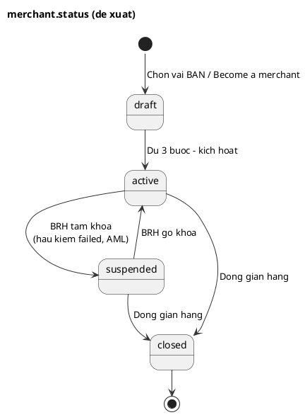
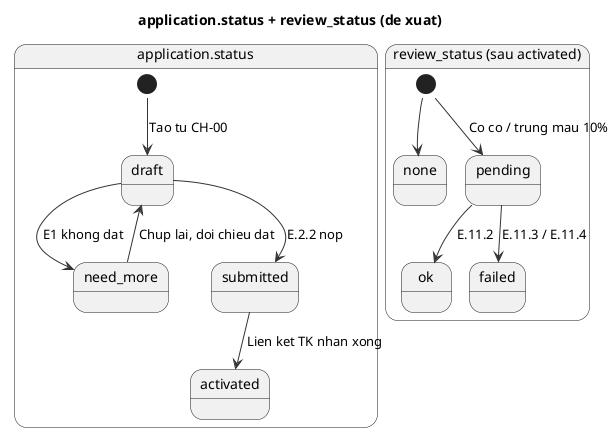

# CR-STATUS-01 — Tách nghĩa `merchant.status` và `application.status`

| Hạng mục | Nội dung |
|---|---|
| **Mã CR** | CR-STATUS-01 |
| **Ngày** | 16/10/2026 |
| **Người đề xuất** | BA (review chéo SRS — xem `REVIEW-SRS-conflict-2026-10-16.md` mục N4) |
| **Trạng thái** | ⏳ Dự thảo — chờ BA/BRH chốt 3 câu hỏi ở Mục 7 |
| **Mức ảnh hưởng** | Cao — đổi enum DB (DDL), API E.2.x / E.11.x, SRS CN-01 / CN-07, portal BRH-03 |
| **Tài liệu nguồn** | DataDict v4.4 §2 (bảng `merchant`, `application`), §3 (enum) · TSD v4.6 §5 (DDL) · API Spec v3.7 E.2.2, E.2.3, E.2.4, E.11.1–E.11.5 · SRS CN-01, CN-07 · CFG-03 |

---

## 1. Bối cảnh

Từ v3.6, mô hình onboarding đổi từ **nộp → BRH duyệt → kích hoạt** sang **kích hoạt ngay → hậu kiểm sau** ("tạo là active"). DataDict ghi nhận thay đổi này là **"đổi NGHĨA, không đổi giá trị"** — các enum thiết kế cho quy trình cũ được giữ nguyên và gán nghĩa mới.

Hệ quả: hai cột trạng thái cùng gánh nhiều chiều thông tin, chồng lấn nhau, và các tài liệu hiểu khác nhau:

- `merchant.status` — mô tả là "vòng đời **hồ sơ/gian hàng**", gánh cả tiến độ khai hồ sơ.
- `application.status` — gánh **ba chiều cùng lúc**: tiến độ khai hồ sơ, kết quả kích hoạt, và kết quả hậu kiểm.

## 2. Hiện trạng

### 2.1. Enum theo DataDict / DDL

| Cột | Giá trị |
|---|---|
| `merchant.status` | `draft` · `pending` · `need_more` · `rejected` · `active` · `suspended` · `closed` |
| `application.status` | `submitted` · `auto_approved` · `pending_review` · `approved` · `need_more` · `rejected` |
| `application.flags` | `ekyc_low_score` · `aml_hit` · `e2_deferred` · `name_mismatch` · `e1_manual` · `sampled` |

### 2.2. Cách các tài liệu đang dùng

| Tài liệu | Cách dùng | Lệch với DataDict |
|---|---|---|
| CN-01 | `merchant`: `draft` → `active` → `suspended`. `application`: `draft` → `need_more` / `submitted` → `auto_approved`, kèm `next_step` | Dùng `application.status = draft` (không có trong enum — CR-C). Luồng 6 · Bước 9 viết "Pending". Không dùng `pending_review` / `approved` |
| CN-07 | Dùng cả 7 giá trị `merchant.status` | Chép nguyên DataDict, lệch CN-01 |
| API E.2.2 | "Kích hoạt ngay khi eKYC đạt + đủ hồ sơ + tài khoản nhận" trong một lệnh | CN-01: E1 chạy **trước** E.2.2; liên kết tài khoản nhận chạy **sau** E.2.2 |
| API E.2.3 | Trả `processing` · `pending_review` · `need_more` · `approved` · `rejected`; gộp `auto_approved` → `approved` | App không phân biệt "kích hoạt tự động" với "BRH đã soát xong" |
| API E.2.4 | Cho gửi lại `cin_no` · `full_name` · `dob` | CN-01: thông tin định danh **chỉ đọc**, chỉ sửa bằng chụp lại ảnh |
| API E.11.3 | Reject → `application.status = rejected`; ghi chú v3.6: "reject = suspend + yêu cầu bổ sung" | Không nói `merchant.status` đổi thành gì |

## 3. Điểm bất hợp lý

### 3.1. `merchant.status`

| # | Vấn đề |
|---|---|
| M1 | **`draft` và `pending` trùng nghĩa.** Cả hai là "chưa xong, chưa nhận tiền". Không có chuyển đổi nào giữa hai giá trị; không SRS nào đặt `pending` |
| M2 | **`need_more` không có đường vào.** Trùng `application.status = need_more`. Từ v3.6, gian hàng đã active bị yêu cầu bổ sung thì đi `suspended`, không đi `need_more` |
| M3 | **`rejected` mâu thuẫn với API.** E.11.3 không nói merchant đổi gì, ghi chú v3.6 lại nói reject = suspend. Không rõ kết cục là vĩnh viễn hay phục hồi được. Pilot không còn duyệt tay trước kích hoạt nên không còn ca "từ chối khi chưa active" |
| M4 | **`activated_at`** vẫn mô tả "auto C10 hoặc BRH duyệt tay" — duyệt tay không còn |

### 3.2. `application.status`

| # | Vấn đề |
|---|---|
| A1 | **Thiếu trạng thái "đang khai".** Enum bắt đầu từ `submitted`, nhưng CN-01 tạo `application` từ CH-00. Vì thiếu nên "đang khai" bị đẩy sang `merchant.status` (`draft`/`pending`) — nguồn gốc chồng lấn |
| A2 | **`submitted` ba tài liệu ba nghĩa.** DataDict: "E1/E2 đang chạy" · CN-01: "đã nộp định danh + gian hàng, chờ liên kết tài khoản" · API E.2.2: nộp và kích hoạt trong một lệnh |
| A3 | **Trộn hai chiều độc lập trong một cột.** `auto_approved` / `pending_review` / `approved` đều là gian hàng **đã active**, chỉ khác trạng thái hậu kiểm; còn `need_more` / `rejected` là tiến độ/kết quả hồ sơ |
| A4 | **Hai cơ chế hậu kiểm song song.** Mẫu 10% giữ `auto_approved` + cờ `sampled`; hồ sơ có cờ rủi ro chuyển `pending_review`. Cùng phải hậu kiểm nhưng hai trạng thái khác nhau |
| A5 | **`approved` đổi nghĩa ngược với tên.** Nay là "đóng hậu kiểm OK" trong khi gian hàng đã active từ trước |
| A6 | **`pending_review` gần như không có đường vào ở pilot.** CN-01 chặn cứng theo `AUTO_ACTIVATE_SCORE`, AML hit sang `aml_alert`, bỏ cờ hậu kiểm onboarding (CR-J). Cờ `ekyc_low_score`, `e1_manual`, `name_mismatch` không còn phát sinh; `e2_deferred` cũng không được CN-01 đưa vào `pending_review` |
| A7 | **`need_more` lẫn hai tình huống.** (a) Tự động — E1 không đạt, **trước** khi nộp. (b) BRH yêu cầu qua E.11.4 với gian hàng **đã active** — không tài liệu nào nói gian hàng có còn nhận tiền không |

## 4. Đề xuất

### 4.1. Nguyên tắc

**Mỗi trường trả lời đúng một câu hỏi:**

| Trường | Câu hỏi |
|---|---|
| `merchant.status` | Gian hàng **có nhận được tiền không**? |
| `application.status` | Hồ sơ onboarding **đang ở bước nào**? |
| `application.review_status` **(mới)** | Hậu kiểm sau kích hoạt **đang ở đâu**? |

### 4.2. Enum mới

**`merchant.status`** — 4 giá trị

| Giá trị | Nghĩa | Nhận tiền | Chức năng bán hàng |
|---|---|---|---|
| `draft` | Hồ sơ chưa đủ ba bước _(định danh · gian hàng · tài khoản nhận)_ | Không | Chặn — `PIN-422-PROFILE` |
| `active` | Đủ ba bước, đã kích hoạt | Có | Dùng được |
| `suspended` | BRH tạm khóa _(hậu kiểm xấu, AML…)_ — đọc được, không ghi | Không | Chặn ghi — `PIN-422-SHOPHOLD` |
| `closed` | Đã đóng — trạng thái cuối; thu hồi standee + token (M1b), E3-reg cập nhật | Không | Chặn ghi — `PIN-422-SHOPHOLD` |

**`application.status`** — 4 giá trị

| Giá trị | Nghĩa | `next_step` tương ứng (CN-01) |
|---|---|---|
| `draft` | Đang khai — tạo từ CH-00 / **Become a merchant** | `ekyc_photos` · `ekyc_confirm` · `shop_profile` |
| `need_more` | Đối chiếu định danh không đạt, phải chụp lại _(tự động, trước khi nộp)_ | `retake` · `retake_blocked` |
| `submitted` | Đã nộp định danh + gian hàng (E.2.2), chờ liên kết tài khoản nhận | `account_link` · `wait` |
| `activated` | Đã kích hoạt — đồng thời với `merchant.status = active` _(thay cho `auto_approved`)_ | `done` |

**`application.review_status`** **(cột mới)** — hậu kiểm sau kích hoạt

| Giá trị | Nghĩa |
|---|---|
| `none` | Không thuộc diện hậu kiểm |
| `pending` | Trong diện hậu kiểm — do cờ (`flags`) hoặc mẫu ngẫu nhiên (`sampled`). **Một cơ chế duy nhất** cho cả hai nguồn |
| `ok` | BRH kết luận đạt (E.11.2) |
| `failed` | BRH kết luận không đạt (E.11.3 / E.11.4) — `reject_reason` bắt buộc (AC-6.1) |

Giữ `flags`, `decided_by`, `decided_at`, `reject_reason` — nay gắn với hậu kiểm.

### 4.3. Ánh xạ giá trị cũ → mới (migration)

| Cột | Giá trị cũ | Giá trị mới |
|---|---|---|
| `merchant.status` | `draft` · `pending` · `need_more` | `draft` |
| `merchant.status` | `rejected` | `closed` _(nếu câu hỏi Q1 chốt "có từ chối vĩnh viễn")_ — hoặc `suspended` |
| `application.status` | `submitted` | `submitted` _(đổi nghĩa theo CN-01)_ |
| `application.status` | `auto_approved` | `activated` + `review_status = none` _(hoặc `pending` nếu có cờ `sampled`)_ |
| `application.status` | `pending_review` | `activated` + `review_status = pending` |
| `application.status` | `approved` | `activated` + `review_status = ok` |
| `application.status` | `need_more` | trước kích hoạt: `need_more` · sau kích hoạt: `activated` + `review_status = failed` |
| `application.status` | `rejected` | `activated` + `review_status = failed` |

> Pilot chưa go-live — nếu DB chưa có dữ liệu thật thì chỉ cần đổi DDL, không cần script chuyển dữ liệu.

### 4.4. Quy tắc liên thông

| Sự kiện | `application.status` | `review_status` | `merchant.status` |
|---|---|---|---|
| Chọn vai BÁN / Become a merchant (CN-01 L3 B8) | → `draft` | `none` | → `draft` |
| E1 không đạt (CN-01 L5 B6) | → `need_more` | – | giữ `draft` |
| Chụp lại, đối chiếu đạt | → `draft` | – | giữ `draft` |
| Nộp định danh + gian hàng E.2.2 (CN-01 L6 B9) | → `submitted` | – | giữ `draft` |
| Liên kết tài khoản nhận xong → kích hoạt (CN-01 L7 B4) | → `activated` | `none` hoặc `pending` _(có cờ / trúng mẫu)_ | → `active` |
| BRH đóng hậu kiểm OK (E.11.2) | giữ | → `ok` | giữ `active` |
| BRH kết luận không đạt (E.11.3 / E.11.4) | giữ | → `failed` | → `suspended` _(theo Q2)_ |
| BRH gỡ tạm khóa (`/admin/merchants/{id}/resume`) | giữ | giữ | `suspended` → `active` |
| Đóng gian hàng (`/admin/merchants/{id}/close`) | giữ | giữ | → `closed` |

**Điểm duy nhất hai trường đổi cùng lúc:** kích hoạt (`activated` ⇔ `active`).

### 4.5. Sơ đồ trạng thái

## 5. Phạm vi thay đổi tài liệu

| Tài liệu | Mục | Thay đổi |
|---|---|---|
| **DataDict** | §2 bảng `merchant` | CHECK `status` còn 4 giá trị; sửa mô tả cột "vòng đời hồ sơ/gian hàng" → "khả năng nhận tiền của gian hàng"; `activated_at` bỏ "BRH duyệt tay" |
| | §2 bảng `application` | CHECK `status` còn 4 giá trị; **thêm cột `review_status`**; mô tả `flags` / `decided_*` / `reject_reason` gắn với hậu kiểm |
| | §3 enum | Viết lại nghĩa theo Mục 4.2; tổng số enum/giá trị cập nhật |
| **TSD** | §5 DDL | `merchant.status`, `application.status` CHECK mới; `ALTER TABLE application ADD review_status TEXT CHECK (review_status IN ('none','pending','ok','failed')) DEFAULT 'none'` |
| | §4 event | `merchant.suspended` phát cả khi hậu kiểm `failed` |
| **API Spec** | E.2.2 | Bỏ "kích hoạt trong cùng lệnh" — E.2.2 chỉ chuyển `submitted`; kích hoạt sau liên kết tài khoản nhận (CN-01 L7) |
| | E.2.3 | `status` trả `draft` · `need_more` · `submitted` · `activated`; thêm `review_status`; bỏ ánh xạ `auto_approved → approved`; giữ `next_step` |
| | E.2.4 | Theo Q3 — bỏ `cin_no` / `full_name` / `dob` khỏi request nếu giữ nguyên tắc chỉ-đọc của CN-01 |
| | E.11.1 | Lọc theo `review_status = pending` thay cho `status = pending_review` |
| | E.11.2 | `review_status → ok`; lỗi `PIN-409-STATE` khi `review_status ≠ pending` |
| | E.11.3 / E.11.4 | `review_status → failed` + `merchant.status → suspended` (theo Q2); `reason` bắt buộc |
| | E.11.5 | `status` merchant còn 4 giá trị |
| **CN-01** | L6 B9 | "Pending" → `draft` |
| | 3.3 · 3.3.1 · 3.4 | Bảng trạng thái hồ sơ thêm cột `review_status`; `auto_approved` → `activated`; sơ đồ `merchant.status` thêm `closed` (ngoài phạm vi); bỏ đánh dấu CR-C vì `application.draft` đã vào enum |
| **CN-07** | L1 B6 · bảng mã lỗi STT 13–14 | `PIN-422-PROFILE` khi `merchant.status = draft`; `PIN-422-SHOPHOLD` khi `suspended` / `closed` |
| **CFG-03** | `PIN-422-PROFILE` · `PIN-422-SHOPHOLD` | Ghi rõ giá trị `merchant.status` tương ứng |
| **Portal BRH-03** | Hậu kiểm hồ sơ | Danh sách theo `review_status`; hiển thị nguồn hậu kiểm (cờ / mẫu) |

## 6. Rủi ro và lưu ý

- **Code đã viết theo enum cũ** (nếu có): cần rà các chỗ so sánh `status = 'pending_review'` / `'approved'` / `'auto_approved'`.
- **Báo cáo / dashboard** đang đếm "hồ sơ chờ duyệt" theo `pending_review` phải chuyển sang `review_status = pending`.
- **App:** E.2.3 đổi enum trả về — app bản cũ cần map lại hoặc ẩn trạng thái lạ (`PIN-000-UNKNOWN` không áp vì đây không phải mã lỗi).

## 7. Câu hỏi cần chốt trước khi duyệt CR

| # | Câu hỏi | Ảnh hưởng |
|---|---|---|
| **Q1** | Pilot có còn **từ chối vĩnh viễn** một hồ sơ không? Nếu có, kết cục là `merchant = closed` kèm lý do, hay cần giữ một giá trị `rejected` riêng? | Enum `merchant.status`; ánh xạ `rejected` ở 4.3 |
| **Q2** | Gian hàng đã active mà BRH **yêu cầu bổ sung** (E.11.4) thì có **ngừng nhận tiền** (`suspended`) không, hay vẫn `active` trong lúc chờ bổ sung? | Quy tắc liên thông 4.4; có cần tách E.11.3 và E.11.4 không |
| **Q3** | E.2.4 có cho **sửa tay** `cin_no` / `full_name` / `dob` không, khi CN-01 chỉ cho sửa bằng chụp lại ảnh? | Request E.2.4; mã `PIN-422-OCRREVERIFY` (đang hoãn) |

## 8. Tiêu chí chấp nhận

- [ ] `merchant.status` chỉ còn 4 giá trị trong DataDict, DDL và mọi SRS
- [ ] `application.status` có `draft`, không còn `pending_review` / `approved` / `auto_approved`
- [ ] Hậu kiểm chỉ qua `review_status` — mẫu 10% và cờ rủi ro dùng chung một cơ chế
- [ ] API E.2.3 và E.11.x trả / nhận đúng enum mới
- [ ] CN-01 và CN-07 không còn giá trị ngoài enum mới
- [ ] Q1, Q2, Q3 có quyết định ghi trong bảng ghi nhận thay đổi của DataDict
